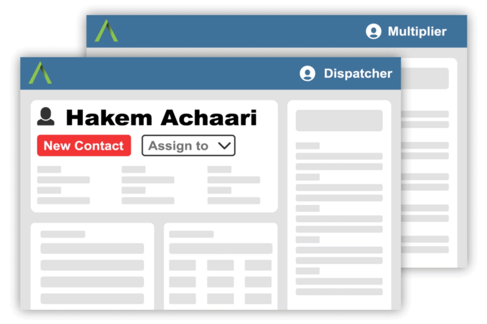

Copied from disciple.tools, its theme repository [disciple-tools-public-site](https://github.com/ChrisChasm/disciple-tools-public-site), and the app repository [disciple-tools-theme](https://github.com/DiscipleTools/disciple-tools-theme), in October 2026.

> **To obtain:** vector masters (SVG/AI/EPS) of the full logo in every colourway, a high-resolution version of the green-and-charcoal logo the site uses in its nav bar (only 300×88 exists), the name of the wordmark typeface, and usage rules (clear space, minimum size) from the Disciple.Tools team. The values below are recommendations until then.

## Logo

- **File:** `logo.png`: 300×88. The green mark beside "DISCIPLE TOOLS" in charcoal, transparent background. This is the logo in the site's nav bar, shown 45px tall (`--size-logo`).
- **Use on:** white or `--color-grey-lightest`.
- **Minimum size:** 30px tall. The file is small; don't show it larger than 88px tall.
- **Clear space:** at least the height of the "T" in TOOLS on every side.

- **File:** `logo-blue.png`: 1200×348, resized from the app's 2982×864 master. The mark in `--color-blue` with the charcoal wordmark. Used in the Disciple.Tools app.
- **Use on:** white, where a larger logo is needed than `logo.png` allows.
- **Minimum size:** 30px tall.

- **File:** `logo-white.png`: 1200×348, resized from the app's master. The green mark with a white wordmark.
- **Use on:** `--color-blue` or dark photos only.
- **Minimum size:** 30px tall.

## Logo mark

- **File:** `logo-mark.png`: 400×383. The green "A"-shaped mark alone, with its dark inner fold.
- **Use on:** white or blue, as an avatar or where the full logo won't fit.
- **Minimum size:** 24px.
- **Clear space:** a quarter of its width on every side.

- **File:** `logo-mark.svg`: the mark as a single-colour vector, traced for the browser's pinned-tab icon. It uses `currentColor`, so inline it to take the text colour.
- **Note:** this is a trace, not an official master. Fine for icons and favicons; confirm before using it large or in print.

## Illustration

- **File:** `collaboration.png`: 800×533, the first frame of the animated illustration beside "Work collaboratively…" on the home page (`collaboration-2.gif`, 1200×800). Two stylised app windows, Dispatcher and Multiplier.
- **Use in:** feature rows and pattern previews. For a live page, use real app screenshots.

## Fonts and icons

- **Fonts:** Roboto (400, 700, 800, 700 italic) and Open Sans (400, 600, 700, 800) from Google Fonts. Both are free (Apache 2.0 / OFL). Loaded in Setup.
- **Icons:** folder `fonts/`: `font-awesome.css` is Font Awesome Free 5.15.4 (the version the site loads), with its `.fas`/`.far`/`.fab` classes and `@font-face` rules pointing at the woff2/woff files beside it (`fa-solid-900`, `fa-regular-400`, `fa-brands-400`). Icons are CC BY 4.0, the fonts SIL OFL 1.1, the CSS MIT. Loaded in Setup.
