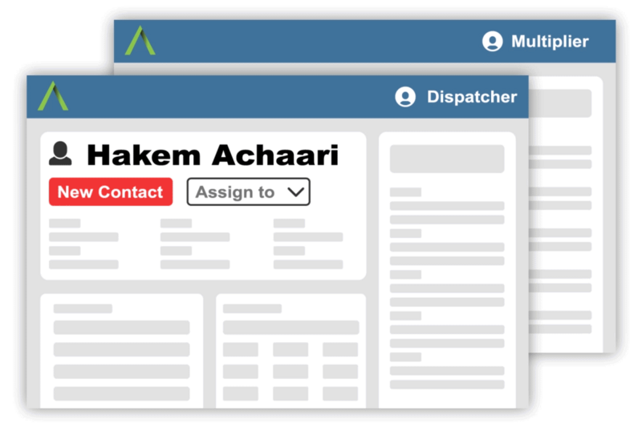

<!-- GENERATED by scripts/generate.mjs from brands/disciple-tools/ and system/. Do not edit this file: edit the sources, then run `npm run generate`. -->

# Disciple.Tools: resolved brand brief

Clear, practical and free. Blue and green on white, heavy Open Sans headings over Roboto, for presenting the Disciple.Tools software to disciple-making teams.

> **Building a page?** Read [`build-a-page.md`](../../build-a-page.md) first and follow its steps. This brief is the reference it points you to.

This file is the whole Disciple.Tools brand in one place, with shared composition, components and patterns and Disciple.Tools's overrides already merged. Use it to build or review anything for Disciple.Tools. Follow it exactly.

## Setup

1. Load the fonts:
   `<link rel="stylesheet" href="https://fonts.googleapis.com/css2?family=Open+Sans:wght@400;600;700;800&family=Roboto:ital,wght@0,400;0,700;0,800;1,700&display=swap">`
   `<link rel="stylesheet" href="assets/fonts/font-awesome.css">`
2. Link `brands/disciple-tools/brand.css`. It holds everything below as CSS, in CUBE CSS order: reset, tokens, base, composition, components, patterns, utilities and surfaces.
3. Link the page's own `site.css` after it, for anything the brand doesn't cover.
4. Copy the **HTML** of the examples below and change only the content. Their CSS is already in brand.css: components and patterns are listed here without it, and layout primitives show theirs only so you can see what each setting does. Never copy CSS into a page.

## How to style anything (CUBE CSS)

Reach for these in order, and stop at the first that works:

1. **A pattern** below, as it is.
2. **A pattern or component plus utilities, surfaces and settings**: `class="… py-xl surface-dark"`, `style="--gutter: var(--space-s)"`.
3. **Composition primitives** (flow, cluster, switcher, sidebar, grid, …) holding **components**.
4. **A new block in site.css**, built only from tokens, with a comment saying why 1–3 didn't work.

Variants are exceptions written as data attributes on the block (`class="btn" data-variant="primary"`); states use ARIA or `data-state`. Inline styles may only set a primitive's or component's settings (the custom properties in its Settings table) to tokens. No media queries: layouts respond to their container.

## Utilities

Generated from the tokens. One class, one job.

- Padding on every side.: `.p-xxxs`, `.p-xxs`, `.p-xs`, `.p-s`, `.p-m`, `.p-l`, `.p-xl`, `.p-button-y`, `.p-button-x`, `.p-button-md`, `.p-field`, `.p-submit`, `.p-nav-y`, `.p-nav-x`, `.p-button-nav`, `.p-paragraph`, `.p-footer`, `.p-copyright`, `.p-band` (e.g. `.p-xxxs` is `padding: var(--space-xxxs)`)
- Padding left and right.: `.px-xxxs`, `.px-xxs`, `.px-xs`, `.px-s`, `.px-m`, `.px-l`, `.px-xl`, `.px-button-y`, `.px-button-x`, `.px-button-md`, `.px-field`, `.px-submit`, `.px-nav-y`, `.px-nav-x`, `.px-button-nav`, `.px-paragraph`, `.px-footer`, `.px-copyright`, `.px-band` (e.g. `.px-xxxs` is `padding-inline: var(--space-xxxs)`)
- Padding top and bottom. The usual way to space a section.: `.py-xxxs`, `.py-xxs`, `.py-xs`, `.py-s`, `.py-m`, `.py-l`, `.py-xl`, `.py-button-y`, `.py-button-x`, `.py-button-md`, `.py-field`, `.py-submit`, `.py-nav-y`, `.py-nav-x`, `.py-button-nav`, `.py-paragraph`, `.py-footer`, `.py-copyright`, `.py-band` (e.g. `.py-xxxs` is `padding-block: var(--space-xxxs)`)
- Padding on top.: `.pt-xxxs`, `.pt-xxs`, `.pt-xs`, `.pt-s`, `.pt-m`, `.pt-l`, `.pt-xl`, `.pt-button-y`, `.pt-button-x`, `.pt-button-md`, `.pt-field`, `.pt-submit`, `.pt-nav-y`, `.pt-nav-x`, `.pt-button-nav`, `.pt-paragraph`, `.pt-footer`, `.pt-copyright`, `.pt-band` (e.g. `.pt-xxxs` is `padding-block-start: var(--space-xxxs)`)
- Padding at the bottom.: `.pb-xxxs`, `.pb-xxs`, `.pb-xs`, `.pb-s`, `.pb-m`, `.pb-l`, `.pb-xl`, `.pb-button-y`, `.pb-button-x`, `.pb-button-md`, `.pb-field`, `.pb-submit`, `.pb-nav-y`, `.pb-nav-x`, `.pb-button-nav`, `.pb-paragraph`, `.pb-footer`, `.pb-copyright`, `.pb-band` (e.g. `.pb-xxxs` is `padding-block-end: var(--space-xxxs)`)
- Font weight.: `.weight-regular`, `.weight-semibold`, `.weight-strong`, `.weight-heavy` (e.g. `.weight-regular` is `font-weight: var(--weight-regular)`)
- Font family.: `.font-body`, `.font-heading` (e.g. `.font-body` is `font-family: var(--font-body)`)
- Line height.: `.leading-body`, `.leading-base`, `.leading-heading`, `.leading-compact`, `.leading-h5`, `.leading-label`, `.leading-page-title` (e.g. `.leading-body` is `line-height: var(--leading-body)`)
- Rounded corners.: `.radius-xs`, `.radius-sm`, `.radius-md`, `.radius-lg`, `.radius-card` (e.g. `.radius-xs` is `border-radius: var(--radius-xs)`)
- Shadow.: `.shadow-card`, `.shadow-media`, `.shadow-video`, `.shadow-field`, `.shadow-field-focus` (e.g. `.shadow-card` is `box-shadow: var(--shadow-card)`)
- Text alignment.: `.text-start`, `.text-center`, `.text-end` (e.g. `.text-start` is `text-align: start`)
- Centres a block that has a width.: `.mx-auto` (`margin-inline: auto`)
- Italic text.: `.italic` (`font-style: italic`)
- Capitals.: `.uppercase` (`text-transform: uppercase`)
- Hides text on screen but keeps it for screen readers, such as a label for an icon-only link.: `.visually-hidden` (`position: absolute; inline-size: 1px; block-size: 1px; padding: 0; margin: -1px; overflow: hidden; clip: rect(0, 0, 0, 0); white-space: nowrap; border: 0`)

## Text styles

Classes from the base styles for text that isn't a plain heading or paragraph. Use them anywhere, including to give a heading the look of another level.

None. Headings and body text are styled by element.

## Surfaces

A surface sets a background with the text and link colours that pass contrast on it. Put sections and boxes on a surface instead of picking colours one by one.

- `.surface-default` — The white page. Blue headings and bold blue links. Contrast on it: text 19.8:1, heading 5.1:1, link 5.1:1.
- `.surface-blue` — Blue bands: title bands, the statement band, the copyright bar. White text, headings and links. Contrast on it: text 5.1:1, heading 5.1:1, link 5.1:1.
- `.surface-green` — Green bands: the link band, the steps band, the green statement band. The site puts white (2.1:1) and blue (2.4:1) on green; both fail, so text here is near-black until the team picks a darker green. Contrast on it: text 9.4:1, heading 9.4:1, link 9.4:1.
- `.surface-grey-light` — The icon-grid section. Blue on this grey is 4.3:1, so blue is for large headings only. Contrast on it: text 16.4:1, heading-large 4.3:1.
- `.surface-grey-lightest` — Light sections: the footer menu, the partner-logo strip, testimonials on some pages. Contrast on it: text 18.6:1, heading 4.8:1, link 4.8:1.

## Icons

- **Font Awesome 5 Free** — The only icon set on the marketing pages. Solid (fas) by default; the site also uses regular (far) for fa-clock and fa-check-circle, and one brand icon (fab fa-simplybuilt). Seen on the site: fa-quote-left (testimonial cards), fa-people-carry, fa-clock, fa-dna, fa-simplybuilt (icon grid), fa-check-circle (icon lists). Write <i class="fas fa-quote-left" aria-hidden="true"></i>; it takes the text colour and font size (see the Icon component).
  Source: https://fontawesome.com/v5/search?m=free. v5.15.4, the version the site loads through Elementor, self-hosted in assets/fonts/ (font-awesome.css plus woff2/woff).

## Guidelines

> Scraped from https://disciple.tools in October 2026, from the live pages and the theme repository [disciple-tools-public-site](https://github.com/ChrisChasm/disciple-tools-public-site). Colours, type and spacing are what the site renders. Voice, principles and the do/don't lists are a **draft** inferred from the site's copy. Have the Disciple.Tools team confirm them. This brand covers the marketing site, not the Disciple.Tools app.

### Voice (draft)

Plain, practical and warm. Disciple.Tools explains software to people whose job is ministry, not technology.

- **People first, software second.** "Disciple.Tools software is designed by disciple makers for disciple makers to increase time you can spend with people."
- **Benefits as verbs.** Headings start with what a team gets to do: "Work collaboratively to serve spiritual seekers around you", "Steward the people God has given your ministry", "See a movement of the Gospel".
- **Free, and says so.** "Always free as your team grows", "Pricing (Free)". Cost and security are answered directly, not hidden.
- **Ministry vocabulary, used plainly.** Disciple-making movements, seekers, multipliers, the Kingdom. Write for practitioners; don't explain it away.
- **Real users speak.** Testimonials are from field workers and team leaders, named by role ("A field worker in the Middle East") rather than by name, for their security.
- **Calls to action are short and title case:** Get Started, Learn More, Download Disciple.Tools, Explore Hosting, Launch Demo.

### Principles (draft)

- **Blue for content, green for go.** Headings, links and most buttons are blue. Green marks the start of the journey (Get Started, Demo) and breaks a page into chapters with full-width bands.
- **One idea per row.** Feature rows pair one heading, one paragraph and at most two buttons with one picture of the app.
- **Show the product.** Screenshots and illustrations of the app sit beside nearly every claim.
- **Plain white page, coloured bands.** Sections are white with no decoration; full-width blue or green bands carry statements, titles and link lists.
- **Heavy headings, quiet text.** Section headings are Open Sans 800 in blue; everything else is Roboto at 16px.

### Do

- Use Open Sans 800 (`--font-heading`, `--weight-heavy`) in `--color-blue` for section headings, and Roboto (`--font-body`) for everything else.
- Use `data-variant="green"` buttons for the first step (Get Started, Demo) and `data-variant="blue"` for the rest. Pair a filled button with `data-variant="outline"` when there are two.
- Make text links bold and blue. They turn green and underline on hover.
- Put a blue title band (`.title-band`) above each chapter of a long page, and close a page with the green link band ("Dig in!").
- Give each coloured section a surface: `.surface-blue` for blue bands, `.surface-green` for green bands, `.surface-grey-light` and `.surface-grey-lightest` for the grey sections. The surface sets the text, heading and link colours that pass contrast on it.
- Lay sections out with the composition primitives. Columns switch at the threshold tokens: `--threshold-l` (768px) for most rows, `--threshold-m` (640px) for the footer, `--threshold-s` (320px) for a pair of buttons.
- Give app screenshots the `--shadow-media` shadow.
- Build new pages from this guide's tokens, composition and components. When adding to an existing site, adapt them to that site's own classes; don't paste the guide's markup in as-is.
- Use the full-colour logo (`logo.png`, `logo-blue.png`) on white, and `logo-white.png` on blue.

### Don't

- Don't use green for text on white, or white or blue text on green. All fail contrast (see below). On green, text, headings and links are near-black (`.surface-green`).
- Don't use the sky blue (`--color-sky`) outside nav hover.
- Don't round corners beyond `--radius-card` (7px). Buttons and fields are almost square (3px).
- Don't name testimonial authors where it could put them at risk. Use their role and region.
- Don't add cards or tags to new layouts as decoration. The only card on the site is the testimonial; the site has no tags, so the shared Tag is excluded.

### Known issues on the live site

These are facts from the scrape, recorded so builds don't copy them by accident:

- White on `--color-green` is 2.1:1. It fails WCAG AA even for large text (3:1), which affects the Get Started and Demo buttons and the white headings on green bands. This guide's green surface uses near-black text (9.4:1) instead of white until the team decides; a darker green would let it go back to white. The green buttons still have white labels, as on the site.
- `--color-blue` on `--color-green` (link-band column headings) is 2.4:1, and green link hover on white is 2.1:1. Both fail. The link band's headings are near-black here.
- White on `--color-sky` (nav hover) is 2.5:1. It fails.
- Blue text on the note tint is 3.5:1. It fails for body-size text.
- Blue on `--color-grey-light` is 4.3:1: fine for the 32px headings in the icon grid, not for body text. The grey-light surface has it only as `heading-large` and no link colour.
- Body text on white (19.8:1) and white on blue (5.1:1) pass.
- Elementor buttons only underline on hover; there is no colour change. The nav Demo button turns blue on hover.
- The contact form's textarea renders in Arial at 19.2px while the other fields are Roboto at 16px. The Input component uses Roboto for all fields.
- The Elementor kit defines Roboto Slab and Elementor's default palette (#6EC1E4, #54595F, #7A7A7A, #61CE70), but no page uses them. They are not part of this brand.

## Tokens

### color

- `--color-background`: `#FFFFFF` — Page background and the testimonial cards. The site renders #FEFEFE, folded into white.
- `--color-text`: `#0A0A0A` — Body text, image-box titles, footer column headings. The near-black also used for the quote icon (#212121 on the site) and pasted copy (#333).
- `--color-blue`: `#3F729B` — The brand blue ($medium-blue-color, primary). Headings, links, buttons, title bands, the copyright bar.
- `--color-green`: `#8BC34A` — The brand green ($green-color, theme-color). The logo mark, Get Started and Demo buttons, green bands, feature icons.
- `--color-sky`: `#00AEFF` — Hover and open background of nav menu items. Used nowhere else.
- `--color-blue-tint`: `#90B4D066` — Background of the note callout (.dt-note): #90B4D0 at 40%.
- `--color-grey-lightest`: `#F8F8F8` — Light sections: the partner-logo strip, the footer menu, testimonial section on some pages.
- `--color-grey-lighter`: `#F5F5F5` — Dividers and striped table rows (the site's #F1F1F1 folded in). The site also sets paragraphs on blue bands in it; the blue surface uses white.
- `--color-grey-light`: `#E9EAEC` — The icon-grid section background and the rules between feature-list rows.
- `--color-grey`: `#D3D3D3` — Form field borders, the dropdown menu border and the focus glow (the site's #CACACA/#CCCCCC folded in).
- `--color-grey-dark`: `#8A8A8A` — The 1px rule under the nav bar.
- `--color-white`: `#FFFFFF` — Text on blue and green, button labels.

### shadow

- `--shadow-card`: `0 5px 25px 0 rgba(0, 0, 0, 0.1)` — Testimonial cards.
- `--shadow-media`: `0 0 10px 0 rgba(0, 0, 0, 0.5)` — App screenshots in the feature list.
- `--shadow-video`: `0 0 10px 0 rgba(0, 0, 0, 0.45)` — The home page video.
- `--shadow-field`: `inset 0 1px 2px rgba(10, 10, 10, 0.1)` — Form fields at rest.
- `--shadow-field-focus`: `0 0 5px {color.grey}` — Form fields on focus.

### font

- `--font-body`: `Roboto, Arial, sans-serif` — Everything except headings: body, buttons, nav, footer, forms. Also the page title (h1).
- `--font-heading`: `'Open Sans', Arial, sans-serif` — Section headings (h2–h5), the statement band, step numbers.

### weight

- `--weight-regular`: `400` — Body, nav links, form labels, step descriptions.
- `--weight-semibold`: `600` — Open Sans: the heading on green statement bands.
- `--weight-strong`: `700` — Buttons, links, table headers, image-box titles (h4, h5).
- `--weight-heavy`: `800` — Every section heading (Open Sans) and the page title (Roboto).

### leading

- `--leading-body`: `1.6` — Paragraphs.
- `--leading-base`: `1.5` — Everything else at body size; h4; multi-line statement headings.
- `--leading-heading`: `1` — Section headings (32px on 32px), buttons, step numbers.
- `--leading-compact`: `1.3` — Feature-list group headings.
- `--leading-h5`: `1.4` — Image-box titles (h5).
- `--leading-label`: `1.8` — Form labels.
- `--leading-page-title`: `2.6` — The page title (h1). The tall line box is what spaces it from the content below.

### size

- `--size-body`: `1rem` — 16px. Body, nav, links, footer, md buttons, fields.
- `--size-button`: `0.9375rem` — 15px. Default (small) buttons.
- `--size-button-lg`: `1.125rem` — 18px. Large buttons (pricing).
- `--size-label`: `1.2rem` — 19.2px. Form labels.
- `--size-h1`: `2.3rem` — 36.8px. Page title.
- `--size-h2`: `2rem` — 32px. Section headings and band headings.
- `--size-h3`: `1.7rem` — 27.2px. Sub-section headings, partner host names.
- `--size-h4`: `1.3rem` — 20.8px. Image-box titles, link-band column headings, step descriptions.
- `--size-h5`: `1.25rem` — 20px. Testimonial names.
- `--size-step`: `5.5625rem` — 89px. Numbers in the steps band.
- `--size-icon-xl`: `7.8125rem` — 125px. Icons in the icon grid.
- `--size-icon`: `1.875rem` — 30px. The quote icon on testimonial cards.
- `--size-icon-small`: `0.875rem` — 14px. Check icons in icon lists.
- `--size-field`: `2.4375rem` — 39px. Height of text fields and selects.
- `--size-logo`: `45px` — Height of the logo in the nav bar.
- `--size-container`: `1140px` — Width of every section's content.
- `--size-nav`: `1200px` — Width of the nav bar's content.

### radius

- `--radius-xs`: `2px` — Note callout.
- `--radius-sm`: `3px` — Default: buttons, fields, the Demo button, tables.
- `--radius-md`: `4px` — Medium buttons.
- `--radius-lg`: `5px` — Large buttons.
- `--radius-card`: `7px` — Testimonial cards.

### space

- `--space-xxxs`: `5px` — Icon to text in icon lists.
- `--space-xxs`: `10px` — Column padding (the container gutter), table cells, the note callout.
- `--space-xs`: `20px` — Between widgets (the flow default), statement band padding, gap between stacked buttons.
- `--space-s`: `30px` — Card padding, padding of green and grey bands.
- `--space-m`: `40px` — Partner-logo strip padding; large button padding-x.
- `--space-l`: `60px` — Top padding of feature rows and the steps band.
- `--space-xl`: `80px` — Padding of the tallest sections (testimonial intro).
- `--space-button-y`: `12px` — Default button padding top and bottom.
- `--space-button-x`: `24px` — Default button padding left and right.
- `--space-button-md`: `15px` — Medium button padding top and bottom (left and right is s).
- `--space-field`: `8px` — Form field padding.
- `--space-submit`: `1rem` — Form submit button padding, all sides.
- `--space-nav-y`: `0.7rem` — Nav link padding top and bottom.
- `--space-nav-x`: `1rem` — Nav link padding left; Demo button padding left and right.
- `--space-button-nav`: `0.85em` — Demo button padding top and bottom.
- `--space-paragraph`: `1rem` — Space below a paragraph (16px).
- `--space-footer`: `2rem` — Space above the footer menu columns.
- `--space-copyright`: `3rem` — Padding of the copyright bar.
- `--space-band`: `25px` — Title band padding top and bottom (82px tall with a 32px heading). Card padding below 768px.

### threshold

- `--threshold-s`: `20rem` — 320px. A pair of buttons stacks below this (feature rows).
- `--threshold-m`: `40rem` — 640px. The footer columns stack, and the nav menu collapses on the site.
- `--threshold-l`: `48rem` — 768px. The site's main breakpoint: feature rows, icon grid, link band and testimonials stack, card padding drops.

### surface

- `--surface-default-background`: `{color.background}`
- `--surface-default-text`: `{color.text}`
- `--surface-default-heading`: `{color.blue}`
- `--surface-default-link`: `{color.blue}`
- `--surface-blue-background`: `{color.blue}`
- `--surface-blue-text`: `{color.white}`
- `--surface-blue-heading`: `{color.white}`
- `--surface-blue-link`: `{color.white}`
- `--surface-green-background`: `{color.green}`
- `--surface-green-text`: `{color.text}`
- `--surface-green-heading`: `{color.text}`
- `--surface-green-link`: `{color.text}`
- `--surface-grey-light-background`: `{color.grey-light}`
- `--surface-grey-light-text`: `{color.text}`
- `--surface-grey-light-heading-large`: `{color.blue}`
- `--surface-grey-lightest-background`: `{color.grey-lightest}`
- `--surface-grey-lightest-text`: `{color.text}`
- `--surface-grey-lightest-heading`: `{color.blue}`
- `--surface-grey-lightest-link`: `{color.blue}`


## Assets

Copied from disciple.tools, its theme repository [disciple-tools-public-site](https://github.com/ChrisChasm/disciple-tools-public-site), and the app repository [disciple-tools-theme](https://github.com/DiscipleTools/disciple-tools-theme), in October 2026.

> **To obtain:** vector masters (SVG/AI/EPS) of the full logo in every colourway, a high-resolution version of the green-and-charcoal logo the site uses in its nav bar (only 300×88 exists), the name of the wordmark typeface, and usage rules (clear space, minimum size) from the Disciple.Tools team. The values below are recommendations until then.

### Logo


- **File:** `logo.png`: 300×88. The green mark beside "DISCIPLE TOOLS" in charcoal, transparent background. This is the logo in the site's nav bar, shown 45px tall (`--size-logo`).
- **Use on:** white or `--color-grey-lightest`.
- **Minimum size:** 30px tall. The file is small; don't show it larger than 88px tall.
- **Clear space:** at least the height of the "T" in TOOLS on every side.


- **File:** `logo-blue.png`: 1200×348, resized from the app's 2982×864 master. The mark in `--color-blue` with the charcoal wordmark. Used in the Disciple.Tools app.
- **Use on:** white, where a larger logo is needed than `logo.png` allows.
- **Minimum size:** 30px tall.

<div class="ds-on-dark">


</div>

- **File:** `logo-white.png`: 1200×348, resized from the app's master. The green mark with a white wordmark.
- **Use on:** `--color-blue` or dark photos only.
- **Minimum size:** 30px tall.

### Logo mark


- **File:** `logo-mark.png`: 400×383. The green "A"-shaped mark alone, with its dark inner fold.
- **Use on:** white or blue, as an avatar or where the full logo won't fit.
- **Minimum size:** 24px.
- **Clear space:** a quarter of its width on every side.


- **File:** `logo-mark.svg`: the mark as a single-colour vector, traced for the browser's pinned-tab icon. It uses `currentColor`, so inline it to take the text colour.
- **Note:** this is a trace, not an official master. Fine for icons and favicons; confirm before using it large or in print.

### Illustration



- **File:** `collaboration.png`: 800×533, the first frame of the animated illustration beside "Work collaboratively…" on the home page (`collaboration-2.gif`, 1200×800). Two stylised app windows, Dispatcher and Multiplier.
- **Use in:** feature rows and pattern previews. For a live page, use real app screenshots.

### Fonts and icons

- **Fonts:** Roboto (400, 700, 800, 700 italic) and Open Sans (400, 600, 700, 800) from Google Fonts. Both are free (Apache 2.0 / OFL). Loaded in Setup.
- **Icons:** folder `fonts/`: `font-awesome.css` is Font Awesome Free 5.15.4 (the version the site loads), with its `.fas`/`.far`/`.fab` classes and `@font-face` rules pointing at the woff2/woff files beside it (`fa-solid-900`, `fa-regular-400`, `fa-brands-400`). Icons are CC BY 4.0, the fonts SIL OFL 1.1, the CSS MIT. Loaded in Setup.

## Composition

### Box

Padding and an optional border around content. Add a surface utility to give it a background. Shared (`system/composition/box.md`).

Every Layout's Box. It only pads and outlines: colours come from a surface (`.surface-*`), so text on it always has enough contrast.

#### Settings

| Property | Default | What it does |
| --- | --- | --- |
| `--box-padding` | `var(--space-m)` | Padding on every side. |
| `--box-border-width` | `0` | Border width. The border takes the text colour. |

#### When to use

- A callout, a panel of related links, a boxed quote. For a full card with an image and actions, use the brand's Card.

#### Code

```html
<div class="box demo-fill" style="--box-border-width: 1px">A box with a border in the text colour.</div>
```

```css
.box {
  padding: var(--box-padding, var(--space-m));
  border: var(--box-border-width, 0) solid currentColor;
  /* Keeps the box visible in Windows high contrast mode, where backgrounds are removed. */
  outline: 1px solid transparent;
  outline-offset: -1px;
}
```

### Center

Centres a block horizontally with a maximum width, such as a readable column of text. Shared (`system/composition/center.md`).

Every Layout's Center. It centres the box itself, not the text inside it.

#### Settings

| Property | Default | What it does |
| --- | --- | --- |
| `--measure` | `60ch` | Maximum width of the content. |
| `--gutter` | `0` | Minimum space on each side on narrow screens. |

Add `data-intrinsic` to also centre the children by their own width, for example a button below a paragraph. Add `data-align="start"` to keep the column at a readable width but on the left, in line with the rest of a left-aligned page.

#### When to use

- A column of article text, a form, a narrow intro inside a wide section.

#### Don't

- Don't use it as the page-width wrapper. That's Container.

#### Code

```html
<div class="center demo-box demo-fill" data-intrinsic>
  <p>A centred column, at most 60 characters wide.</p>
  <span class="demo-box">Intrinsic child</span>
</div>
```

```css
.center {
  box-sizing: content-box;
  max-inline-size: var(--measure, 60ch);
  margin-inline: auto;
  padding-inline: var(--gutter, 0);
}
.center[data-align="start"] { margin-inline: 0; }
.center[data-intrinsic] {
  display: flex;
  flex-direction: column;
  align-items: center;
}
```

### Cluster

A row of items that wraps onto new lines, with even gaps. For tags, buttons, links and icons. Shared (`system/composition/cluster.md`).

Every Layout's Cluster, as used in CUBE CSS.

#### Settings

| Property | Default | What it does |
| --- | --- | --- |
| `--gutter` | `var(--space-s)` | Gap between items, both across and down. |
| `--cluster-horizontal-alignment` | `flex-start` | `justify-content` of the row. |
| `--cluster-vertical-alignment` | `center` | `align-items` of the row. |

#### When to use

- A group of buttons, a row of social links, a list of tags.

#### Don't

- Don't use it for two things pushed to opposite ends. Use Repel.

#### Code

```html
<ul class="cluster" role="list">
  <li class="demo-box">First</li>
  <li class="demo-box">Second item</li>
  <li class="demo-box">Third</li>
  <li class="demo-box">A longer fourth item</li>
  <li class="demo-box">Fifth</li>
</ul>
```

```css
.cluster {
  display: flex;
  flex-wrap: wrap;
  gap: var(--gutter, var(--space-s));
  justify-content: var(--cluster-horizontal-alignment, flex-start);
  align-items: var(--cluster-vertical-alignment, center);
}
```

### Container

The page-width wrapper, 1140px wide with a 10px gutter, as every section on disciple.tools. Brand override (`brands/disciple-tools/composition/container.md`), replaces `system/composition/container.md`.

Replaces the shared Container because the site's content column is narrower and its gutter is much smaller. Every section on disciple.tools centres its content at 1140px (`--size-container`), and each column inside adds 10px of padding (`--space-xxs`), so content sits 10px from the screen edge on phones. The nav bar is the one exception: it is 1200px wide (`--size-nav`), set in the Nav bar component.

#### Settings

| Property | Default | What it does |
| --- | --- | --- |
| `--container-max` | `var(--size-container)` | Maximum width of the content. |
| `--gutter` | `var(--space-xxs)` | Padding on each side. |

#### Do

- Put the background on the full-width section and the `.container` inside it.

#### Code

```html
<section class="demo-box demo-fill">
  <div class="container demo-box">Content stays within 1140px, 10px from the edge.</div>
</section>
```

```css
.container {
  position: relative;
  margin-inline: auto;
  max-width: var(--container-max, var(--size-container));
  padding-inline: var(--gutter, var(--space-xxs));
}
```

### Cover

A block at least as tall as a minimum height (by default the screen), with one child centred vertically and others pinned to the top and bottom. Shared (`system/composition/cover.md`).

Every Layout's Cover. For a full-screen opening section: the main message sits in the middle, with a small header above it and a "scroll down" link or credits below.

#### Settings

| Property | Default | What it does |
| --- | --- | --- |
| `--cover-min-height` | `100vh` | The least height of the block. Set it to a size token for a shorter block. |
| `--cover-padding` | `var(--space-m)` | Padding on every side. |
| `--cover-gap` | `var(--space-s)` | Least space between the children. |

Mark the child to centre with `data-centre`. Without one, the children stack from the top.

#### When to use

- An opening section with one big message, an event page's title screen, a "coming soon" page.

#### Don't

- Don't put long content in it. If the content is taller than the screen, the block grows and the centring stops meaning anything.

#### Code

```html
<div class="cover demo-box demo-fill" style="--cover-min-height: var(--threshold-s)">
  <p>Small header</p>
  <h2 data-centre>The one centred message</h2>
  <p>Footer line</p>
</div>
```

```css
.cover {
  display: flex;
  flex-direction: column;
  min-block-size: var(--cover-min-height, 100vh);
  padding: var(--cover-padding, var(--space-m));
}
.cover > * { margin-block: var(--cover-gap, var(--space-s)); }
.cover > :first-child:not([data-centre]) { margin-block-start: 0; }
.cover > :last-child:not([data-centre]) { margin-block-end: 0; }
.cover > [data-centre] { margin-block: auto; }
```

### Flow

Even vertical space between children, 20px by default, the gap between every heading, paragraph and button on the site. Brand override (`brands/disciple-tools/composition/flow.md`), replaces `system/composition/flow.md`.

The shared Flow with a different default. On disciple.tools every block in a column (heading, text, button, image) is followed by the same 20px (`--space-xs`), so that is the default here instead of `--space-m`. It also clears the children's own top and bottom margins (paragraphs have a bottom margin outside flow), so the gap is exactly `--flow-space`.

#### Settings

| Property | Default | What it does |
| --- | --- | --- |
| `--flow-space` | `var(--space-xs)` | Space between each child. Set it on the element or on any child. |

#### Do

- Use `style="--flow-space: var(--space-s)"` or a block's CSS to change the rhythm, rather than adding margins.

#### Don't

- Don't add top margins to the children as well. Flow owns that space.

#### Code

```html
<div class="flow">
  <h2>Always free as your team grows</h2>
  <p>Each child is separated by 20px.</p>
  <p>No margin before the first child or after the last.</p>
</div>
```

```css
.flow > * { margin-block: 0; }
.flow > * + * { margin-block-start: var(--flow-space, var(--space-xs)); }
```

### Frame

Crops an image or video to a fixed aspect ratio, such as 16:9 or square, without stretching it. Shared (`system/composition/frame.md`).

Every Layout's Frame. The frame keeps its ratio at any width and the image inside fills it, cropped rather than squashed.

#### Settings

| Property | Default | What it does |
| --- | --- | --- |
| `--frame-ratio` | `16 / 9` | Width / height. Write it unitless: `4 / 3`, `1`. |
| `--frame-position` | `50% 50%` | Which part of the image stays in view when it is cropped (`object-position`). |

#### When to use

- Photos in cards, video embeds, a row of images that must line up.

#### Do

- Give the image real `alt` text, or `alt=""` if it is decoration. The frame doesn't change what the image means.

#### Code

```html
<div class="frame demo-fill" style="--frame-ratio: 4 / 3">
  
</div>
```

```css
.frame {
  position: relative;
  aspect-ratio: var(--frame-ratio, 16 / 9);
  overflow: hidden;
  display: flex;
  justify-content: center;
  align-items: center;
}
.frame > img,
.frame > video,
.frame > iframe {
  inline-size: 100%;
  block-size: 100%;
  object-fit: cover;
  object-position: var(--frame-position, 50% 50%);
}
```

### Grid

Equal columns that fit as many items per row as there is room for, then wrap. For cards, logos and any list of like items. Shared (`system/composition/grid.md`).

Every Layout's Grid. It fits as many columns as there is room for at a minimum width and wraps the rest, so six cards become 3 + 3 on a wide screen, 2 + 2 + 2 on a tablet and one column on a phone. No media queries.

#### Settings

| Property | Default | What it does |
| --- | --- | --- |
| `--grid-min` | `20rem` | The narrowest a column may get before the grid drops a column. |
| `--gutter` | `var(--space-s)` | Gap between columns and rows. |

#### When to use

- A set of cards, a logo wall, a gallery: any number of items that should all be the same width.

#### Don't

- Don't use it for two to four items that should all stack at once. Use the Switcher.
- Don't put a grid directly in a flex row (a cluster, or a flex wrapper) without giving it a width. It has no intrinsic width, so a shrink-to-fit parent collapses it to one column. Inside a section or `.container` it fills the width by itself.

#### Code

```html
<ul class="grid demo-fill" role="list" style="--grid-min: var(--threshold-s)">
  <li class="demo-box">One</li>
  <li class="demo-box">Two</li>
  <li class="demo-box">Three</li>
  <li class="demo-box">Four</li>
  <li class="demo-box">Five</li>
  <li class="demo-box">Six</li>
</ul>
```

```css
.grid {
  display: grid;
  grid-template-columns: repeat(auto-fit, minmax(min(var(--grid-min, 20rem), 100%), 1fr));
  gap: var(--gutter, var(--space-s));
}
```

### Imposter

Centres one element over another, such as a label over an image or a dialog over the page. Shared (`system/composition/imposter.md`).

Every Layout's Imposter. It sits in the middle of the nearest positioned ancestor (`.container`, `.frame`, or anything with `position: relative`) and never grows bigger than it.

#### Settings

| Property | Default | What it does |
| --- | --- | --- |
| `--imposter-margin` | `0px` | Least space between the imposter and the edges of what it covers. |

Add `data-fixed` to centre it on the screen instead, for a dialog.

#### Do

- Put it inside a positioned parent. Without one it centres on the whole page.

#### Don't

- Don't cover text people need to read with it.

#### Code

```html
<div class="frame demo-fill" style="--frame-ratio: 3">
  
  <p class="imposter demo-box">Centred over the image</p>
</div>
```

```css
.imposter {
  position: absolute;
  inset-block-start: 50%;
  inset-inline-start: 50%;
  transform: translate(-50%, -50%);
  max-inline-size: calc(100% - var(--imposter-margin, 0px) * 2);
  max-block-size: calc(100% - var(--imposter-margin, 0px) * 2);
  overflow: auto;
}
.imposter[data-fixed] { position: fixed; }
```

### Reel

A row that scrolls sideways instead of wrapping, such as a strip of photos or cards. Shared (`system/composition/reel.md`).

Every Layout's Reel. Items stay on one line at their own width and the row scrolls horizontally. Each item snaps into place.

#### Settings

| Property | Default | What it does |
| --- | --- | --- |
| `--reel-item-width` | `auto` | Width of each item. Set it to a size token so cards line up. |
| `--gutter` | `var(--space-s)` | Gap between items. |

#### Do

- Make the reel reachable by keyboard and named for screen readers: `tabindex="0"`, `role="region"` and an `aria-label` saying what is in it.
- Leave part of the next item visible at the edge, so people can see there is more.

#### Don't

- Don't hide important content in a reel. Many people never scroll sideways. Use the Grid when everything must be seen.

#### Code

```html
<ul class="reel demo-fill" role="list" tabindex="0" aria-label="Example items" style="--reel-item-width: var(--threshold-s)">
  <li class="demo-box">One</li>
  <li class="demo-box">Two</li>
  <li class="demo-box">Three</li>
  <li class="demo-box">Four</li>
  <li class="demo-box">Five</li>
</ul>
```

```css
.reel {
  display: flex;
  gap: var(--gutter, var(--space-s));
  overflow-x: auto;
  overflow-y: hidden;
  scroll-snap-type: x mandatory;
  scrollbar-width: thin;
}
.reel > * {
  flex: 0 0 var(--reel-item-width, auto);
  scroll-snap-align: start;
}
.reel > img { block-size: 100%; flex-basis: auto; inline-size: auto; }
```

### Repel

Pushes items to opposite ends of a row, and lets them wrap when there isn't room. Shared (`system/composition/repel.md`).

CUBE CSS's repel composition.

#### Settings

| Property | Default | What it does |
| --- | --- | --- |
| `--gutter` | `var(--space-s)` | Minimum gap between the items, and between lines when they wrap. |
| `--repel-vertical-alignment` | `center` | `align-items` of the row. |

Add `data-nowrap` to keep the items on one line.

#### When to use

- A title with an action at the far end, a logo with a menu button, a button with a partner logo.

#### Code

```html
<div class="repel demo-fill">
  <strong>Left item</strong>
  <span>Right item</span>
</div>
```

```css
.repel {
  display: flex;
  flex-wrap: wrap;
  justify-content: space-between;
  align-items: var(--repel-vertical-alignment, center);
  gap: var(--gutter, var(--space-s));
}
.repel[data-nowrap] { flex-wrap: nowrap; }
```

### Sidebar

A narrow item beside a wide one, such as an image beside text. They stack when the wide one would get too narrow. No media queries. Shared (`system/composition/sidebar.md`).

Every Layout's Sidebar. The first child is the sidebar, with a preferred width. The second child takes the rest of the row, and the two stack as soon as the second would get narrower than `--sidebar-content-min` of the row.

#### Settings

| Property | Default | What it does |
| --- | --- | --- |
| `--sidebar-width` | `20rem` | Preferred width of the sidebar. When stacked it fills the row. |
| `--sidebar-content-min` | `50%` | The narrowest the main item may get before the two stack. |
| `--gutter` | `var(--space-m)` | Gap between the two, across and down. |
| `--sidebar-vertical-alignment` | `stretch` | `align-items` of the row. Use `center` to centre text beside an image. |

Add `data-side="end"` to make the **last** child the sidebar, so the narrow item sits on the right while staying second in the reading order.

#### When to use

- An image or icon beside a paragraph, a form beside its explanation, a list of filters beside results.
- Any two-column layout where the columns should not be equal. For equal columns use the Switcher.

#### Don't

- Don't give it more than two children. Wrap each side in its own element.

#### Code

```html
<div class="sidebar demo-fill" style="--sidebar-width: var(--threshold-s)">
  <div class="demo-box">Sidebar: a photo, an icon, or a short list</div>
  <div class="demo-box">The main content takes the rest of the row, and the two stack when it would get narrower than half the row.</div>
</div>
```

```html
<div class="sidebar demo-fill" data-side="end" style="--sidebar-vertical-alignment: center">
  <div class="demo-box">Main content first in the source, on the left.</div>
  <div class="demo-box">Sidebar on the right</div>
</div>
```

```css
.sidebar {
  display: flex;
  flex-wrap: wrap;
  gap: var(--gutter, var(--space-m));
  align-items: var(--sidebar-vertical-alignment, stretch);
}
/* The sidebar: the first child, or the last with data-side="end". */
.sidebar:not([data-side="end"]) > :first-child,
.sidebar[data-side="end"] > :last-child {
  flex-basis: var(--sidebar-width, 20rem);
  flex-grow: 1;
}
/* The main item takes the rest, and wraps below the sidebar when it would get too narrow. */
.sidebar:not([data-side="end"]) > :last-child,
.sidebar[data-side="end"] > :first-child {
  flex-basis: 0;
  flex-grow: 999;
  min-inline-size: var(--sidebar-content-min, 50%);
}
```

### Switcher

Items sit side by side, and all stack at once when the container gets narrower than a threshold. No media queries. Shared (`system/composition/switcher.md`).

Every Layout's Switcher. It switches on the width of the container, not the viewport, so it works anywhere on the page.

#### Settings

| Property | Default | What it does |
| --- | --- | --- |
| `--threshold` | `30rem` | Container width below which every item stacks. |
| `--gutter` | `var(--space-s)` | Gap between items. |

Five or more children always stack. The Switcher is for two to four items.

#### When to use

- Two-column sections (text beside an image), a row of three stats, pricing tiers.

#### Don't

- Don't use it for more than four items. Use a grid.

#### Code

```html
<div class="switcher demo-fill">
  <div class="demo-box">One</div>
  <div class="demo-box">Two</div>
  <div class="demo-box">Three</div>
</div>
```

```css
.switcher {
  display: flex;
  flex-wrap: wrap;
  gap: var(--gutter, var(--space-s));
}
.switcher > * {
  flex-grow: 1;
  flex-basis: calc((var(--threshold, 30rem) - 100%) * 999);
}
.switcher > :nth-last-child(n + 5),
.switcher > :nth-last-child(n + 5) ~ * {
  flex-basis: 100%;
}
```

### With icon

An icon beside a short piece of text, sized to the text's capitals and lined up with it. Shared (`system/composition/with-icon.md`).

Every Layout's Icon, named `with-icon` here because brands have their own `.icon` class for their icon fonts. The icon is as tall as the text's capital letters and sits on the same baseline, at any font size.

#### Settings

| Property | Default | What it does |
| --- | --- | --- |
| `--with-icon-gap` | `0.5em` | Space between the icon and the text. |

#### Do

- Use it for a link or label with an icon: "Download the app", a phone number, a list of features.
- Hide decorative icons from screen readers with `aria-hidden="true"`. If the icon is the only content, give the link an `aria-label` or a `.visually-hidden` label instead.

#### Code

```html
<a class="with-icon" href="/contact/"><svg viewBox="0 0 16 16" aria-hidden="true" fill="currentColor"><circle cx="8" cy="8" r="8" /></svg>Contact us</a>
```

```css
.with-icon {
  display: inline-flex;
  align-items: baseline;
  gap: var(--with-icon-gap, 0.5em);
}
.with-icon > :is(svg, img) {
  flex: none;
  block-size: 0.75em;
  block-size: 1cap;
  inline-size: auto;
}
```

## Components

### Button

Almost-square buttons with bold Roboto labels. Blue for most actions, green for the first step, a blue outline for the second of a pair. Brand override (`brands/disciple-tools/components/button.md`), replaces `system/components/button.md`. Works with: cluster. Its CSS is in brand.css (look for `/* brands/disciple-tools/components/button.md */`).

The site's Elementor buttons and the theme's `.green-button` (the Demo button in the nav bar), with values as tokens. The block is `.btn`; `data-variant`, `data-size` and `data-width` pick the version.

#### Variants

| Attribute | Where the site uses it | Example |
| --- | --- | --- |
| `data-variant="blue"` (or none) | Most actions: feature rows, link bands, forms. | Learn More, Download Disciple.Tools |
| `data-variant="green"` | The first step, on blue or white. | Get Started |
| `data-variant="outline"` | The second of a pair, on white. 2px blue border. | Get Started (beside Learn More) |
| `data-variant="nav"` | The Demo button in the nav bar. Regular weight, 1px border, turns blue on hover. | Demo |

Sizes: default (15px, 12px × 24px), `data-size="medium"` (16px, 15px × 30px, the home page feature rows), `data-size="large"` (18px, 20px × 40px, pricing). Add `data-width="full"` to fill the column, as in the link band.

#### Do

- Write labels in title case, two or three words: "Get Started", "Explore Hosting".
- Use `<a>` for navigation (nearly every button on the site opens a page) and `<button>` for actions.
- Set a row of buttons in a `.cluster`.

#### Don't

- Don't put two green buttons side by side.
- Don't expect a colour change on hover. Like the site, the label only underlines; the nav Demo button is the exception.
- Don't put body-size white text on green. The green button's label is 2.1:1 (see Known issues).

#### Code

```html
<div class="cluster" style="--gutter: var(--space-xs)">
  <a class="btn" data-variant="blue" href="/features/">Learn More</a>
  <a class="btn" data-variant="outline" href="/get-started/">Get Started</a>
  <a class="btn" data-variant="green" href="/get-started/">Get Started</a>
  <a class="btn" data-variant="nav" href="/demo/">Demo</a>
</div>
```

```html
<div class="cluster" style="--gutter: var(--space-xs)">
  <a class="btn" data-variant="blue" data-size="medium" href="/download/">Download Disciple.Tools</a>
  <a class="btn" data-variant="blue" data-size="large" href="/download/">Download Disciple.Tools</a>
</div>
```

```html
<div class="surface-blue p-xs cluster" style="--cluster-horizontal-alignment: center">
  <a class="btn" data-variant="green" href="/get-started/">Get Started</a>
</div>
```

### Card

The testimonial card. White, 7px corners, a soft shadow, with a role, a region, a quote icon and the quote. Brand override (`brands/disciple-tools/components/card.md`), replaces `system/components/card.md`. Works with: icon, grid. Its CSS is in brand.css (look for `/* brands/disciple-tools/components/card.md */`).

The only card on disciple.tools: the testimonials on the home page. Four sit in a row, then stack below 768px (`--threshold-l`), where their padding drops from 30px to 25px.

#### When to use

- A short quote from a user, named by role and region.

#### Don't

- Don't use it as a generic content box. The site has no other cards.
- Don't name the person if that could put them at risk.

#### Code

```html
<div class="grid" style="--grid-min: var(--threshold-s)">
<figure class="card">
  <figcaption class="card__head">
    <h5>A field worker</h5>
    <p>in the Middle East</p>
  </figcaption>
  <i class="fas fa-quote-left icon" data-variant="quote" aria-hidden="true"></i>
  <blockquote>
    <p>Our team is made up of a small group of nationals and expats. Disciple.Tools gives us an easy and secure way to track conversations.</p>
  </blockquote>
</figure>
</div>
```

### Icon

Font Awesome 5 Free icons in three sizes, taking the text colour. 125px green in the icon grid, 30px near-black on testimonial cards, 14px in icon lists. Disciple.Tools-only (`brands/disciple-tools/components/icon.md`). Works with: cluster. Its CSS is in brand.css (look for `/* brands/disciple-tools/components/icon.md */`).

Every icon on the marketing pages is a Font Awesome 5 Free glyph (loaded in Setup). An `<i>` icon takes the colour and size of its text. Add `.icon` and a `data-variant` to give it one of the site's three sizes and colours.

| Attribute | Size | Colour | Where |
| --- | --- | --- | --- |
| `data-variant="feature"` | 125px (`--size-icon-xl`) | `--color-green` | Icon grid ("Manpower", "Time", "DNA") |
| `data-variant="quote"` | 30px (`--size-icon`) | `--color-text` | Testimonial cards |
| `data-variant="check"` | 14px (`--size-icon-small`) | inherits | Icon lists (see Icon list) |

#### Do

- Mark decorative icons `aria-hidden="true"`.
- Use solid icons (`fas`) unless the site already uses the regular one (`far fa-clock`, `far fa-check-circle`).

#### Don't

- Don't mix in another icon set.
- Don't use a green icon on `--color-grey-light` for meaning alone. It is 1.7:1; the site always puts a heading under it.

#### Code

```html
<div class="cluster" style="--gutter: var(--space-s)">
  <i class="fas fa-people-carry icon" data-variant="feature" aria-hidden="true"></i>
  <i class="far fa-clock icon" data-variant="feature" aria-hidden="true"></i>
  <i class="fas fa-dna icon" data-variant="feature" aria-hidden="true"></i>
  <i class="fas fa-quote-left icon" data-variant="quote" aria-hidden="true"></i>
  <i class="far fa-check-circle icon" data-variant="check" aria-hidden="true"></i>
</div>
```

### Icon list

A list with a small check-circle icon before each item instead of a bullet. For short lists of what a host or plan includes. Disciple.Tools-only (`brands/disciple-tools/components/icon-list.md`). Works with: icon. Its CSS is in brand.css (look for `/* brands/disciple-tools/components/icon-list.md */`).

From the Hosting page, where each host lists what it offers.

#### Do

- Keep items to one line each.

#### Code

```html
<ul class="icon-list" role="list">
  <li><i class="far fa-check-circle icon" data-variant="check" aria-hidden="true"></i><span>Managed WordPress hosting</span></li>
  <li><i class="far fa-check-circle icon" data-variant="check" aria-hidden="true"></i><span>Daily backups</span></li>
  <li><i class="far fa-check-circle icon" data-variant="check" aria-hidden="true"></i><span>Disciple.Tools pre-installed</span></li>
</ul>
```

### Input

Text fields, selects and text areas with a large regular-weight label, a light grey border, a faint inner shadow and a grey glow on focus. Brand override (`brands/disciple-tools/components/input.md`), replaces `system/components/input.md`. Works with: button. Its CSS is in brand.css (look for `/* brands/disciple-tools/components/input.md */`).

From the contact form on the Join the Community page.

#### Do

- Put a visible label above every field. Labels are larger than the field text (19.2px against 16px).
- End a form with one blue submit button (`class="btn" data-variant="blue" type="submit"`). The form gives it its own padding.

#### Don't

- Don't use placeholder text as the label.

#### Code

```html
<form class="form">
  <label class="field">
    <span class="field__label">Name</span>
    <input class="input" type="text" name="name" autocomplete="name" />
  </label>
  <label class="field">
    <span class="field__label">Email</span>
    <input class="input" type="email" name="email" />
  </label>
  <label class="field">
    <span class="field__label">How did you hear about us?</span>
    <select class="input"><option>Choose one</option><option>A friend</option></select>
  </label>
  <label class="field">
    <span class="field__label">Comments</span>
    <textarea class="input" rows="3"></textarea>
  </label>
  <button class="btn" data-variant="blue" type="submit">Submit</button>
</form>
```

### Nav bar

White top bar, 1200px wide. Logo on the left, centred menu with blue dropdown carets, green Demo button on the right, a grey rule underneath. Disciple.Tools-only (`brands/disciple-tools/components/nav-bar.md`). Works with: button, repel, cluster. Its CSS is in brand.css (look for `/* brands/disciple-tools/components/nav-bar.md */`).

The site's top bar (theme `parts/nav-offcanvas-topbar.php`). Menu items are black, regular weight; hovering or opening one fills it with sky blue (`--color-sky`) and turns the text white. Items with a submenu show a small blue triangle: mark the link `data-submenu`. Below 640px the menu collapses into an off-canvas panel behind a menu button; that panel is not covered yet.

Menu on the live site: About, Pricing (Free), Software, Resources, Join the Community, News, then the Demo button.

#### Do

- Keep the menu to six top-level items or fewer, with the details in dropdowns.

#### Don't

- Don't use `--color-sky` anywhere else. White on sky is 2.5:1 (see Known issues).

#### Code

```html
<header class="nav-bar">
  <nav class="nav-bar__inner repel" aria-label="Main">
    <a href="/"></a>
    <ul class="nav-bar__menu cluster" role="list">
      <li><a href="/about/" data-submenu>About</a></li>
      <li><a href="/pricing/" data-submenu>Pricing (Free)</a></li>
      <li><a href="/features/" data-submenu>Software</a></li>
      <li><a href="/join-the-community/">Join the Community</a></li>
      <li><a href="/news/">News</a></li>
    </ul>
    <a class="btn" data-variant="nav" href="/demo/">Demo</a>
  </nav>
</header>
```

### Note

A pale blue callout with blue text, for a short aside inside page copy. Disciple.Tools-only (`brands/disciple-tools/components/note.md`). Its CSS is in brand.css (look for `/* brands/disciple-tools/components/note.md */`).

The theme's `.dt-note`, used on the Give page ("Disciple.Tools is part of Gospel Ambition…").

#### Don't

- Don't put long or essential text in it. Blue on the tint is 3.5:1, below AA for body text (see Known issues).

#### Code

```html
<p class="note">Note: Disciple.Tools is part of Gospel Ambition. You may see Gospel Ambition on your receipt.</p>
```

### Table

A comparison table with bold headers, light borders and striped rows. For pricing and feature comparisons. Disciple.Tools-only (`brands/disciple-tools/components/table.md`). Its CSS is in brand.css (look for `/* brands/disciple-tools/components/table.md */`).

From the Pricing page ("Cost Comparison", "Features Comparison").

#### Do

- Put Disciple.Tools in the first data column and the alternative after it.
- Wrap wide tables in `.table-scroll` so they scroll sideways on phones.

#### Code

```html
<div class="table-scroll">
  <table class="table">
    <thead>
      <tr><th>Pricing</th><th>Disciple.Tools</th><th>Other CRMs</th></tr>
    </thead>
    <tbody>
      <tr><td>Contact record limits</td><td>Free unlimited</td><td>Pricing tiers by record count</td></tr>
      <tr><td>Group record limits</td><td>Free unlimited</td><td>Pricing tiers by record count</td></tr>
      <tr><td>User limits</td><td>Free unlimited</td><td>Pricing per user</td></tr>
    </tbody>
  </table>
</div>
```

Not available for Disciple.Tools (excluded on purpose, don't build them): tag.

## Patterns

### Feature list

A long reference list of features in groups. An uppercase group heading, then rows of a bold blue label, a description and a screenshot. Disciple.Tools-only (`brands/disciple-tools/patterns/feature-list.md`). Works with: container, flow. Its CSS is in brand.css (look for `/* brands/disciple-tools/patterns/feature-list.md */`).

The Features page. Each group ("USERS", "CONTACTS", "SECURITY"…) has a heading in Open Sans 700, written in capitals in the copy, and rows of three columns: the feature name as a bold blue link, one to five short paragraphs, and an app screenshot with `--shadow-media`. Rows are separated by a `--color-grey-light` rule. The columns stack below 768px (`--threshold-l`).

Approximate: the site's 1px `--color-grey-light` borders are measured, but the 20px row padding is estimated from screenshots.

#### Code

```html
<section>
  <div class="container flow">
    <h3 class="feature-list__group">USERS</h3>
    <div class="feature-list__row">
      <a href="/features/#cost-per-user">Cost per user</a>
      <div>
        <p>Most Contact Management Services or Commercial CRMs charge per user.</p>
        <p>Disciple.Tools has no cost per user. Add your whole team.</p>
      </div>
      
    </div>
    <div class="feature-list__row">
      <a href="/features/#multilingual">Multilingual</a>
      <div><p>Disciple.Tools has been written to support left-to-right and right-to-left languages.</p></div>
      
    </div>
  </div>
</section>
```

### Feature row

Two columns on white. A blue heading, one paragraph and up to two buttons beside a picture of the app. Rows alternate sides down the page. Disciple.Tools-only (`brands/disciple-tools/patterns/feature-row.md`). Works with: button, container, flow, switcher. Its CSS is in brand.css (look for `/* brands/disciple-tools/patterns/feature-row.md */`).

The body of the home page ("Work collaboratively to serve spiritual seekers around you", "Always free as your team grows", "Steward the people God has given your ministry", "See a movement of the Gospel"). Each row has 60px above it and none below, and the image swaps sides every row (`data-direction="reverse"` on the section). Columns stack below 768px (`--threshold-l`); the buttons stack below 320px (`--threshold-s`).

#### Do

- Start the heading with what a team gets to do.
- Use a filled button with an outline one (`data-variant="blue"` + `data-variant="outline"`), or two blue buttons at `data-size="medium"`.

#### Don't

- Don't use more than one paragraph. Link to a page instead.

#### Code

```html
<section class="feature-row pt-l">
  <div class="container"><div class="switcher">
    <div class="flow">
      <h2>Work collaboratively to serve spiritual seekers around you</h2>
      <p>Disciple.Tools brings clarity to your team through delegating contacts and groups and reducing confusion and redundancy.</p>
      <div class="switcher feature-row__buttons">
        <a class="btn" data-variant="blue" href="/features/">Learn More</a>
        <a class="btn" data-variant="outline" href="/get-started/">Get Started</a>
      </div>
    </div>
    
  </div></div>
</section>
```

```html
<section class="feature-row pt-l" data-direction="reverse">
  <div class="container"><div class="switcher">
    <div class="flow">
      <h2>Always free as your team grows</h2>
      <p>The Disciple.Tools software can be downloaded and used at no cost. Add an unlimited number of users and contacts for free.</p>
      <div class="switcher feature-row__buttons">
        <a class="btn" data-variant="blue" data-size="medium" href="/download/">Download Disciple.Tools</a>
        <a class="btn" data-variant="blue" data-size="medium" href="/hosting/">Explore Hosting</a>
      </div>
    </div>
    
  </div></div>
</section>
```

### Footer

Four columns of bold blue links under bold headings on light grey, then a blue copyright bar. Disciple.Tools-only (`brands/disciple-tools/patterns/footer.md`). Works with: container, switcher. Its CSS is in brand.css (look for `/* brands/disciple-tools/patterns/footer.md */`).

The site footer (theme `footer.php`): Product, Solutions, Resources and Developer columns on the grey-lightest surface (`.surface-grey-lightest`) with 32px above, then the copyright line centred in white on the blue surface (`.surface-blue`) with 48px of padding. The columns stack below 640px (`--threshold-m`). On the home page a strip of partner logos on `--color-grey-lightest` sits just above it (not covered yet).

#### Code

```html
<footer>
  <div class="footer__menu surface-grey-lightest">
    <div class="container"><div class="switcher">
      <p><strong>Product</strong><br /><a href="/features/">Features</a><br /><a href="/security/">Security</a><br /><a href="/pricing/">Pricing</a><br /><a href="/demo/">Demo</a></p>
      <p><strong>Solutions</strong><br /><a href="/online-strategies/">For Online Strategies</a><br /><a href="/small-teams/">For Small Teams</a><br /><a href="/multiple-teams/">For Multiple Teams</a></p>
      <p><strong>Resources</strong><br /><a href="/contact/">Contact Us</a><br /><a href="/news/">News</a><br /><a href="/user-docs/">User Docs</a><br /><a href="/plugins/">Plugins</a></p>
      <p><strong>Developer</strong><br /><a href="/developer-docs/">Developer Docs</a><br /><a href="/open-source/">Open Source</a><br /><a href="https://github.com/DiscipleTools/disciple-tools-theme">GitHub Project</a></p>
    </div></div>
  </div>
  <div class="footer__copyright surface-blue">
    <p>© 2026 <a href="/">Disciple.Tools</a>. A project of <a href="https://gospelambition.org/">GospelAmbition.org</a></p>
  </div>
</footer>
```

### Icon grid

Up to four columns on light grey. A big green icon, a centred blue heading and a short paragraph in each. Disciple.Tools-only (`brands/disciple-tools/patterns/icon-grid.md`). Works with: icon, container, flow, switcher. Its CSS is in brand.css (look for `/* brands/disciple-tools/patterns/icon-grid.md */`).

"Top Challenges" on the For Small Teams page: Manpower, Time, DNA, Simplicity. It sits on the grey-light surface (`.surface-grey-light`). Columns stack below 768px (`--threshold-l`). The paragraphs in the example are placeholder copy.

#### Do

- Use one-word headings.
- Keep each paragraph to two or three sentences.

#### Code

```html
<section class="icon-grid surface-grey-light py-s">
  <div class="container"><div class="switcher">
    <div class="flow text-center">
      <i class="fas fa-people-carry icon" data-variant="feature" aria-hidden="true"></i>
      <h2>Manpower</h2>
      <p>Small teams can't afford to lose track of the people they serve.</p>
    </div>
    <div class="flow text-center">
      <i class="far fa-clock icon" data-variant="feature" aria-hidden="true"></i>
      <h2>Time</h2>
      <p>Spend time with people, not spreadsheets.</p>
    </div>
    <div class="flow text-center">
      <i class="fas fa-dna icon" data-variant="feature" aria-hidden="true"></i>
      <h2>DNA</h2>
      <p>Build reproducible habits into the team from day one.</p>
    </div>
  </div></div>
</section>
```

### Link band

The green "Dig in!" band that closes a page. A centred heading, then columns of headings over stacked full-width blue buttons. Disciple.Tools-only (`brands/disciple-tools/patterns/link-band.md`). Works with: button, container, flow, switcher. Its CSS is in brand.css (look for `/* brands/disciple-tools/patterns/link-band.md */`).

The last section of What is Disciple.Tools, For Small Teams and the other audience pages. Each column groups related pages ("Learn more about…", "Explore solutions…"); buttons stack 20px apart and fill the column (`data-width="full"`). It sits on the green surface (`.surface-green`). Columns stack below 768px (`--threshold-l`).

#### Don't

- Don't use it mid-page. It is the page's way out.
- Don't make the headings white or blue as the live site does. White on green is 2.1:1 and blue on green 2.4:1 (see Known issues); the green surface sets them near-black.

#### Code

```html
<section class="link-band surface-green pt-s pb-l">
  <div class="container flow">
    <h2 class="text-center">Dig in!</h2>
    <div class="switcher">
      <div class="flow">
        <h4>Learn more about Disciple.Tools</h4>
        <a class="btn" data-variant="blue" data-width="full" href="/kingdom-vision/">Our Kingdom Vision</a>
        <a class="btn" data-variant="blue" data-width="full" href="/history/">Our History</a>
        <a class="btn" data-variant="blue" data-width="full" href="/what-is-disciple-tools/">What Disciple.Tools Is</a>
      </div>
      <div class="flow">
        <h4>Explore solutions for your team</h4>
        <a class="btn" data-variant="blue" data-width="full" href="/online-strategies/">For Online Strategies</a>
        <a class="btn" data-variant="blue" data-width="full" href="/small-teams/">For Small Teams</a>
        <a class="btn" data-variant="blue" data-width="full" href="/multiple-teams/">For Multiple Teams</a>
      </div>
    </div>
  </div>
</section>
```

### Page title

The page's name, centred, in blue Roboto 800, at the top of every marketing page. Disciple.Tools-only (`brands/disciple-tools/patterns/page-title.md`). Works with: container. Its CSS is in brand.css (look for `/* brands/disciple-tools/patterns/page-title.md */`).

Every marketing page except the home page opens with its name ("Features", "Pricing", "Hosting", "For Small Teams") and nothing else. The tall line height (2.6) gives the space above and below; the section has no padding of its own.

#### Code

```html
<section class="page-title">
  <div class="container">
    <h1>Pricing</h1>
  </div>
</section>
```

### Statement band

A full-width blue band (`.surface-blue`) with one centred sentence in white Open Sans 800 and a green Get Started button. The home page's mission statement. Disciple.Tools-only (`brands/disciple-tools/patterns/statement-band.md`). Works with: button, container, flow. Its CSS is in brand.css (look for `/* brands/disciple-tools/patterns/statement-band.md */`).

Directly under the home page video: "Disciple.Tools software is designed by disciple makers for disciple makers to increase time you can spend with people." The For Small Teams page uses a green version (`.surface-green` and `data-variant="green"`) for a one-line statement, with the heading at semibold (`--weight-semibold`) and no button. The site sets that heading in white (2.1:1, see Known issues); the green surface makes it near-black.

#### Do

- One sentence, at most two lines.
- At most one button.

#### Code

```html
<section class="statement-band surface-blue py-xs">
  <div class="container flow text-center">
    <h2>Disciple.Tools software is designed by disciple makers for disciple makers to increase time you can spend with people.</h2>
    <a class="btn" data-variant="green" href="/get-started/">Get Started</a>
  </div>
</section>
```

```html
<section class="statement-band surface-green py-s" data-variant="green">
  <div class="container text-center">
    <h2>If your team is large or growing, Disciple.Tools grows with you.</h2>
  </div>
</section>
```

### Steps band

A green band (`.surface-green`) of numbered steps. Huge Open Sans numbers beside short instructions. Disciple.Tools-only (`brands/disciple-tools/patterns/steps-band.md`). Works with: container, flow. Its CSS is in brand.css (look for `/* brands/disciple-tools/patterns/steps-band.md */`).

"7 Simple Steps to…" on the Hosting page. Each step is a big number (89px, `--size-step`) in a column of its own, with the instruction (Open Sans 400, 20.8px) beside it. The site sets them in white; on the green surface they are near-black, because white on green is 2.1:1.

#### Don't

- Don't put long text here. Keep each step to one line.

#### Code

```html
<section class="surface-green pt-l pb-l">
  <div class="container flow">
    <h2 class="text-center">7 Simple Steps to Self-Hosting</h2>
    <ol class="steps" role="list">
      <li><span class="steps__number">1</span><h4>Download Disciple.Tools (this is a WordPress theme)</h4></li>
      <li><span class="steps__number">2</span><h4>Choose a host and set up a WordPress site</h4></li>
      <li><span class="steps__number">3</span><h4>Upload the theme and activate it</h4></li>
    </ol>
  </div>
</section>
```

### Testimonials

A green stripe, then a row of up to four testimonial cards on white. Disciple.Tools-only (`brands/disciple-tools/patterns/testimonials.md`). Works with: card, icon, container, switcher. Its CSS is in brand.css (look for `/* brands/disciple-tools/patterns/testimonials.md */`).

On the home page, after the feature rows. A 30px green stripe (the section's top border) marks the change from product to people, then four [cards](../../components/card/) sit in a row. They stack below 768px (`--threshold-l`).

#### Do

- Name people by role and region ("A field worker in the Middle East", "A Team Leader using Disciple.Tools").
- Keep quotes to a short paragraph. Cards in a row stretch to the tallest.

#### Code

```html
<section class="testimonials py-s">
  <div class="container"><div class="switcher">
    <figure class="card">
      <figcaption class="card__head"><h5>A field worker</h5><p>in the Middle East</p></figcaption>
      <i class="fas fa-quote-left icon" data-variant="quote" aria-hidden="true"></i>
      <blockquote><p>Our team is made up of a small group of nationals and expats. Disciple.Tools gives us an easy and secure way to track conversations.</p></blockquote>
    </figure>
    <figure class="card">
      <figcaption class="card__head"><h5>A Team Leader</h5><p>using Disciple.Tools</p></figcaption>
      <i class="fas fa-quote-left icon" data-variant="quote" aria-hidden="true"></i>
      <blockquote><p>Disciple.Tools helped organize our team, streamline our communication and follow up with every contact.</p></blockquote>
    </figure>
  </div></div>
</section>
```

### Title band

A short full-width blue band (`.surface-blue`) with a centred white heading. Opens each chapter of a long page. Disciple.Tools-only (`brands/disciple-tools/patterns/title-band.md`). Works with: container. Its CSS is in brand.css (look for `/* brands/disciple-tools/patterns/title-band.md */`).

On What is Disciple.Tools ("Conceptually…", "Technically…", "Aspirationally…") and Hosting ("Recommended Partner Hosting", "Premium Hosting Services", "Budget Hosting Services"). The band is 82px tall: a 32px heading with 25px above and below. The content under it is a plain white section, often a [Feature row](../feature-row/).

#### Code

```html
<section class="title-band surface-blue py-band">
  <div class="container text-center">
    <h2>Conceptually, Disciple.Tools is…</h2>
  </div>
</section>
```

## Base styles (`brands/disciple-tools/base.css`)

```css
/* Disciple.Tools base element styles. Replaces system/base.css for this brand.
   Load after the Google Fonts and Font Awesome stylesheets and tokens.css.
   Based on the rules disciple.tools renders (theme + Elementor kit), with values as tokens. */
body {
  margin: 0;
  background: var(--color-background);
  color: var(--color-text);
  font-family: var(--font-body);
  font-size: var(--size-body);
  font-weight: var(--weight-regular);
  line-height: var(--leading-base);
  -webkit-font-smoothing: antialiased;
  /* Lets components and patterns switch with @container at a --threshold-* value instead of viewport breakpoints. */
  container-type: inline-size;
}
h1, h2, h3, h4, h5 { margin: 0; }

/* Page title: Roboto 800 in blue, centred, with a tall line box. */
h1 {
  font-family: var(--font-body);
  font-size: var(--size-h1);
  font-weight: var(--weight-heavy);
  line-height: var(--leading-page-title);
  color: var(--color-blue);
  text-align: center;
}
/* Section headings: Open Sans 800 in blue. */
h2, h3 {
  font-family: var(--font-heading);
  font-weight: var(--weight-heavy);
  line-height: var(--leading-heading);
  color: var(--color-blue);
}
h2 { font-size: var(--size-h2); }
h3 { font-size: var(--size-h3); }
/* Image-box titles: Open Sans 700 in the colour of the text around them. */
h4, h5 { font-family: var(--font-heading); font-weight: var(--weight-strong); }
h4 { font-size: var(--size-h4); line-height: var(--leading-base); }
h5 { font-size: var(--size-h5); line-height: var(--leading-h5); }

p { margin: 0 0 var(--space-paragraph); line-height: var(--leading-body); }
p:last-child { margin-bottom: 0; }
strong, b { font-weight: var(--weight-strong); }

a { color: var(--color-blue); font-weight: var(--weight-strong); text-decoration: none; }
a:hover, a:focus { color: var(--color-green); text-decoration: underline; }

*:focus-visible { outline: 2px solid var(--color-blue); outline-offset: 2px; }
img { max-width: 100%; height: auto; }

/* Headings on a surface take its heading colour (see the surface tokens). Text and link colours
   come from the generated .surface-* utilities. */
.surface-default :is(h1, h2, h3) { color: var(--surface-default-heading); }
.surface-blue :is(h1, h2, h3) { color: var(--surface-blue-heading); }
.surface-green :is(h1, h2, h3) { color: var(--surface-green-heading); }
.surface-grey-light :is(h1, h2, h3) { color: var(--surface-grey-light-heading-large); }
.surface-grey-lightest :is(h1, h2, h3) { color: var(--surface-grey-lightest-heading); }
```
