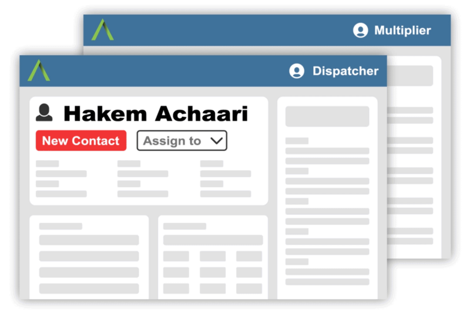

The body of the home page ("Work collaboratively to serve spiritual seekers around you", "Always free as your team grows", "Steward the people God has given your ministry", "See a movement of the Gospel"). Each row has 60px above it and none below, and the image swaps sides every row (`data-direction="reverse"` on the section). Columns stack below 768px (`--threshold-l`); the buttons stack below 320px (`--threshold-s`).

## Do

- Start the heading with what a team gets to do.
- Use a filled button with an outline one (`data-variant="blue"` + `data-variant="outline"`), or two blue buttons at `data-size="medium"`.

## Don't

- Don't use more than one paragraph. Link to a page instead.

## Code

```html
<section class="feature-row pt-l">
  <div class="container"><div class="switcher">
    <div class="flow">
      <h2>Work collaboratively to serve spiritual seekers around you</h2>
      <p>Disciple.Tools brings clarity to your team through delegating contacts and groups and reducing confusion and redundancy.</p>
      <div class="switcher feature-row__buttons">
        <a class="btn" data-variant="blue" href="/features/">Learn More</a>
        <a class="btn" data-variant="outline" href="/get-started/">Get Started</a>
      </div>
    </div>
    
  </div></div>
</section>
```

```html
<section class="feature-row pt-l" data-direction="reverse">
  <div class="container"><div class="switcher">
    <div class="flow">
      <h2>Always free as your team grows</h2>
      <p>The Disciple.Tools software can be downloaded and used at no cost. Add an unlimited number of users and contacts for free.</p>
      <div class="switcher feature-row__buttons">
        <a class="btn" data-variant="blue" data-size="medium" href="/download/">Download Disciple.Tools</a>
        <a class="btn" data-variant="blue" data-size="medium" href="/hosting/">Explore Hosting</a>
      </div>
    </div>
    
  </div></div>
</section>
```

```css
.feature-row .container > .switcher { --threshold: var(--threshold-l); --gutter: var(--space-s); align-items: center; }
.feature-row__buttons { --threshold: var(--threshold-s); --gutter: var(--space-xs); }
.feature-row[data-direction="reverse"] .container > .switcher { flex-direction: row-reverse; }
.feature-row img { display: block; }
```
