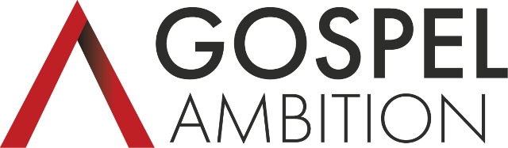
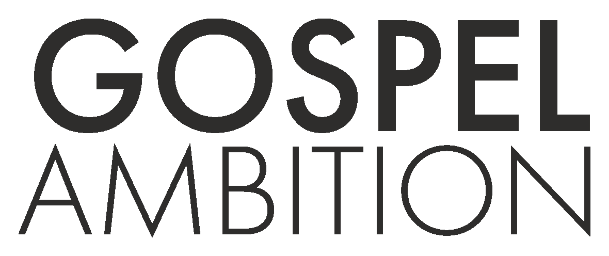
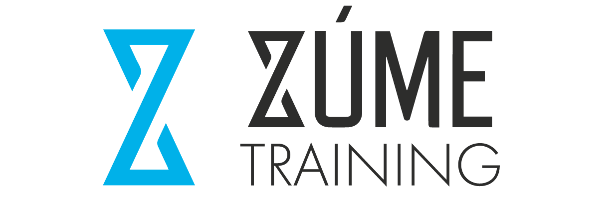
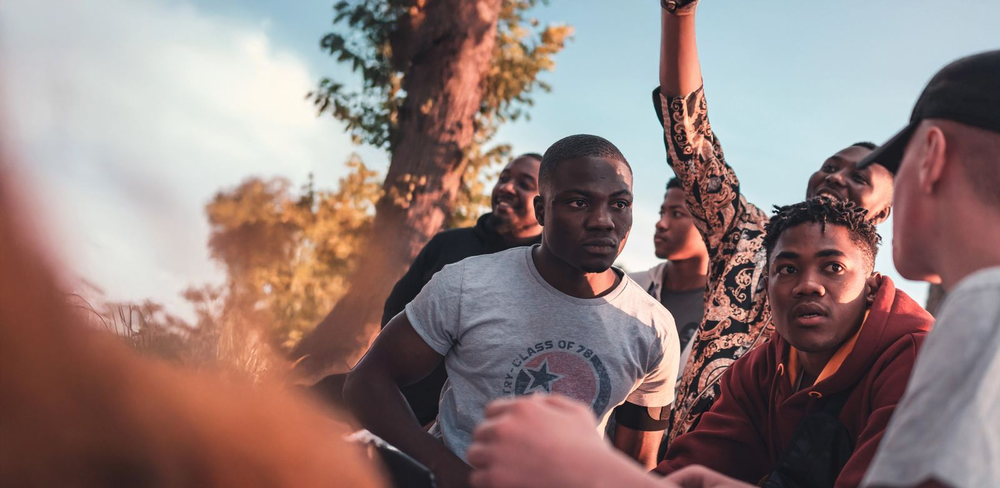
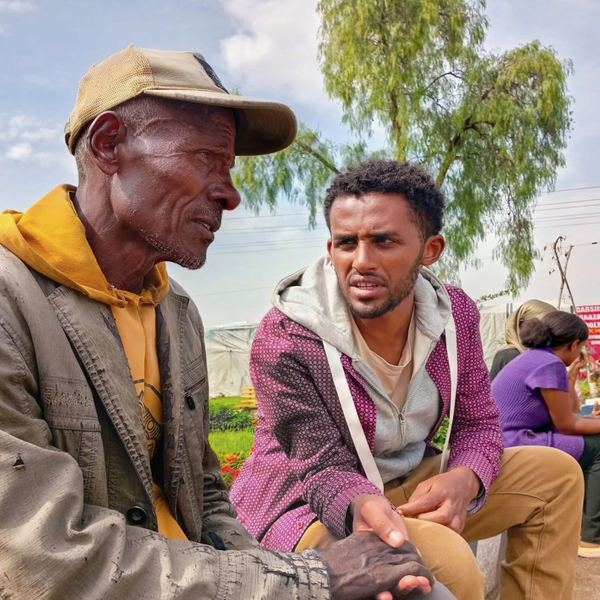
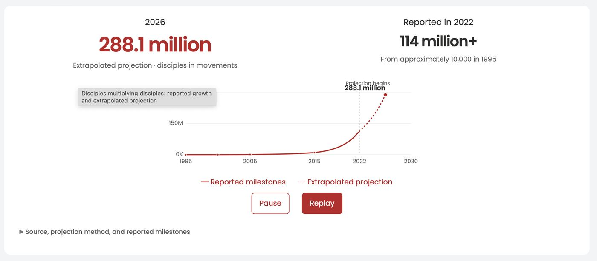

<!-- GENERATED by scripts/generate.mjs from brands/gospel-ambition/ and system/. Do not edit this file: edit the sources, then run `npm run generate`. -->

# Gospel Ambition: resolved brand brief

Confident, warm and mission-driven. Brand red and charcoal on white, heavy Poppins headlines and sweeping red curves, for inviting ministries to use free disciple-making tools.

This file is the whole Gospel Ambition brand in one place, with shared composition, components and patterns and Gospel Ambition's overrides already merged. Use it to build or review anything for Gospel Ambition. Follow it exactly.

## Setup

1. Load the fonts:
   `<link rel="stylesheet" href="https://fonts.googleapis.com/css2?family=Bebas+Neue&family=Poppins:ital,wght@0,400;0,500;0,600;0,700;0,800;1,400;1,500;1,800&display=swap">`
2. Load the variables: `brands/gospel-ambition/tokens.css` (copy also at the end of this file).
3. Load the base element styles: `brands/gospel-ambition/base.css`.
4. Copy the CSS of each composition primitive and component you use from the Composition and Components sections. Use only the CSS variables, never raw colours or font names.

## Icons

- **Bootstrap Icons** — The design uses two icons, both matching Bootstrap Icons: arrow-right (at the end of every full-size button, in the label colour, about 1.3× the label size) and search (in the search field, 16px, --color-grey). Inline the SVG so it takes currentColor. For any other icon, pick it from the same set so line weight and style match.
  Source: https://icons.getbootstrap.com (MIT). The two SVGs in assets/icons/ are traced from the XD file, not copied from the set.
  Files: `assets/icons/`

## Guidelines

> Built from the Adobe XD design of the Gospel Ambition home page ("Kylan-updated", artboard "Web 1920 – 7", 1920px wide) in October 2026, not from a live site. Colours, type, radii, shadows and curves are exact values read from the XD file. Spacing is measured from it and fitted to a scale. The design has one page at one width, so hover states, mobile layouts and anything the page doesn't show are proposals and are marked as such. Voice, principles and the do/don't lists are a **draft** inferred from the page's copy. Have the Gospel Ambition team confirm them.

### Voice (draft)

Confident, warm and inclusive. Gospel Ambition speaks as experienced practitioners inviting others into a shared mission, not as a vendor selling software.

- **Big calling, plainly said.** The mission is stated without hedging: "Fulfilling the Great Commission in this generation, with you." "Understand the calling."
- **"With you."** The reader is a partner, not an audience: "There's a place for you in the mission." "Tools made on our mission field. Useful on yours."
- **Short, stacked fragments.** "Mission experience. Technical expertise." "All free. Most multilingual." "Free. Anytime. Anywhere." Two to four words, full stops, no filler.
- **Credentials from the field.** Claims are grounded in practice: "Conceived on the mission field and delivered in difficult places."
- **Jesus and Scripture first.** The page begins with Matthew 28 and returns to people: "Behind the numbers are people Jesus loves."
- **Christian vocabulary, used plainly.** Disciple-makers, obedient disciples, the Church, the Kingdom of God, frontier missions. Write for practitioners; don't explain it away or stack jargon.
- **Calls to action are short verb phrases, set in caps by the button style:** Find my tools, Start praying, Partner with us, Receive updates.

### Principles (draft)

- **Red moves, charcoal grounds.** Brand red carries the energy: the ribbons, the main buttons, the key words of a heading. Charcoal is for text and the one dark section. Everything else is white or a soft grey.
- **Curves, not boxes, between sections.** The red ribbon and the grey swoosh replace straight section edges. They are the most recognisable thing in the design; use the exact curves, never approximations.
- **Headlines do the work.** Big, heavy Poppins with one phrase in red. Body text is short and secondary.
- **People in every picture.** Photos are of real people in the places the tools serve, and fade softly into white rather than sitting in frames.
- **Everything is free, and says so.** Tools are presented as gifts to the Church: "See what is free."

### Do

- Use Poppins for everything except eyebrows, which are Bebas Neue (`--font-label`) in red.
- Put the key phrase of a heading in red with `.text-accent`: "motive, mission and vision.", "with you.", "go.".
- Open each chapter of a long page with a red [ribbon](components/ribbon/), and separate other sections with the grey [swoosh](components/swoosh/).
- Use one `.btn-primary` per block, with the arrow, and `.btn-light` or `.btn-grey` for the second action.
- Put tool cards on the grey wash (`.bg-wash`) and call-to-action cards on a darkened photo.
- Keep `body` (or the page's outer wrapper) an inline-size container, as `base.css` does. Fluid sizes use `cqi` and breakpoints use `@container`, so they follow the width of the page, or of a preview or embed.
- Build new pages from this guide's tokens, composition and components. When adding to an existing site, adapt them to that site's own classes; don't paste the guide's markup in as-is.
- Use the full-colour logo (`logo.png`) on white only. A reversed logo for red, charcoal or photos doesn't exist yet (see the assets page).

### Don't

- Don't use red text on charcoal at any size. It fails contrast (see below), including the design's own red "go.".
- Don't use colours outside the palette. The design file also saves cyan, gold, blue and navy swatches; they aren't used on the page and aren't part of this guide.
- Don't square off corners: buttons and fields are pills, cards are 16px or 25px.
- Don't add shadows to tool cards or panels. Only the nav bar, the call-to-action cards and the chat button have one.
- Don't add tags or badges. The design has none, so the shared Tag is excluded.
- Don't set body text in italics. Italics are for the hero title, the hero tagline, Scripture, quotes and footnotes.

### Known issues in the design

These are facts from the XD file, recorded so builds don't copy them by accident:

- Red on charcoal is 2.2:1. The red "go." in "Let's go." fails WCAG AA even for large text (3:1). Make it white or raise it with the team.
- The 1px `--color-grey` outlines on the light and grey buttons and the search field are 1.7:1 against white. The search field's edge fails the 3:1 non-text contrast rule; consider a darker outline for form fields.
- The call-to-action cards have a 1px `--color-grey-dark` outline (XD's default stroke) that barely shows on the dark photo. It is kept in the card, but it may be unintended.
- The nav bar reads "FOR YOUR MINSITRY". The guide spells it "For your ministry".
- Font sizes the design uses once have been folded into the nearest step: the 17px Give label (18px here), 25px testimonial roles (26px) and 38px testimonial names (36px).
- The design has no hover, focus or pressed states, and no tablet or phone layouts. Everything this guide adds for them is a proposal.
- Passing pairs, for reference: charcoal on white 13.7:1, white on red 6.2:1, red on white 6.2:1, red on the grey wash 5.0:1, white at 80% on charcoal 9.4:1, white at 90% on red 5.3:1.

## Tokens

### color

- `--color-background`: `#FFFFFF` — Page background, tool cards, call-to-action cards, the nav bar.
- `--color-text`: `#2E2D2C` — Body text and headings on light backgrounds. Same value as charcoal.
- `--color-red`: `#BC2026` — The brand red. Primary buttons, the ribbon bands, the nav arch, highlighted words in headings, eyebrows, outline buttons, the ministries panel, the chat button.
- `--color-red-dark`: `#8A1E20` — A swatch saved in the design file but not used on the page. Used here only for hover on red buttons; the design has no hover states.
- `--color-charcoal`: `#2E2D2C` — Text, the dark ministries section, and the overlay on the call-to-action photo (at 78%).
- `--color-grey-wash`: `#E6E7E8` — Top of the wash gradient behind the stats and tools sections.
- `--color-grey-light`: `#F7F7F7` — The swoosh crescents between sections, and the grey button.
- `--color-grey`: `#C7C7C7` — 1px outlines of the light and grey buttons and the search field, and the search icon.
- `--color-grey-dark`: `#707070` — 1px outline of the call-to-action cards. Barely visible on the dark photo behind them.
- `--color-white`: `#FFFFFF` — Text on red, charcoal and photos; button labels on red.

### gradient

- `--gradient-wash`: `linear-gradient({color.grey-wash}, {color.white})` — Top-to-bottom wash behind the stats section and the tools section.
- `--gradient-fade-hero`: `linear-gradient(90deg, {color.white} 19%, transparent 58%)` — Laid over the hero photo so it fades into the white page on its left.
- `--gradient-fade-story`: `linear-gradient(90deg, {color.white} 37%, transparent 60%)` — Laid over the story photo so its left edge fades into white.
- `--gradient-fade-top`: `linear-gradient({color.white}, transparent)` — Laid over the top of a full-width photo band so it fades in from the white section above.
- `--gradient-overlay`: `linear-gradient(color-mix(in srgb, {color.charcoal} 78%, transparent), color-mix(in srgb, {color.charcoal} 78%, transparent))` — Charcoal at 78%, over the photo behind the call-to-action section.

### shadow

- `--shadow-nav`: `0 3px 3px rgba(0, 0, 0, 0.05)` — Under the white nav bar.
- `--shadow-card`: `0 3px 3px rgba(0, 0, 0, 0.16)` — Call-to-action cards. Tool cards have no shadow.
- `--shadow-float`: `0 3px 3px rgba(0, 0, 0, 0.35)` — The floating chat button.

### font

- `--font-body`: `Poppins, Arial, sans-serif` — Everything: headings, body, buttons, nav. The design uses Poppins Regular to ExtraBold, with italics.
- `--font-heading`: `Poppins, Arial, sans-serif` — Same family as body; headings differ by weight.
- `--font-label`: `'Bebas Neue', 'Arial Narrow', sans-serif` — Eyebrows above call-to-action titles only (Equip your ministry, PAY IT FORWARD, STAY CONNECTED). Caps-only, one weight.

### weight

- `--weight-regular`: `400` — Body text, intros, testimonial roles, the inactive tab.
- `--weight-medium`: `500` — Tool card category and description, the hero tagline, the copyright line.
- `--weight-semibold`: `600` — Buttons, nav links, subtitles on red ribbons, the active tab, testimonial names.
- `--weight-bold`: `700` — Section headings (h2), card titles (h3), the footer tagline.
- `--weight-heavy`: `800` — Page and ribbon titles (h1), the hero title (italic) and the 'Let's go.' display line.

### leading

- `--leading-body`: `1.5` — Body (20/30), buttons, nav, ribbon subtitles (26/39).
- `--leading-lead`: `1.3` — Intros and statements at 32px and 36px (32/42, 36/47).
- `--leading-heading`: `1.2` — h1–h3 (56/66, hero 66/78, card titles 36/41).
- `--leading-quote`: `1.4` — Testimonial quotes (36/50).
- `--leading-story`: `1.7` — Long-form story text (20/34).
- `--leading-display`: `1` — 'Let's go.' The design sets 80px type on a 66px line; 1 keeps the descenders clear.

### size

- `--size-small`: `1.125rem` — 18px. Nav links, outline buttons in cards, footer links and copyright. The nav Give pill is 17px in the design.
- `--size-body`: `clamp(1.0625rem, 1rem + 0.25cqi, 1.25rem)` — 20px in the design. Body text, primary buttons, tool card descriptions.
- `--size-eyebrow`: `1.5rem` — 24px. Bebas Neue eyebrows.
- `--size-subtitle`: `clamp(1.25rem, 1.1rem + 0.4cqi, 1.625rem)` — 26px in the design. Subtitles on ribbons, tabs, the 'More tools' link, testimonial roles (25px in the design).
- `--size-lead`: `clamp(1.375rem, 1.1rem + 0.75cqi, 2rem)` — 32px in the design. Intros under section headings, the scripture block.
- `--size-h3`: `clamp(1.5rem, 1.2rem + 0.9cqi, 2.25rem)` — 36px in the design. Card titles, tool categories, statements, testimonial quotes. Testimonial names are 38px in the design, folded in here.
- `--size-tagline`: `clamp(1.75rem, 1.3rem + 1.2cqi, 2.75rem)` — 44px in the design. The footer tagline.
- `--size-h2`: `clamp(2rem, 1.3rem + 2.2cqi, 3.5rem)` — 56px in the design. Section headings.
- `--size-h1`: `clamp(2.5rem, 1.6rem + 2.6cqi, 4.125rem)` — 66px in the design. The hero title and ribbon titles.
- `--size-display`: `clamp(3rem, 1.8rem + 3.3cqi, 5rem)` — 80px in the design. 'Let's go.'
- `--size-icon`: `1.3em` — Width of the arrow icon in buttons (26px beside 20px text).
- `--size-logo`: `5.8rem` — 93px. Height of the logo in the nav bar (320×93).
- `--size-tool-logo`: `5.625rem` — 90px. Height of a tool logo in a tool card.
- `--size-avatar`: `12.3rem` — 197px. Diameter of a testimonial photo.
- `--size-chat`: `7.4rem` — 119px. Diameter of the chat button.
- `--size-measure`: `52rem` — 836px. Width of the hero tagline and ribbon subtitles.
- `--size-container`: `102.5rem` — 1640px. Width of every section's content (140px margins at 1920px).

### radius

- `--radius-md`: `16px` — Call-to-action cards and their photos, the embedded chart.
- `--radius-lg`: `25px` — Tool cards and the ministries panel.
- `--radius-pill`: `999px` — Every button and the search field.

### space

- `--space-xxs`: `0.5rem` — 8px. Eyebrow to title.
- `--space-xs`: `1rem` — 16px. Heading to subtitle, small gaps.
- `--space-s`: `1.75rem` — 28px. Gap between tool cards, between the Give pill and the search field; button padding left and right.
- `--space-m`: `3rem` — 48px. Card padding (43–50px in the design), the default flow gap.
- `--space-l`: `4rem` — 64px. Space under the button in a tool card; between a heading block and a grid.
- `--space-xl`: `6rem` — 96px. Section padding top and bottom.
- `--space-xxl`: `8.75rem` — 140px. The scripture block's indent (131px in the design).


## Assets

Taken from the Adobe XD design of the Gospel Ambition home page in October 2026. Logos and photos are the images embedded in the XD file. The world map, the ministry-logo wall, the Prayer.Global logo and the two icons were vectors in the file and are exported from it.

> **To obtain:** vector masters (SVG/AI/EPS) of the logo in every colourway; a reversed (white) logo for red, charcoal and photo backgrounds, which the design never needs and so doesn't contain; the name and licence of the wordmark typeface; usage rules (clear space, minimum size) from the Gospel Ambition team; permission records for the ministry logos and the testimonial photos; and the source photos at full resolution with their licences. The sizes and clear-space rules below are recommendations until then.

### Logo



- **File:** `logo.png`: 640×187, transparent. The red "A" mark (with a dark fold on its right leg) beside the wordmark, GOSPEL in heavy capitals over AMBITION in light capitals, both charcoal. This is the nav-bar logo, shown 93px tall (`--size-logo`).
- **Use on:** white only.
- **Minimum size:** 40px tall.
- **Clear space:** at least the height of the "G" in GOSPEL on every side.

### Logo badge and wordmark


- **File:** `logo-badge.png`: 255×256, transparent. The mark reversed out of a red circle with a soft gradient. The footer pairs it with the wordmark; on its own it works as an avatar or app icon.
- **Use on:** white or light grey.
- **Minimum size:** 32px.
- **Clear space:** a quarter of its width on every side.



- **File:** `logo-wordmark.png`: 609×256, transparent. The wordmark alone, in charcoal. In the footer it sits directly to the right of the badge at the same height (128px).
- **Use on:** white, next to the badge only. Don't use the wordmark without a mark.

### Tool logos

The logos of the six tools in the tool cards, shown 90px tall (`--size-tool-logo`). Each belongs to its own brand; use them only to point to that tool.



- **File:** `tools/zume-training.png`: 603×208. Zúme Training (Multiply).


- **File:** `tools/prayer-global.png`: 530×180. Prayer.Global (Pray). Rendered from the vector logo in the XD file.


- **File:** `tools/prayer-tools.png`: 556×180. Prayer.Tools (Pray).


- **File:** `tools/disciple-tools.png`: 554×180. Disciple.Tools (Steward).


- **File:** `tools/kingdom-training.png`: 577×180. Kingdom Training (Engage).


- **File:** `tools/great-commission-benchmark.png`: 556×180. Great Commission Benchmark (Evaluate).

### Graphics



- **File:** `world-map.svg`: 2004×704, vector. A world map in `#E0E1E3` at 50% opacity, from the footer. Use it behind the footer logo, centred and slightly wider than the page.

<div class="ds-on-dark">



</div>

- **File:** `ministry-logos.svg`: 1496×679, vector. About 40 partner ministry logos in white at 90% opacity, in five columns, from the ministries section. Use it only on the red panel of the Ministries pattern. Each logo belongs to its ministry.

### Photos

Used in the pattern previews. Resized from the images embedded in the XD file; get the originals before using them on a live site.



- **File:** `photos/hero.jpg`: 1600×782. The hero photo. It fills the right of the hero and fades to white on the left.


- **File:** `photos/photo-band.jpg`: 1600×1044. The full-width photo band above the "See what is free." ribbon.


- **File:** `photos/story.jpg`: 1000×801. The illustrative portrait beside Samir's story.


- **File:** `photos/cta-background.jpg`: 1600×702. The background of the "Let's go." section, under the charcoal overlay.


- **File:** `photos/cta-tools.jpg`: 332×222. The "Find the right tools." card photo. Small in the XD file; don't show it larger.



- **File:** `photos/cta-partner.jpg`: 600×600. The "Help equip more disciple-makers." card photo.


- **File:** `photos/clyde-taber.jpg`: 400×300. Testimonial photo, shown in a circle.


- **File:** `photos/curtis-sergeant.jpg`: 394×394. Testimonial photo, shown in a circle.



- **File:** `photos/disciples-chart.jpg`: 1400×614. A screenshot of the interactive "Disciples multiplying disciples" chart, as placed in the design. A build should embed the live chart instead.

### Icons

- **Files:** `icons/arrow-right.svg` and `icons/search.svg`, both `currentColor`. Traced from the XD file; they match Bootstrap Icons' arrow-right and search. The arrow ends every full-size button; the search icon sits in the search field.

### Fonts

- **Poppins** (400, 500, 600, 700, 800; italics 400, 500, 800) and **Bebas Neue** (400) from Google Fonts. Both are free under the SIL Open Font License. Loaded in Setup.

## Composition

### Center

Centres a block horizontally with a maximum width, such as a readable column of text. Shared (`system/composition/center.md`).

Every Layout's Center. It centres the box itself, not the text inside it.

#### Settings

| Property | Default | What it does |
| --- | --- | --- |
| `--measure` | `60ch` | Maximum width of the content. |
| `--gutter` | `0` | Minimum space on each side on narrow screens. |

Add `data-intrinsic` to also centre the children by their own width, for example a button below a paragraph.

#### When to use

- A column of article text, a form, a narrow intro inside a wide section.

#### Don't

- Don't use it as the page-width wrapper. That's Container.

#### Code

```html
<div class="center" data-intrinsic style="outline: 1px dashed currentColor; width: 100%">
  <p>A centred column, at most 60 characters wide.</p>
  <span style="outline: 1px dashed currentColor">Intrinsic child</span>
</div>
```

```css
.center {
  box-sizing: content-box;
  max-inline-size: var(--measure, 60ch);
  margin-inline: auto;
  padding-inline: var(--gutter, 0);
}
.center[data-intrinsic] {
  display: flex;
  flex-direction: column;
  align-items: center;
}
```

### Cluster

A row of items that wraps onto new lines, with even gaps. For tags, buttons, links and icons. Shared (`system/composition/cluster.md`).

Every Layout's Cluster, as used in CUBE CSS.

#### Settings

| Property | Default | What it does |
| --- | --- | --- |
| `--gutter` | `var(--space-s)` | Gap between items, both across and down. |
| `--cluster-horizontal-alignment` | `flex-start` | `justify-content` of the row. |
| `--cluster-vertical-alignment` | `center` | `align-items` of the row. |

#### When to use

- A group of buttons, a row of social links, a list of tags.

#### Don't

- Don't use it for two things pushed to opposite ends. Use Repel.

#### Code

```html
<div class="cluster" role="list" style="padding: 0; margin: 0; list-style: none">
  <div>First</div>
  <div>Second item</div>
  <div>Third</div>
  <div>A longer fourth item</div>
  <div>Fifth</div>
</div>
```

```css
.cluster {
  display: flex;
  flex-wrap: wrap;
  gap: var(--gutter, var(--space-s));
  justify-content: var(--cluster-horizontal-alignment, flex-start);
  align-items: var(--cluster-vertical-alignment, center);
}
```

### Container

The page-width wrapper. Content is 1640px wide, which leaves 140px margins on a 1920px screen. Brand override (`brands/gospel-ambition/composition/container.md`), replaces `system/composition/container.md`.

Replaces the shared Container because the design's content column is wider. Every section of the design lines its content up between x = 140 and x = 1780 on the 1920px artboard, so the content box is 1640px (`--size-container`). The padding is added outside that width, so the content stays 1640px wide on large screens.

The design has no mobile layout. The side padding is a proposal: 1rem on phones, growing to 3rem.

#### Settings

| Property | Default | What it does |
| --- | --- | --- |
| `--container-max` | `var(--size-container)` | Maximum width of the content. |
| `--gutter` | `clamp(var(--space-xs), 4cqi, var(--space-m))` | Padding on each side. |

#### Do

- Put the background (colour, wash, photo, ribbon) on the full-width section and the `.container` inside it.

#### Code

```html
<section style="width: 100%; outline: 1px dashed currentColor">
  <div class="container" style="outline: 1px dashed currentColor">Content stays within 1640px.</div>
</section>
```

```css
.container {
  position: relative;
  box-sizing: content-box;
  margin-inline: auto;
  max-width: var(--container-max, var(--size-container));
  padding-inline: var(--gutter, clamp(var(--space-xs), 4cqi, var(--space-m)));
}
```

### Flow

Even vertical space between the children of an element. The default rhythm for any run of content. Shared (`system/composition/flow.md`).

CUBE CSS's flow utility (Every Layout calls it the Stack). It adds space between siblings, never before the first child or after the last, so it doesn't fight the container's padding.

#### Settings

| Property | Default | What it does |
| --- | --- | --- |
| `--flow-space` | `var(--space-m)` | Space between each child. Set it on the element or on any child. |

#### When to use

- Any sequence of blocks: a heading, paragraphs and a button in a section, or cards in a column.

#### Do

- Change the rhythm for one section with `style="--flow-space: var(--space-l)"` or in that block's CSS, rather than adding margins to children.
- Set `--flow-space` on a single child to change the gap above just that child.

#### Don't

- Don't add top margins to the children as well. Flow owns that space.

#### Code

```html
<div class="flow" style="max-width: 32rem">
  <h3>A heading</h3>
  <p>Each child is separated by the same space, taken from the brand's space scale.</p>
  <p>No margin before the first child or after the last.</p>
</div>
```

```css
.flow > * + * { margin-block-start: var(--flow-space, var(--space-m)); }
```

### Grid

Equal columns that fit as many items per row as there is room for, then wrap. For the tool cards. Gospel Ambition-only (`brands/gospel-ambition/composition/grid.md`).

Brand-only primitive (Every Layout's Grid). The tool section shows six cards three to a row, which the Switcher can't do: it stacks everything once there are more than four items. The Grid fits as many columns as fit at a minimum width and wraps the rest, so six cards become 3 + 3 on a wide screen, 2 + 2 + 2 on a tablet and one column on a phone.

#### Settings

| Property | Default | What it does |
| --- | --- | --- |
| `--grid-min` | `20rem` | The narrowest a column may get before the grid drops a column. |
| `--gutter` | `var(--space-s)` | Gap between columns and rows (28px, as between the tool cards). |

#### Don't

- Don't put a grid directly in a flex row (a cluster, or a flex wrapper) without giving it a width. It has no intrinsic width of its own, so a shrink-to-fit parent collapses it to one column. Inside a section or `.container` it fills the width by itself.

#### Code

```html
<div class="grid" style="--grid-min: 10rem; width: 100%">
  <div style="outline: 1px dashed currentColor; padding: 1rem">One</div>
  <div style="outline: 1px dashed currentColor; padding: 1rem">Two</div>
  <div style="outline: 1px dashed currentColor; padding: 1rem">Three</div>
  <div style="outline: 1px dashed currentColor; padding: 1rem">Four</div>
  <div style="outline: 1px dashed currentColor; padding: 1rem">Five</div>
  <div style="outline: 1px dashed currentColor; padding: 1rem">Six</div>
</div>
```

```css
.grid {
  display: grid;
  grid-template-columns: repeat(auto-fit, minmax(min(var(--grid-min, 20rem), 100%), 1fr));
  gap: var(--gutter, var(--space-s));
}
```

### Repel

Pushes items to opposite ends of a row, and lets them wrap when there isn't room. Shared (`system/composition/repel.md`).

CUBE CSS's repel composition.

#### Settings

| Property | Default | What it does |
| --- | --- | --- |
| `--gutter` | `var(--space-s)` | Minimum gap between the items, and between lines when they wrap. |
| `--repel-vertical-alignment` | `center` | `align-items` of the row. |

Add `data-nowrap` to keep the items on one line.

#### When to use

- A title with an action at the far end, a logo with a menu button, a button with a partner logo.

#### Code

```html
<div class="repel" style="width: 100%">
  <strong>Left item</strong>
  <span>Right item</span>
</div>
```

```css
.repel {
  display: flex;
  flex-wrap: wrap;
  justify-content: space-between;
  align-items: var(--repel-vertical-alignment, center);
  gap: var(--gutter, var(--space-s));
}
.repel[data-nowrap] { flex-wrap: nowrap; }
```

### Switcher

Items sit side by side, and all stack at once when the container gets narrower than a threshold. No media queries. Shared (`system/composition/switcher.md`).

Every Layout's Switcher. It switches on the width of the container, not the viewport, so it works anywhere on the page.

#### Settings

| Property | Default | What it does |
| --- | --- | --- |
| `--threshold` | `30rem` | Container width below which every item stacks. |
| `--gutter` | `var(--space-s)` | Gap between items. |

Five or more children always stack. The Switcher is for two to four items.

#### When to use

- Two-column sections (text beside an image), a row of three stats, pricing tiers.

#### Don't

- Don't use it for more than four items. Use a grid.

#### Code

```html
<div class="switcher" style="width: 100%">
  <div style="outline: 1px dashed currentColor; padding: 1rem">One</div>
  <div style="outline: 1px dashed currentColor; padding: 1rem">Two</div>
  <div style="outline: 1px dashed currentColor; padding: 1rem">Three</div>
</div>
```

```css
.switcher {
  display: flex;
  flex-wrap: wrap;
  gap: var(--gutter, var(--space-s));
}
.switcher > * {
  flex-grow: 1;
  flex-basis: calc((var(--threshold, 30rem) - 100%) * 999);
}
.switcher > :nth-last-child(n + 5),
.switcher > :nth-last-child(n + 5) ~ * {
  flex-basis: 100%;
}
```

## Components

### Button

Uppercase Poppins SemiBold pills with a right arrow. Red is the main action; white, grey, red-outline and white-outline pills are for the rest. Brand override (`brands/gospel-ambition/components/button.md`), replaces `system/components/button.md`.

Every button in the design is a pill (`--radius-pill`) with an uppercase SemiBold label, and all but the nav's Give pill end with a right arrow. Full-size buttons are 65px tall at 1920px (20px label on a 30px line). The design gives them fixed widths (332–380px); here that becomes a minimum width of 16.5em.

#### Variants

| Class | Where the design uses it | Example |
| --- | --- | --- |
| `.btn-primary` | The main action: in the hero and on call-to-action cards. | Our tools & trainings, Find my tools |
| `.btn-light` | The second action beside a primary one, on white. White with a grey outline. | Our story |
| `.btn-grey` | A quiet "read more" at the end of a section. | More about us |
| `.btn-outline` | One per tool card. Red outline and label, 18px. | Explore Zume.Training |
| `.btn-outline-light` | On charcoal or dark photos. | Receive updates |
| `.btn-sm` | Add to `.btn-primary` for the nav bar's Give pill: 18px, 32px tall, no arrow. | Give |

The arrow is the design's `arrow-right` icon (`assets/icons/arrow-right.svg`), inlined so it takes the label colour.

#### Do

- Write labels as short verb phrases; the CSS uppercases them: "Find my tools", "Start praying", "Partner with us".
- Use `<a>` for navigation (nearly every button opens another page) and `<button>` for actions.
- Keep one `.btn-primary` per card or block. Pair it with `.btn-light`, not a second red pill.

#### Don't

- Don't leave out the arrow on full-size buttons. Only the Give pill has none.
- Don't use `.btn-outline` outside a white card. It is the tool card's button.

#### Approximate

- The design has no hover, focus or pressed states. The hover states here are proposals: red buttons darken to `--color-red-dark` (a swatch saved in the design file), outlined buttons fill.
- In the design the label is centred on the whole pill and the arrow sits 28–35px from the right edge. Here the label and arrow are centred together, so the label sits about 20px left of the design's position on wide buttons.

#### Code

```html
<a class="btn btn-primary" href="#">Our tools &amp; trainings <svg class="btn__icon" viewBox="1 3.49 26.42 16.99" aria-hidden="true"><path d="M1 11.99c0-.52.42-.95.94-.95H24.2l-5.94-5.93a.95.95 0 0 1 0-1.34.94.94 0 0 1 1.33 0l7.55 7.55a.95.95 0 0 1 .28.67.95.95 0 0 1-.28.67l-7.55 7.55a.94.94 0 0 1-1.33 0 .95.95 0 0 1 0-1.34l5.94-5.94H1.94A.94.94 0 0 1 1 11.99Z"/></svg></a>
<a class="btn btn-light" href="#">Our story <svg class="btn__icon" viewBox="1 3.49 26.42 16.99" aria-hidden="true"><path d="M1 11.99c0-.52.42-.95.94-.95H24.2l-5.94-5.93a.95.95 0 0 1 0-1.34.94.94 0 0 1 1.33 0l7.55 7.55a.95.95 0 0 1 .28.67.95.95 0 0 1-.28.67l-7.55 7.55a.94.94 0 0 1-1.33 0 .95.95 0 0 1 0-1.34l5.94-5.94H1.94A.94.94 0 0 1 1 11.99Z"/></svg></a>
<a class="btn btn-grey" href="#">More about us <svg class="btn__icon" viewBox="1 3.49 26.42 16.99" aria-hidden="true"><path d="M1 11.99c0-.52.42-.95.94-.95H24.2l-5.94-5.93a.95.95 0 0 1 0-1.34.94.94 0 0 1 1.33 0l7.55 7.55a.95.95 0 0 1 .28.67.95.95 0 0 1-.28.67l-7.55 7.55a.94.94 0 0 1-1.33 0 .95.95 0 0 1 0-1.34l5.94-5.94H1.94A.94.94 0 0 1 1 11.99Z"/></svg></a>
<a class="btn btn-outline" href="#">Explore Zume.Training <svg class="btn__icon" viewBox="1 3.49 26.42 16.99" aria-hidden="true"><path d="M1 11.99c0-.52.42-.95.94-.95H24.2l-5.94-5.93a.95.95 0 0 1 0-1.34.94.94 0 0 1 1.33 0l7.55 7.55a.95.95 0 0 1 .28.67.95.95 0 0 1-.28.67l-7.55 7.55a.94.94 0 0 1-1.33 0 .95.95 0 0 1 0-1.34l5.94-5.94H1.94A.94.94 0 0 1 1 11.99Z"/></svg></a>
<a class="btn btn-primary btn-sm" href="#">Give</a>
```

```html
<div class="bg-charcoal" style="padding: 1.5rem">
  <a class="btn btn-outline-light" href="#">Receive updates <svg class="btn__icon" viewBox="1 3.49 26.42 16.99" aria-hidden="true"><path d="M1 11.99c0-.52.42-.95.94-.95H24.2l-5.94-5.93a.95.95 0 0 1 0-1.34.94.94 0 0 1 1.33 0l7.55 7.55a.95.95 0 0 1 .28.67.95.95 0 0 1-.28.67l-7.55 7.55a.94.94 0 0 1-1.33 0 .95.95 0 0 1 0-1.34l5.94-5.94H1.94A.94.94 0 0 1 1 11.99Z"/></svg></a>
</div>
```

```css
.btn {
  --btn-color: var(--color-white);
  --btn-bg: var(--color-red);
  --btn-border: var(--color-red);
  --btn-hover-color: var(--btn-color);
  --btn-hover-bg: var(--btn-bg);
  --btn-hover-border: var(--btn-border);
  box-sizing: border-box;
  display: inline-flex;
  align-items: center;
  justify-content: center;
  gap: 0.7em;
  min-inline-size: 16.5em;
  padding: 0.85em var(--space-s);
  font: var(--weight-semibold) var(--size-body) / var(--leading-body) var(--font-body);
  text-transform: uppercase;
  text-decoration: none;
  color: var(--btn-color);
  background-color: var(--btn-bg);
  border: 1px solid var(--btn-border);
  border-radius: var(--radius-pill);
  cursor: pointer;
  transition: color 0.15s ease-in-out, background-color 0.15s ease-in-out, border-color 0.15s ease-in-out;
}
.btn:hover { color: var(--btn-hover-color); background-color: var(--btn-hover-bg); border-color: var(--btn-hover-border); }
.btn:focus-visible { outline: 2px solid var(--color-red); outline-offset: 3px; }
.btn__icon { flex: none; inline-size: var(--size-icon); block-size: auto; fill: currentColor; }

.btn-primary { --btn-hover-bg: var(--color-red-dark); --btn-hover-border: var(--color-red-dark); }
.btn-light { --btn-color: var(--color-charcoal); --btn-bg: var(--color-white); --btn-border: var(--color-grey); --btn-hover-color: var(--color-red); --btn-hover-border: var(--color-red); }
.btn-grey { --btn-color: var(--color-charcoal); --btn-bg: var(--color-grey-light); --btn-border: var(--color-grey); --btn-hover-color: var(--color-red); --btn-hover-border: var(--color-red); }
.btn-outline { --btn-color: var(--color-red); --btn-bg: var(--color-white); --btn-hover-color: var(--color-white); --btn-hover-bg: var(--color-red); font-size: var(--size-small); }
.btn-outline-light { --btn-color: var(--color-white); --btn-bg: transparent; --btn-border: var(--color-white); --btn-hover-color: var(--color-charcoal); --btn-hover-bg: var(--color-white); }
.btn-sm { min-inline-size: 0; padding: 0.15em 1.3em; font-size: var(--size-small); }
```

### Card

The tool card. A white, 25px-rounded panel with a category word, the tool's logo, a short description and a red outline button at the bottom. Brand override (`brands/gospel-ambition/components/card.md`), replaces `system/components/card.md`. Also needs the CSS from: button.

Replaces the shared Card. The design's tool grid ("Tools made on our mission field") is six of these on the grey wash: 528×576px at 1920px, no border and no shadow, so they only work on a tinted background (`.bg-wash`). The category is one verb (Multiply, Pray, Steward, Engage, Evaluate) in Poppins Medium 36px, then the tool's logo at 90px tall, a three- to five-line description in Poppins Medium 20px, and the button pinned to the bottom so buttons line up across a row.

For the photo-and-text cards in the call-to-action section, use [CTA card](../cta-card/).

#### Do

- Use the tool's own logo file (see the assets page) and keep it 90px tall (`--size-tool-logo`).
- Start the description with a verb: "Trains ordinary believers…", "Equips leaders…", "Helps prayer champions…".
- Put cards on `.bg-wash`, never on white.

#### Don't

- Don't add a shadow or border. The design's cards have neither.
- Don't use a filled button in a tool card. It is always `.btn-outline`.

#### Code

```html
<div class="bg-wash" style="padding: 1.5rem">
  <article class="card" style="max-width: 33rem">
    <h3 class="card__category">Multiply</h3>
    
    <p class="card__text">Trains ordinary believers to make disciples who make disciples. Small groups, self-paced, in 50+ languages. Free. Anytime. Anywhere.</p>
    <a class="btn btn-outline" href="#">Explore Zume.Training <svg class="btn__icon" viewBox="1 3.49 26.42 16.99" aria-hidden="true"><path d="M1 11.99c0-.52.42-.95.94-.95H24.2l-5.94-5.93a.95.95 0 0 1 0-1.34.94.94 0 0 1 1.33 0l7.55 7.55a.95.95 0 0 1 .28.67.95.95 0 0 1-.28.67l-7.55 7.55a.94.94 0 0 1-1.33 0 .95.95 0 0 1 0-1.34l5.94-5.94H1.94A.94.94 0 0 1 1 11.99Z"/></svg></a>
  </article>
</div>
```

```css
.card {
  box-sizing: border-box;
  display: flex;
  flex-direction: column;
  align-items: flex-start;
  gap: var(--space-xs);
  padding: var(--space-m) var(--space-m) var(--space-l);
  background: var(--color-white);
  border-radius: var(--radius-lg);
}
.card__category { font-size: var(--size-h3); font-weight: var(--weight-medium); }
.card__logo { display: block; block-size: var(--size-tool-logo); inline-size: auto; max-inline-size: 100%; object-fit: contain; object-position: left center; }
.card__text { font-weight: var(--weight-medium); margin-block-end: var(--space-m); }
.card .btn { margin-block-start: auto; align-self: center; inline-size: min(100%, 21em); }
```

### Chat button

A floating red circle with a white speech bubble, fixed to the bottom right of the screen. Gospel Ambition-only (`brands/gospel-ambition/components/chat-button.md`).

The design floats a 119px red circle (`--size-chat`) with a white speech-bubble shape over the bottom right of the hero, 50px from the edge, with a darker shadow than anything else (`--shadow-float`). The bubble is a 49px square rounded on three corners, which makes the tail. In a build it stays fixed while the page scrolls and opens the help chat.

#### Do

- Give it an accessible name ("Chat with us") and keep it the only floating element.

#### Approximate

- The design shows it only at 1920px. Below 48rem it shrinks to 4rem here; that is a proposal.
- The example is shown in place; add `.chat-button--fixed` in a build to fix it to the corner.

#### Code

```html
<button class="chat-button" type="button" aria-label="Chat with us"><span class="chat-button__bubble"></span></button>
```

```css
.chat-button {
  display: inline-grid;
  place-items: center;
  inline-size: var(--size-chat);
  block-size: var(--size-chat);
  padding: 0;
  background: var(--color-red);
  border: 0;
  border-radius: 50%;
  box-shadow: var(--shadow-float);
  cursor: pointer;
}
.chat-button:hover { background: var(--color-red-dark); }
.chat-button__bubble { inline-size: 41%; aspect-ratio: 1; background: var(--color-white); border-radius: 50% 50% 0 50%; }
.chat-button--fixed { position: fixed; inset: auto var(--space-m) var(--space-m) auto; z-index: 10; }
@container (max-width: 48rem) {
  .chat-button { inline-size: var(--space-l); block-size: var(--space-l); }
  .chat-button--fixed { inset: auto var(--space-xs) var(--space-xs) auto; }
}
```

### CTA card

A white call-to-action card with a red Bebas eyebrow, a bold title, one line of text and a red button, and a photo filling its right side. Gospel Ambition-only (`brands/gospel-ambition/components/cta-card.md`). Also needs the CSS from: button.

Two of these sit side by side in the "Let's go." section, over the darkened photo: 812×433px at 1920px, 16px corners, a soft shadow (`--shadow-card`) and a 1px `--color-grey-dark` outline. The text column is about 54% of the card; the photo takes the rest, and the card's rounded corners clip it. Below about 40rem the photo moves on top.

#### Do

- Write the eyebrow as the job ("Equip your ministry", "Pay it forward") and the title as the promise ("Find the right tools.", "Help equip more disciple-makers.").
- End titles with a full stop, as the design does.
- Use a photo of people, ideally in a group or in conversation.

#### Don't

- Don't put more than one button in a CTA card.

#### Code

```html
<div class="bg-charcoal" style="padding: 1.5rem">
  <article class="cta-card" style="max-width: 51rem">
    <div class="cta-card__body">
      <span class="eyebrow">Equip your ministry</span>
      <h3>Find the right tools.</h3>
      <p>Answer a few simple questions and discover free tools and training that fit the work God has given you.</p>
      <a class="btn btn-primary" href="#">Find my tools <svg class="btn__icon" viewBox="1 3.49 26.42 16.99" aria-hidden="true"><path d="M1 11.99c0-.52.42-.95.94-.95H24.2l-5.94-5.93a.95.95 0 0 1 0-1.34.94.94 0 0 1 1.33 0l7.55 7.55a.95.95 0 0 1 .28.67.95.95 0 0 1-.28.67l-7.55 7.55a.94.94 0 0 1-1.33 0 .95.95 0 0 1 0-1.34l5.94-5.94H1.94A.94.94 0 0 1 1 11.99Z"/></svg></a>
    </div>
    
  </article>
</div>
```

```css
.cta-card {
  display: flex;
  flex-wrap: wrap-reverse;
  overflow: hidden;
  color: var(--color-text);
  background: var(--color-white);
  border: 1px solid var(--color-grey-dark);
  border-radius: var(--radius-md);
  box-shadow: var(--shadow-card);
}
.cta-card__body {
  flex: 54 1 18rem;
  display: flex;
  flex-direction: column;
  align-items: flex-start;
  gap: var(--space-xs);
  padding: var(--space-m);
}
.cta-card__body .eyebrow { margin-block-end: calc(var(--space-xxs) - var(--space-xs)); }
.cta-card__body .btn { margin-block-start: var(--space-xs); }
.cta-card__image {
  flex: 46 1 16rem;
  min-inline-size: 0;
  min-block-size: 14rem;
  object-fit: cover;
}
```

### Input

The search field. A small white pill with a grey outline and a grey search icon, as in the nav bar. Brand override (`brands/gospel-ambition/components/input.md`), replaces `system/components/input.md`.

Replaces the shared Input. The only field in the design is the search box in the nav bar: 143×32px, white, a 1px `--color-grey` outline, fully rounded, with the 16px search icon 13px from its left edge. The design shows no text in it.

The design has no forms. For a sign-up or contact form, ask for a design rather than stretching this field.

#### Approximate

- Placeholder text, typing size and the focus state are not in the design. They are proposals: 18px Poppins (`--size-small`), and a red outline on focus like every other control.

#### Code

```html
<label class="search">
  <svg class="search__icon" viewBox="0 0 16.19 16.19" aria-hidden="true"><path d="M11.88 10.46a6.57 6.57 0 1 0-1.41 1.42h-.01l.1.12 3.9 3.89a1.01 1.01 0 0 0 1.43-1.43L12 10.56a1 1 0 0 0-.12-.1Zm.26-3.89a5.57 5.57 0 1 1-11.13 0 5.57 5.57 0 0 1 11.13 0Z"/></svg>
  <span class="visually-hidden">Search</span>
  <input class="search__input" type="search" />
</label>
```

```css
.search {
  box-sizing: border-box;
  display: inline-flex;
  align-items: center;
  gap: var(--space-xxs);
  inline-size: 9rem;
  block-size: 2rem;
  padding-inline: 0.8rem var(--space-xs);
  background: var(--color-white);
  border: 1px solid var(--color-grey);
  border-radius: var(--radius-pill);
}
.search:focus-within { outline: 2px solid var(--color-red); outline-offset: 2px; }
.search__icon { flex: none; inline-size: 1rem; block-size: 1rem; fill: var(--color-grey); }
.search__input {
  flex: 1;
  min-inline-size: 0;
  padding: 0;
  font: var(--weight-regular) var(--size-small) / var(--leading-body) var(--font-body);
  color: var(--color-text);
  background: transparent;
  border: 0;
  outline: 0;
}
.visually-hidden { position: absolute; inline-size: 1px; block-size: 1px; overflow: hidden; clip-path: inset(50%); white-space: nowrap; }
```

### Nav bar

A red arch across the top of the page, then a white bar with the logo on the left and uppercase links, a red Give pill and the search field on the right. Gospel Ambition-only (`brands/gospel-ambition/components/nav-bar.md`). Also needs the CSS from: container, button, input.

The top of every page. A red band arches across the very top (73px at the edges, 13px in the middle, at 1920px), and the white bar below it (187px in all) holds the logo at 93px tall (`--size-logo`) and the menu. Links are Poppins SemiBold 18px in charcoal, uppercase, about 56px apart. The Give pill is the only red item; the search field closes the row. The bar has a faint shadow (`--shadow-nav`).

The arch is the design's own curve, drawn with an inline SVG that stretches to the page width.

#### Do

- Keep the menu to four or five short items. The design has About, Tools & trainings, Impact, For your ministry.
- Keep Give as the last link, as a `.btn-primary.btn-sm` pill.

#### Approximate

- The design has no mobile menu. Here the links wrap under the logo on narrow screens; a real build needs a menu button, which isn't designed yet.
- Hover is a proposal: links turn red.

#### Code

```html
<header class="nav-bar">
  <svg class="nav-bar__arch" viewBox="0 0 1920 73" preserveAspectRatio="none" aria-hidden="true"><path d="M1920 73.3C1920 73.3 1619.9 12.7 962.3 12.7 325.9 12.7 0 73.3 0 73.3V0h1920Z"/></svg>
  <div class="container nav-bar__inner">
    <a class="nav-bar__logo" href="#"></a>
    <nav class="nav-bar__menu" aria-label="Main">
      <a href="#">About</a>
      <a href="#">Tools &amp; trainings</a>
      <a href="#">Impact</a>
      <a href="#">For your ministry</a>
      <a class="btn btn-primary btn-sm" href="#">Give</a>
      <label class="search">
        <svg class="search__icon" viewBox="0 0 16.19 16.19" aria-hidden="true"><path d="M11.88 10.46a6.57 6.57 0 1 0-1.41 1.42h-.01l.1.12 3.9 3.89a1.01 1.01 0 0 0 1.43-1.43L12 10.56a1 1 0 0 0-.12-.1Zm.26-3.89a5.57 5.57 0 1 1-11.13 0 5.57 5.57 0 0 1 11.13 0Z"/></svg>
        <span class="visually-hidden">Search</span>
        <input class="search__input" type="search" />
      </label>
    </nav>
  </div>
</header>
```

```css
.nav-bar { position: relative; background: var(--color-white); box-shadow: var(--shadow-nav); }
.nav-bar__arch { display: block; inline-size: 100%; block-size: auto; aspect-ratio: 1920 / 73; fill: var(--color-red); }
.nav-bar__inner {
  display: flex;
  flex-wrap: wrap;
  align-items: center;
  justify-content: space-between;
  gap: var(--space-xs) var(--space-l);
  padding-block: var(--space-xxs) var(--space-s);
}
.nav-bar__logo { display: block; flex: none; }
.nav-bar__logo img { display: block; block-size: var(--size-logo); inline-size: auto; }
.nav-bar__menu { display: flex; flex-wrap: wrap; align-items: center; column-gap: calc(var(--space-s) * 2); row-gap: var(--space-xs); }
.nav-bar__menu > a:not(.btn) {
  font-size: var(--size-small);
  font-weight: var(--weight-semibold);
  text-transform: uppercase;
  text-decoration: none;
  color: var(--color-text);
}
.nav-bar__menu > a:not(.btn):hover { color: var(--color-red); }
/* The Give pill and the search field sit closer: 28px instead of 56px. */
.nav-bar__menu > .btn,
.nav-bar__menu > .search { margin-inline-start: calc(var(--space-s) * -1); }
```

### Ribbon

The red swoosh band. A full-width red ribbon, tall on the left and thin on the right, that carries a white title and subtitle and overlaps the photo above it. Gospel Ambition-only (`brands/gospel-ambition/components/ribbon.md`). Also needs the CSS from: container.

The design's signature shape, used twice on the home page: once under the hero ("Understand the calling.") and once under the photo band ("See what is free."). It is one exact curve from the XD file, 1924×664 at 1920px: the top edge dips and rises to the top right corner, the bottom edge falls from a third of the height on the right to the full height on the left. White ExtraBold title, white SemiBold subtitle, both on the tall left side.

The shape is an inline SVG stretched to the band (`preserveAspectRatio="none"`), so it keeps the curve at any width. The content's padding scales with the viewport so the text stays inside the tall part.

#### Settings

| Property | Default | What it does |
| --- | --- | --- |
| `--ribbon-overlap` | `0` | Negative top margin, to lay the ribbon over the bottom of the section above (the hero photo, the photo band). The design overlaps by about 13cqi. |
| `--ribbon-below` | `transparent` | Fill for the area under the ribbon's bottom edge. Set it to the next section's top colour when the next section starts behind the ribbon (`var(--color-grey-wash)` before the tools section). |

#### Do

- Keep the ribbon to a title (h1 or h2 styled as h1) and one short subtitle. It is a chapter heading, not a content block.
- Follow it with a white or washed section.

#### Don't

- Don't put buttons or long text in a ribbon. The thin right end can't hold them.
- Don't change the curve or flip it. The design uses the same ribbon both times.

#### Approximate

- Below 48rem (no mobile design) the ribbon would get too thin on the right for its text, so it becomes a plain red band with the curve dropped. This is a proposal.

#### Code

The shape on its own, at the design's proportions:

```html
<svg viewBox="0 0 1924.5 664.5" style="display: block; width: 100%; height: auto; fill: var(--color-red)" aria-hidden="true"><path d="M0 110C0 110 997.3 342.9 1924.5 0V248.3C1924.5 248.3 1446.7 450.5 1152.7 517.9 817.6 594.7 0 664.5 0 664.5Z"/></svg>
```

The ribbon with its content. In a narrow preview it shows the small-screen fallback:

```html
<section class="ribbon">
  <svg class="ribbon__shape" viewBox="0 0 1924.5 664.5" preserveAspectRatio="none" aria-hidden="true">
    <path class="ribbon__below" d="M1924.5 248.3C1924.5 248.3 1446.7 450.5 1152.7 517.9 817.6 594.7 0 664.5 0 664.5H1924.5Z"/>
    <path d="M0 110C0 110 997.3 342.9 1924.5 0V248.3C1924.5 248.3 1446.7 450.5 1152.7 517.9 817.6 594.7 0 664.5 0 664.5Z"/>
  </svg>
  <div class="container ribbon__content">
    <h2 class="ribbon__title">Understand the calling.</h2>
    <p class="subtitle">Begin with Jesus and the commission He has given His Church.</p>
  </div>
</section>
```

```css
.ribbon {
  position: relative;
  z-index: 1;
  margin-block-start: var(--ribbon-overlap, 0);
  color: var(--color-white);
}
.ribbon__shape { position: absolute; inset: 0; inline-size: 100%; block-size: 100%; fill: var(--color-red); }
.ribbon__shape .ribbon__below { fill: var(--ribbon-below, transparent); }
.ribbon__content { padding-block: 20cqi 7cqi; }
.ribbon__content > * { max-inline-size: var(--size-measure); }
.ribbon__title { font-size: var(--size-h1); font-weight: var(--weight-heavy); margin-block-end: var(--space-xxs); }
@container (max-width: 48rem) {
  .ribbon { background: var(--color-red); margin-block-start: 0; }
  .ribbon__shape { display: none; }
  .ribbon__content { padding-block: var(--space-l); }
}
```

### Swoosh

The soft section edge. A light grey crescent that curves across the full width where one section meets the next. Gospel Ambition-only (`brands/gospel-ambition/components/swoosh.md`).

Between most sections the design doesn't use a straight edge. A `--color-grey-light` crescent sweeps across the page: its top edge falls from the top left corner to two thirds of the way down on the right, and its bottom edge arches up in the middle. The section above fills the area over the crescent, and the section below shows through under the arch. The curve is the design's own, 1946×342 at 1920px, drawn as an inline SVG.

Place the swoosh as the first child of the lower section. It sits over that section's top, so give the section enough top padding to clear it (about 18cqi).

#### Settings

| Property | Default | What it does |
| --- | --- | --- |
| `--swoosh-above` | `var(--color-white)` | The colour of the section above. Charcoal after the ministries section. |
| `--swoosh-color` | `var(--color-grey-light)` | The crescent. |

Add `.swoosh--end` to turn it upside down and place it as the last child of the upper section instead. The design does this once, between the story and the testimonials; `--swoosh-above` is then the colour of the section below.

#### Do

- Use a swoosh wherever the background changes between two sections (white to wash, charcoal to white, white to photo).

#### Don't

- Don't stack a swoosh directly under a ribbon. The ribbon already makes the edge.

#### Code

```html
<div style="background: var(--color-charcoal); height: 3rem"></div>
<section class="swoosh-demo" style="position: relative; padding-top: 18cqi; padding-bottom: 2rem">
  <svg class="swoosh" style="--swoosh-above: var(--color-charcoal)" viewBox="0 0 1946 342" preserveAspectRatio="none" aria-hidden="true">
    <path class="swoosh__above" d="M0 0C826.8 35.9 1165.7 75.5 1165.7 75.5 1463.1 110.2 1946 214.4 1946 214.4V0Z"/>
    <path class="swoosh__crescent" d="M0 285.7C0 285.7 1008.6 165.7 1946 342.3V214.4C1946 214.4 1463.1 110.2 1165.7 75.5 826.8 35.9 0 0 0 0Z"/>
  </svg>
  <p class="container">The section below shows through under the arch.</p>
</section>
```

```css
.swoosh {
  position: absolute;
  inset-block-start: -1px; /* overlaps the seam so no hairline shows between sections */
  inset-inline: 0;
  display: block;
  inline-size: 100%;
  block-size: auto;
  aspect-ratio: 1946 / 342;
  pointer-events: none;
}
.swoosh__above { fill: var(--swoosh-above, var(--color-white)); }
.swoosh__crescent { fill: var(--swoosh-color, var(--color-grey-light)); }
.swoosh--end { inset-block: auto -1px; transform: rotate(180deg); }
```

### Tabs

Text-only tabs on charcoal. The active tab is SemiBold white, the others Regular white at 80%. Gospel Ambition-only (`brands/gospel-ambition/components/tabs.md`).

Above the ministries heading the design offers two views, "Ministries" and "Recent Activity". There is no underline, pill or box. Only weight and opacity show which tab is active. Both are 26px (`--size-subtitle`), about 36px apart.

Only the visual state is designed. Wire it up with the usual tab roles (`role="tablist"`, `role="tab"`, `aria-selected`) and panels.

#### Do

- Use tabs only on `.bg-charcoal`, and only to switch between two or three views of the same content.

#### Approximate

- Hover and focus are proposals: inactive tabs go to full white on hover, and focus gets a white outline.

#### Code

```html
<div class="bg-charcoal" style="padding: 1.5rem">
  <div class="tabs" role="tablist" aria-label="Who uses Gospel Ambition">
    <button class="tabs__tab" role="tab" aria-selected="true">Ministries</button>
    <button class="tabs__tab" role="tab" aria-selected="false">Recent Activity</button>
  </div>
</div>
```

```css
.tabs { display: flex; flex-wrap: wrap; gap: var(--space-xs) calc(var(--space-s) + var(--space-xxs)); }
.tabs__tab {
  padding: 0;
  font: var(--weight-regular) var(--size-subtitle) / var(--leading-body) var(--font-body);
  color: var(--color-white);
  background: none;
  border: 0;
  opacity: 0.8;
  cursor: pointer;
}
.tabs__tab[aria-selected="true"] { font-weight: var(--weight-semibold); opacity: 1; }
.tabs__tab:hover { opacity: 1; }
.tabs__tab:focus-visible { outline: 2px solid var(--color-white); outline-offset: 4px; }
```

### Testimonial

A centred italic quote in large type, a round photo, then the person's name and role. Gospel Ambition-only (`brands/gospel-ambition/components/testimonial.md`).

No card, no quote mark icon: the quote itself is the design. Poppins Italic 36px on a 50px line, centred, with typographic quote marks in the text. Under it a 197px round photo (`--size-avatar`), then the name in SemiBold and the role in Regular below it.

#### Do

- Use real names and roles of public figures who agreed to be quoted, as the design does ("Clyde Taber, Director of the Visual Story Network").
- Keep quotes to two or three sentences.
- Write the quote marks into the text: “…”.

#### Don't

- Don't add a box, border or background behind testimonials.

#### Code

```html
<figure class="testimonial" style="max-width: 45rem">
  <blockquote><p>“We have worked with hundreds of organizations around the world. Pound for pound, the Gospel Ambition team is the most fruitful group in frontier missions I know.”</p></blockquote>
  
  <figcaption><strong class="testimonial__name">Clyde Taber</strong> Director of the Visual Story Network</figcaption>
</figure>
```

```css
.testimonial { display: flex; flex-direction: column; align-items: center; gap: var(--space-m); margin: 0; text-align: center; }
.testimonial blockquote { margin: 0; font-size: var(--size-h3); font-style: italic; line-height: var(--leading-quote); }
.testimonial__photo { inline-size: var(--size-avatar); block-size: var(--size-avatar); border-radius: 50%; object-fit: cover; }
.testimonial figcaption { margin-block-start: calc(var(--space-m) * -1 + var(--space-xs)); font-size: var(--size-subtitle); line-height: var(--leading-body); }
.testimonial__name { display: block; font-size: var(--size-h3); font-weight: var(--weight-semibold); }
```

### Utilities

Single-purpose classes for section padding and text alignment. Spacing classes are named after the space tokens (.py-xl, .pt-l). Gospel Ambition-only (`brands/gospel-ambition/components/utilities.md`).

CUBE CSS's utility layer for this brand: one class, one job. Spacing classes are a prefix plus a space token: `p` padding, `y` top and bottom, `t` top, `b` bottom, so `.py-xl` sets top and bottom padding to `--space-xl`. Only the classes the patterns use are defined so far.

#### Code

```html
<div class="text-center py-m" style="outline: 1px dashed currentColor">
  <p class="mx-auto" style="outline: 1px dashed currentColor; width: fit-content">.mx-auto inside .py-m .text-center</p>
</div>
```

```css
.text-center { text-align: center; }
.mx-auto { margin-inline: auto; }
.py-m { padding-top: var(--space-m); padding-bottom: var(--space-m); }
.py-l { padding-top: var(--space-l); padding-bottom: var(--space-l); }
.py-xl { padding-top: var(--space-xl); padding-bottom: var(--space-xl); }
.pt-l { padding-top: var(--space-l); }
.pt-xl { padding-top: var(--space-xl); }
.pb-xl { padding-bottom: var(--space-xl); }
```

Not available for Gospel Ambition (excluded on purpose, don't build them): tag.

## Patterns

### CTA section

'Let's go.' over a darkened photo: a huge display line with a red last word, two call-to-action cards, then a 'stay connected' row with an outline button. Gospel Ambition-only (`brands/gospel-ambition/patterns/cta-section.md`). Also needs the CSS from: container, flow, switcher, repel, swoosh, cta-card, button.

The close of the home page. A swoosh leads from white into a full-width photo darkened with charcoal at 78% (`--gradient-overlay`). "Let's **go.**" is Poppins ExtraBold 80px (`.display`) in white with "go." in red, then a Medium 36px line and one Regular 20px line. Two [CTA cards](../../components/cta-card/) sit side by side, 16px apart. Under them, a row: Bebas eyebrow and white Bold 36px title on the left, a short line in the middle, and a white outline button on the right.

#### Do

- Keep the display line to two words.
- Give each card a different audience: the people who need tools, and the people who can help others get them.

#### Don't

- Don't use a bright photo. The overlay assumes a busy, mid-tone picture of people.

#### Code

```html
<section class="cta-section">
  <svg class="swoosh" viewBox="0 0 1946 342" preserveAspectRatio="none" aria-hidden="true">
    <path class="swoosh__above" d="M0 0C826.8 35.9 1165.7 75.5 1165.7 75.5 1463.1 110.2 1946 214.4 1946 214.4V0Z"/>
    <path class="swoosh__crescent" d="M0 285.7C0 285.7 1008.6 165.7 1946 342.3V214.4C1946 214.4 1463.1 110.2 1165.7 75.5 826.8 35.9 0 0 0 0Z"/>
  </svg>
  <div class="container flow">
    <p class="display">Let’s <span class="text-accent">go.</span></p>
    <p class="cta-section__sub">There’s a place for you in the mission.</p>
    <p>Bring these resources into your ministry and help others discover them.</p>
    <div class="switcher cta-section__cards">
      <article class="cta-card">
        <div class="cta-card__body">
          <span class="eyebrow">Equip your ministry</span>
          <h3>Find the right tools.</h3>
          <p>Answer a few simple questions and discover free tools and training that fit the work God has given you.</p>
          <a class="btn btn-primary" href="#">Find my tools <svg class="btn__icon" viewBox="1 3.49 26.42 16.99" aria-hidden="true"><path d="M1 11.99c0-.52.42-.95.94-.95H24.2l-5.94-5.93a.95.95 0 0 1 0-1.34.94.94 0 0 1 1.33 0l7.55 7.55a.95.95 0 0 1 .28.67.95.95 0 0 1-.28.67l-7.55 7.55a.94.94 0 0 1-1.33 0 .95.95 0 0 1 0-1.34l5.94-5.94H1.94A.94.94 0 0 1 1 11.99Z"/></svg></a>
        </div>
        
      </article>
      <article class="cta-card">
        <div class="cta-card__body">
          <span class="eyebrow">Pay it forward</span>
          <h3>Help equip more disciple-makers.</h3>
          <p>Position us to make the Church aware of the resources that would help them multiply obedient disciples.</p>
          <a class="btn btn-primary" href="#">Partner with us <svg class="btn__icon" viewBox="1 3.49 26.42 16.99" aria-hidden="true"><path d="M1 11.99c0-.52.42-.95.94-.95H24.2l-5.94-5.93a.95.95 0 0 1 0-1.34.94.94 0 0 1 1.33 0l7.55 7.55a.95.95 0 0 1 .28.67.95.95 0 0 1-.28.67l-7.55 7.55a.94.94 0 0 1-1.33 0 .95.95 0 0 1 0-1.34l5.94-5.94H1.94A.94.94 0 0 1 1 11.99Z"/></svg></a>
        </div>
        
      </article>
    </div>
    <div class="repel cta-section__connect">
      <div><span class="eyebrow">Stay connected</span><h3>See what God is doing.</h3></div>
      <p class="cta-section__connect-text">Get stories, updates and opportunities to participate in what God is doing around the world.</p>
      <a class="btn btn-outline-light" href="#">Receive updates <svg class="btn__icon" viewBox="1 3.49 26.42 16.99" aria-hidden="true"><path d="M1 11.99c0-.52.42-.95.94-.95H24.2l-5.94-5.93a.95.95 0 0 1 0-1.34.94.94 0 0 1 1.33 0l7.55 7.55a.95.95 0 0 1 .28.67.95.95 0 0 1-.28.67l-7.55 7.55a.94.94 0 0 1-1.33 0 .95.95 0 0 1 0-1.34l5.94-5.94H1.94A.94.94 0 0 1 1 11.99Z"/></svg></a>
    </div>
  </div>
</section>
```

```css
.cta-section {
  position: relative;
  padding-block: calc(17.6cqi + var(--space-l)) var(--space-xl);
  color: var(--color-white);
  background: var(--gradient-overlay), url("/brands/gospel-ambition/assets/photos/cta-background.jpg") center / cover;
}
.cta-section .flow { --flow-space: var(--space-xs); }
.cta-section .display { color: var(--color-white); }
.cta-section__sub { font-size: var(--size-h3); font-weight: var(--weight-medium); line-height: var(--leading-heading); }
.cta-section__cards { --threshold: 60rem; --gutter: var(--space-xs); --flow-space: var(--space-s); }
.cta-section__connect { --flow-space: var(--space-l); --gutter: var(--space-m); }
.cta-section__connect .eyebrow { margin-block-end: var(--space-xxs); }
.cta-section__connect-text { max-inline-size: 32rem; }
```

### Footer

The tagline again in bold, the logo centred over a faint world map, then a thin bar with the copyright on the left and uppercase links on the right. Gospel Ambition-only (`brands/gospel-ambition/patterns/footer.md`). Also needs the CSS from: container, repel, cluster.

The page ends where it started: "Fulfilling the Great Commission in this generation, **with you.**" in Poppins Bold 44px (`.tagline`), centred, with the last words in red. Below it the logo (the round badge plus the wordmark, 128px tall) sits over a world map in pale grey at half opacity (`assets/world-map.svg`). A white bar closes the page with "© 2026 Gospel Ambition. All rights reserved." in Medium 18px and four SemiBold 18px uppercase links about 64px apart, all in charcoal.

#### Do

- Keep the footer links to the four in the design (Free resources, Contact, Give, Privacy) unless the site needs more.
- Update the year.

#### Code

```html
<footer class="footer">
  <p class="tagline text-center container">Fulfilling the Great Commission in this generation, <span class="text-accent">with you.</span></p>
  <div class="footer__brand">
    <a class="footer__logo" href="#"></a>
  </div>
  <div class="container repel footer__bar">
    <p>© 2026 Gospel Ambition. All rights reserved.</p>
    <nav class="cluster footer__links" aria-label="Footer">
      <a href="#">Free resources</a>
      <a href="#">Contact</a>
      <a href="#">Give</a>
      <a href="#">Privacy</a>
    </nav>
  </div>
</footer>
```

```css
.footer { padding-block-start: calc(var(--space-xl) * 3); background: var(--color-white); }
.footer__brand {
  display: grid;
  place-items: center;
  min-block-size: 30cqi;
  margin-block-start: var(--space-xs);
  background: url("/brands/gospel-ambition/assets/world-map.svg") center top / 104% auto no-repeat;
}
.footer__logo { display: flex; align-items: center; }
.footer__logo img { display: block; block-size: clamp(4rem, 6.7cqi, 8rem); inline-size: auto; }
.footer__logo img + img { margin-inline-start: -0.5%; }
.footer__bar { padding-block: var(--space-l) var(--space-m); font-size: var(--size-small); }
.footer__bar p { font-weight: var(--weight-medium); }
.footer__links { --gutter: var(--space-xs) var(--space-l); }
.footer__links a { font-weight: var(--weight-semibold); text-transform: uppercase; text-decoration: none; color: var(--color-text); }
.footer__links a:hover { color: var(--color-red); }
```

### Hero

A big italic promise on white, with a photo of people filling the right side and fading in from the left, two buttons, and the red ribbon sweeping across the bottom. Gospel Ambition-only (`brands/gospel-ambition/patterns/hero.md`). Also needs the CSS from: container, cluster, flow, button, ribbon, chat-button.

The top of the home page, under the nav bar. The title is Poppins ExtraBold Italic 66px with the last words in red ("…in this generation, **with you.**"), then a two-line Medium Italic tagline and the two main buttons. The photo covers the right 73% of the section and fades to white over its left half (`--gradient-fade-hero`), so the text stays on white. The red ribbon overlaps the bottom of the photo and carries the first chapter title. The chat button floats at the bottom right.

#### Do

- Write the title as one sentence over three short lines, and put the last few words in `.text-accent`.
- Choose a photo of a group of people, faces towards the left, with the subject in the right half.
- Use `.btn-primary` for the main route in and `.btn-light` for the story.

#### Don't

- Don't put text over the photo. The left of the section stays white.

#### Approximate

- There is no mobile design. Below 48rem the photo moves under the text instead of behind it; this is a proposal.

#### Code

```html
<section class="hero">
  <div class="hero__media"></div>
  <div class="container hero__content flow">
    <h1 class="hero__title">Fulfilling the<br />Great Commission<br />in this generation, <span class="text-accent">with you.</span></h1>
    <p class="hero__tagline">Mission experience. Technical expertise.<br />A shared calling to multiply obedient disciples.</p>
    <div class="cluster hero__actions">
      <a class="btn btn-primary" href="#">Our tools &amp; trainings <svg class="btn__icon" viewBox="1 3.49 26.42 16.99" aria-hidden="true"><path d="M1 11.99c0-.52.42-.95.94-.95H24.2l-5.94-5.93a.95.95 0 0 1 0-1.34.94.94 0 0 1 1.33 0l7.55 7.55a.95.95 0 0 1 .28.67.95.95 0 0 1-.28.67l-7.55 7.55a.94.94 0 0 1-1.33 0 .95.95 0 0 1 0-1.34l5.94-5.94H1.94A.94.94 0 0 1 1 11.99Z"/></svg></a>
      <a class="btn btn-light" href="#">Our story <svg class="btn__icon" viewBox="1 3.49 26.42 16.99" aria-hidden="true"><path d="M1 11.99c0-.52.42-.95.94-.95H24.2l-5.94-5.93a.95.95 0 0 1 0-1.34.94.94 0 0 1 1.33 0l7.55 7.55a.95.95 0 0 1 .28.67.95.95 0 0 1-.28.67l-7.55 7.55a.94.94 0 0 1-1.33 0 .95.95 0 0 1 0-1.34l5.94-5.94H1.94A.94.94 0 0 1 1 11.99Z"/></svg></a>
    </div>
    <button class="chat-button hero__chat" type="button" aria-label="Chat with us"><span class="chat-button__bubble"></span></button>
  </div>
</section>
<section class="ribbon" style="--ribbon-overlap: -13.4cqi">
  <svg class="ribbon__shape" viewBox="0 0 1924.5 664.5" preserveAspectRatio="none" aria-hidden="true">
    <path class="ribbon__below" d="M1924.5 248.3C1924.5 248.3 1446.7 450.5 1152.7 517.9 817.6 594.7 0 664.5 0 664.5H1924.5Z"/>
    <path d="M0 110C0 110 997.3 342.9 1924.5 0V248.3C1924.5 248.3 1446.7 450.5 1152.7 517.9 817.6 594.7 0 664.5 0 664.5Z"/>
  </svg>
  <div class="container ribbon__content">
    <h2 class="ribbon__title">Understand the calling.</h2>
    <p class="subtitle">Begin with Jesus and the commission He has given His Church.</p>
  </div>
</section>
```

```css
.hero { position: relative; overflow: hidden; }
.hero__media { position: absolute; inset: 0 0 0 27%; }
.hero__media img { display: block; inline-size: 100%; block-size: 100%; object-fit: cover; object-position: 60% 30%; }
.hero__media::after { content: ""; position: absolute; inset: 0; background-image: var(--gradient-fade-hero); }
.hero__content { position: relative; --flow-space: var(--space-xs); padding-block: 12.6cqi; }
.hero__title { font-style: italic; max-inline-size: 15em; }
.hero__tagline { font-weight: var(--weight-medium); font-style: italic; max-inline-size: var(--size-measure); }
.hero__actions { --gutter: var(--space-m); --flow-space: var(--space-xl); }
.hero__chat { position: absolute; inset: auto var(--space-m) 1cqi auto; z-index: 2; }
@container (max-width: 48rem) {
  .hero__media { position: relative; inset: auto; aspect-ratio: 4 / 3; order: 2; }
  .hero__media::after { background-image: var(--gradient-fade-top); }
  .hero { display: flex; flex-direction: column; }
  .hero__content { padding-block: var(--space-l); }
  .hero__chat { position: static; }
}
```

### Ministries

A charcoal section with tabs, a white heading and a big red panel of partner ministry logos in white. Gospel Ambition-only (`brands/gospel-ambition/patterns/ministries.md`). Also needs the CSS from: container, flow, tabs.

Social proof after the tools: "Ministries around the globe use Gospel Ambition tools and trainings." On `.bg-charcoal`, [tabs](../../components/tabs/) switch between Ministries and Recent Activity, then a white Bold 56px heading and a full-width red panel with 25px corners holding about 40 ministry logos in white, five columns, each at 90% opacity. The logo wall is one vector file (`assets/ministry-logos.svg`), traced from the design.

The "Recent Activity" view isn't designed.

#### Do

- Show partner logos in white only, on the red panel. Ask each ministry before adding its logo.
- Follow the section with a [swoosh](../../components/swoosh/) whose `--swoosh-above` is `--color-charcoal`.

#### Don't

- Don't show partner logos in their own colours here. The wall reads as one block because every logo is white.

#### Code

```html
<section class="ministries bg-charcoal py-xl">
  <div class="container flow">
    <div class="tabs" role="tablist" aria-label="Who uses Gospel Ambition">
      <button class="tabs__tab" role="tab" aria-selected="true">Ministries</button>
      <button class="tabs__tab" role="tab" aria-selected="false">Recent Activity</button>
    </div>
    <h2 class="ministries__title">Ministries around the globe use Gospel Ambition tools and trainings.</h2>
    <div class="ministries__panel">
      
    </div>
  </div>
</section>
```

```css
.ministries .flow { --flow-space: var(--space-xs); }
.ministries__title { max-inline-size: 26em; }
.ministries__panel { --flow-space: var(--space-s); padding: var(--space-xl) var(--space-l); background: var(--color-red); border-radius: var(--radius-lg); }
.ministries__panel img { display: block; inline-size: 100%; }
@container (max-width: 48rem) { .ministries__panel { padding: var(--space-s); } }
```

### Photo band

A full-width photo that fades in from white at the top, cut off at the bottom by the red ribbon with the next chapter's title. Gospel Ambition-only (`brands/gospel-ambition/patterns/photo-band.md`). Also needs the CSS from: container, ribbon.

Between the stats and the tools on the home page: a full-bleed photo of one person using a phone, its top edge fading in from the white section above (`--gradient-fade-top`), and the red ribbon ("See what is free.") laid over its bottom. Under the ribbon's lower edge the grey wash of the next section begins, so the ribbon's `--ribbon-below` is set to `--color-grey-wash`.

#### Do

- Use a photo of a real person engaging with a tool (a phone, a Bible, a conversation), with space at the top.
- Follow it with the [tools grid](../tools-grid/) or another `.bg-wash` section.

#### Code

```html
<section class="photo-band">
  
</section>
<section class="ribbon" style="--ribbon-overlap: -13.4cqi; --ribbon-below: var(--color-grey-wash)">
  <svg class="ribbon__shape" viewBox="0 0 1924.5 664.5" preserveAspectRatio="none" aria-hidden="true">
    <path class="ribbon__below" d="M1924.5 248.3C1924.5 248.3 1446.7 450.5 1152.7 517.9 817.6 594.7 0 664.5 0 664.5H1924.5Z"/>
    <path d="M0 110C0 110 997.3 342.9 1924.5 0V248.3C1924.5 248.3 1446.7 450.5 1152.7 517.9 817.6 594.7 0 664.5 0 664.5Z"/>
  </svg>
  <div class="container ribbon__content">
    <h2 class="ribbon__title">See what is free.</h2>
    <p class="subtitle">Discover the tools and trainings, the people, and the ministries putting these resources to use.</p>
  </div>
</section>
```

```css
.photo-band { position: relative; }
.photo-band img { display: block; inline-size: 100%; block-size: 50cqi; min-block-size: 16rem; object-fit: cover; object-position: center 35%; }
.photo-band::before { content: ""; position: absolute; inset: 0 0 auto; block-size: 20%; background-image: var(--gradient-fade-top); }
```

### Scripture section

A bold heading with its key words in red, then a passage of Scripture in large italics, indented, with its reference and a grey button. Gospel Ambition-only (`brands/gospel-ambition/patterns/scripture-section.md`). Also needs the CSS from: container, flow, button, utilities.

Follows the first ribbon on the home page: "Jesus has given us our **motive, mission and vision.**", then Matthew 28:17–20. The heading is Bold 56px; the passage is Poppins Italic 32px, indented 140px (`--space-xxl`) from the heading, with the reference in Regular. A grey "More about us" button closes it, on the same indent.

#### Do

- Quote Scripture in full sentences and give the reference on its own line.
- Keep the quoted text in italics and the reference upright.

#### Code

```html
<section class="scripture py-xl">
  <div class="container flow">
    <h2>Jesus has given us our <span class="text-accent">motive, mission and vision.</span></h2>
    <div class="scripture__body flow">
      <blockquote class="scripture__quote">
        <p>When they saw Jesus, they worshiped Him, though some doubted. Jesus approached them and said, “All authority in heaven and on earth has been given to Me.</p>
        <p>Go, then, and make disciples of all nations, baptizing them in the name of the Father and of the Son and of the Holy Spirit, teaching them to obey everything I have commanded. And remember: I am with you always, to the end of the age.”</p>
        <cite>Matthew 28:17–20</cite>
      </blockquote>
      <a class="btn btn-grey" href="#">More about us <svg class="btn__icon" viewBox="1 3.49 26.42 16.99" aria-hidden="true"><path d="M1 11.99c0-.52.42-.95.94-.95H24.2l-5.94-5.93a.95.95 0 0 1 0-1.34.94.94 0 0 1 1.33 0l7.55 7.55a.95.95 0 0 1 .28.67.95.95 0 0 1-.28.67l-7.55 7.55a.94.94 0 0 1-1.33 0 .95.95 0 0 1 0-1.34l5.94-5.94H1.94A.94.94 0 0 1 1 11.99Z"/></svg></a>
    </div>
  </div>
</section>
```

```css
.scripture__body { padding-inline-start: var(--space-xxl); }
.scripture__quote { margin: 0; font-size: var(--size-lead); line-height: var(--leading-lead); font-style: italic; max-inline-size: 85rem; }
.scripture__quote p + p, .scripture__quote cite { display: block; margin-block-start: var(--space-s); }
.scripture__quote cite { font-style: normal; }
@container (max-width: 48rem) { .scripture__body { padding-inline-start: var(--space-s); } }
```

### Stats section

A grey swoosh into the wash, then a heading, a one-line intro and a wide rounded panel for a chart or embed. Gospel Ambition-only (`brands/gospel-ambition/patterns/stats-section.md`). Also needs the CSS from: container, flow, swoosh.

"We are in an extraordinary moment." The section opens with a [swoosh](../../components/swoosh/) and sits on the grey wash (`.bg-wash`). The heading is Bold 56px, the intro Regular 32px, then a full-width panel with 16px corners. In the design the panel is a screenshot of the live "Disciples multiplying disciples" chart (an interactive embed with its own styling); in a build, put the embed there.

#### Do

- Lead with the claim, then one short line that names the evidence ("Disciples are multiplying disciples.").
- Keep the chart's own colours to red and charcoal, as the embedded chart does.

#### Code

```html
<section class="stats bg-wash">
  <svg class="swoosh" viewBox="0 0 1946 342" preserveAspectRatio="none" aria-hidden="true">
    <path class="swoosh__above" d="M0 0C826.8 35.9 1165.7 75.5 1165.7 75.5 1463.1 110.2 1946 214.4 1946 214.4V0Z"/>
    <path class="swoosh__crescent" d="M0 285.7C0 285.7 1008.6 165.7 1946 342.3V214.4C1946 214.4 1463.1 110.2 1165.7 75.5 826.8 35.9 0 0 0 0Z"/>
  </svg>
  <div class="container flow">
    <h2>We are in an extraordinary moment.</h2>
    <p class="lead">Disciples are multiplying disciples.</p>
    <figure class="stats__panel"></figure>
  </div>
</section>
```

```css
.stats { position: relative; padding-block: calc(17.6cqi + var(--space-l)) var(--space-xl); }
.stats .flow { --flow-space: var(--space-xs); }
.stats__panel { margin-inline: 0; margin-block-end: 0; --flow-space: var(--space-l); }
.stats__panel img { display: block; inline-size: 100%; border-radius: var(--radius-md); }
```

### Story

One person's story in a narrow column on white, beside a large portrait that fades in from the left, between two swooshes. Gospel Ambition-only (`brands/gospel-ambition/patterns/story.md`). Also needs the CSS from: container, flow, swoosh.

"Behind the numbers are people Jesus loves." After the charcoal ministries section a swoosh leads into white. A Bold 56px heading over a 660px column of story text in Poppins 20px on a loose 1.7 line (`--leading-story`), ending with the tools that helped and an italic footnote. A large portrait fills the right of the section and fades to white towards the text (`--gradient-fade-story`). An upside-down swoosh closes the section.

#### Do

- Tell one person's story in four or five short paragraphs: the need, the first contact, the change, the multiplication, then which tools helped.
- Protect people: use a pseudonym, say so in the footnote, and say when the photo is illustrative (`*Samir is a pseudonym. Photograph is illustrative.`).

#### Don't

- Don't put the story text over the photo.

#### Code

```html
<section class="story">
  <svg class="swoosh" style="--swoosh-above: var(--color-charcoal)" viewBox="0 0 1946 342" preserveAspectRatio="none" aria-hidden="true">
    <path class="swoosh__above" d="M0 0C826.8 35.9 1165.7 75.5 1165.7 75.5 1463.1 110.2 1946 214.4 1946 214.4V0Z"/>
    <path class="swoosh__crescent" d="M0 285.7C0 285.7 1008.6 165.7 1946 342.3V214.4C1946 214.4 1463.1 110.2 1165.7 75.5 826.8 35.9 0 0 0 0Z"/>
  </svg>
  <div class="story__media"></div>
  <div class="container story__content flow">
    <h2>Behind the numbers are people Jesus loves.</h2>
    <div class="story__text flow">
      <p>Samir* carried deep wounds from childhood abuse. In his youth, a Facebook ad about God’s love, written in his own dialect, caught his attention. A Christian answered his questions and pointed him to the Bible.</p>
      <p>Fear delayed a face-to-face meeting for two years. Eventually, he met local believers, came to faith in Jesus, and was baptized. In Christ, he found freedom to forgive those who had hurt him.</p>
      <p>Prayer mobilization, online outreach, Disciple.Tools, and Zume.Training helped equip the people who served Samir.</p>
      <p class="story__note">*Samir is a pseudonym. Photograph is illustrative.</p>
    </div>
  </div>
  <svg class="swoosh swoosh--end" viewBox="0 0 1946 342" preserveAspectRatio="none" aria-hidden="true">
    <path class="swoosh__above" d="M0 0C826.8 35.9 1165.7 75.5 1165.7 75.5 1463.1 110.2 1946 214.4 1946 214.4V0Z"/>
    <path class="swoosh__crescent" d="M0 285.7C0 285.7 1008.6 165.7 1946 342.3V214.4C1946 214.4 1463.1 110.2 1165.7 75.5 826.8 35.9 0 0 0 0Z"/>
  </svg>
</section>
```

```css
.story { position: relative; overflow: hidden; padding-block: calc(17.6cqi + var(--space-s)) 17.6cqi; }
.story__media { position: absolute; inset: 6cqi 0 6cqi 20%; }
.story__media img { display: block; inline-size: 100%; block-size: 100%; object-fit: cover; object-position: 70% center; }
.story__media::after { content: ""; position: absolute; inset: 0; background-image: var(--gradient-fade-story); }
.story__content { position: relative; }
.story__content > h2 { max-inline-size: 13em; }
.story__text { --flow-space: var(--space-s); max-inline-size: 41rem; line-height: var(--leading-story); }
.story__note { font-style: italic; }
.story .swoosh { z-index: 1; }
@container (max-width: 48rem) {
  .story { display: flex; flex-direction: column; }
  .story__media { position: relative; inset: auto; order: 2; aspect-ratio: 4 / 3; margin-block-start: var(--space-l); }
  .story__media::after { background-image: var(--gradient-fade-top); }
}
```

### Testimonials

Two testimonials side by side on white, the second set lower than the first. Gospel Ambition-only (`brands/gospel-ambition/patterns/testimonials.md`). Also needs the CSS from: container, switcher, testimonial, utilities.

Two [testimonials](../../components/testimonial/) share the row. The design staggers them: the right one starts about 160px lower, which keeps two large italic quotes from reading as a table. They stack below about 50rem.

#### Do

- Use two testimonials, not more. Pick people the audience will recognise as practitioners.

#### Code

```html
<section class="testimonials py-xl">
  <div class="container"><div class="switcher">
    <figure class="testimonial">
      <blockquote><p>“We have worked with hundreds of organizations around the world. Pound for pound, the Gospel Ambition team is the most fruitful group in frontier missions I know.”</p></blockquote>
      
      <figcaption><strong class="testimonial__name">Clyde Taber</strong> Director of the Visual Story Network</figcaption>
    </figure>
    <figure class="testimonial">
      <blockquote><p>“Gospel Ambition provides influential global leadership in terms of the use of technology to advance the Kingdom of God, including in some of the most challenging environments on the planet.”</p></blockquote>
      
      <figcaption><strong class="testimonial__name">Curtis Sergeant</strong> Missionary Church Planter</figcaption>
    </figure>
  </div></div>
</section>
```

```css
.testimonials .switcher { --threshold: 50rem; --gutter: calc(var(--space-xxl) + var(--space-l)); align-items: flex-start; }
@container (min-width: 64rem) {
  .testimonials .switcher > :nth-child(2) { margin-block-start: calc(var(--space-xl) + var(--space-l)); }
}
```

### Tools grid

Two-line heading, intro and a bold statement on the grey wash, then the tool cards three to a row and a plain text link to more tools. Gospel Ambition-only (`brands/gospel-ambition/patterns/tools-grid.md`). Also needs the CSS from: container, flow, grid, card, button, utilities.

"Tools made on our mission field. Useful on yours." The section continues the wash under the ribbon. Heading Bold 56px, intro Regular 32px, a SemiBold 36px statement ("All free. Most multilingual. Some available in 50+ languages."), then six [tool cards](../../components/card/) in a [grid](../../composition/grid/), 28px apart. A centred, underlined Regular 26px link points to the smaller tools.

#### Do

- Order cards by the journey: Multiply, Pray, Pray, Steward, Engage, Evaluate in the design.
- Give every tool card the same parts in the same order, so rows line up.

#### Code

```html
<section class="tools bg-wash">
  <div class="container flow">
    <h2>Tools made on our mission field.<br />Useful on yours.</h2>
    <p class="lead">Conceived on the mission field and delivered in difficult places.</p>
    <p class="statement">All free. Most multilingual. Some available in 50+ languages.</p>
    <div class="grid tools__grid">
      <article class="card">
        <h3 class="card__category">Multiply</h3>
        
        <p class="card__text">Trains ordinary believers to make disciples who make disciples. Small groups, self-paced, in 50+ languages. Free. Anytime. Anywhere.</p>
        <a class="btn btn-outline" href="#">Explore Zume.Training <svg class="btn__icon" viewBox="1 3.49 26.42 16.99" aria-hidden="true"><path d="M1 11.99c0-.52.42-.95.94-.95H24.2l-5.94-5.93a.95.95 0 0 1 0-1.34.94.94 0 0 1 1.33 0l7.55 7.55a.95.95 0 0 1 .28.67.95.95 0 0 1-.28.67l-7.55 7.55a.94.94 0 0 1-1.33 0 .95.95 0 0 1 0-1.34l5.94-5.94H1.94A.94.94 0 0 1 1 11.99Z"/></svg></a>
      </article>
      <article class="card">
        <h3 class="card__category">Pray</h3>
        
        <p class="card__text">Equips leaders to mobilize their church in informed, Scripture-guided prayer for real peoples and places. Builds the kind of prayer community that can cover the world and keep going.</p>
        <a class="btn btn-outline" href="#">Start praying <svg class="btn__icon" viewBox="1 3.49 26.42 16.99" aria-hidden="true"><path d="M1 11.99c0-.52.42-.95.94-.95H24.2l-5.94-5.93a.95.95 0 0 1 0-1.34.94.94 0 0 1 1.33 0l7.55 7.55a.95.95 0 0 1 .28.67.95.95 0 0 1-.28.67l-7.55 7.55a.94.94 0 0 1-1.33 0 .95.95 0 0 1 0-1.34l5.94-5.94H1.94A.94.94 0 0 1 1 11.99Z"/></svg></a>
      </article>
      <article class="card">
        <h3 class="card__category">Pray</h3>
        
        <p class="card__text">Helps prayer champions launch, equip, and sustain focused multilingual prayer campaigns, while giving intercessors a simple campaign page and one mobile app through which to pray.</p>
        <a class="btn btn-outline" href="#">Mobilize prayer <svg class="btn__icon" viewBox="1 3.49 26.42 16.99" aria-hidden="true"><path d="M1 11.99c0-.52.42-.95.94-.95H24.2l-5.94-5.93a.95.95 0 0 1 0-1.34.94.94 0 0 1 1.33 0l7.55 7.55a.95.95 0 0 1 .28.67.95.95 0 0 1-.28.67l-7.55 7.55a.94.94 0 0 1-1.33 0 .95.95 0 0 1 0-1.34l5.94-5.94H1.94A.94.94 0 0 1 1 11.99Z"/></svg></a>
      </article>
      <article class="card">
        <h3 class="card__category">Steward</h3>
        
        <p class="card__text">Gives teams a secure way to track seekers, disciples, groups, and churches across generations. Free and open-source. Less administration. More time with people.</p>
        <a class="btn btn-outline" href="#">Explore Disciple.Tools <svg class="btn__icon" viewBox="1 3.49 26.42 16.99" aria-hidden="true"><path d="M1 11.99c0-.52.42-.95.94-.95H24.2l-5.94-5.93a.95.95 0 0 1 0-1.34.94.94 0 0 1 1.33 0l7.55 7.55a.95.95 0 0 1 .28.67.95.95 0 0 1-.28.67l-7.55 7.55a.94.94 0 0 1-1.33 0 .95.95 0 0 1 0-1.34l5.94-5.94H1.94A.94.94 0 0 1 1 11.99Z"/></svg></a>
      </article>
      <article class="card">
        <h3 class="card__category">Engage</h3>
        
        <p class="card__text">Prepares disciple-makers to use media, advertising, and AI to find spiritually open people and bring them into face-to-face disciple-making relationships.</p>
        <a class="btn btn-outline" href="#">Equip your ministry <svg class="btn__icon" viewBox="1 3.49 26.42 16.99" aria-hidden="true"><path d="M1 11.99c0-.52.42-.95.94-.95H24.2l-5.94-5.93a.95.95 0 0 1 0-1.34.94.94 0 0 1 1.33 0l7.55 7.55a.95.95 0 0 1 .28.67.95.95 0 0 1-.28.67l-7.55 7.55a.94.94 0 0 1-1.33 0 .95.95 0 0 1 0-1.34l5.94-5.94H1.94A.94.94 0 0 1 1 11.99Z"/></svg></a>
      </article>
      <article class="card">
        <h3 class="card__category">Evaluate</h3>
        
        <p class="card__text">Tests AI models for faithful, practical Great Commission usefulness. Pinpoints where a model supports the work and where it refuses, softens, or distorts it.</p>
        <a class="btn btn-outline" href="#">Explore the benchmark <svg class="btn__icon" viewBox="1 3.49 26.42 16.99" aria-hidden="true"><path d="M1 11.99c0-.52.42-.95.94-.95H24.2l-5.94-5.93a.95.95 0 0 1 0-1.34.94.94 0 0 1 1.33 0l7.55 7.55a.95.95 0 0 1 .28.67.95.95 0 0 1-.28.67l-7.55 7.55a.94.94 0 0 1-1.33 0 .95.95 0 0 1 0-1.34l5.94-5.94H1.94A.94.94 0 0 1 1 11.99Z"/></svg></a>
      </article>
    </div>
    <p class="tools__more text-center"><a href="#">More tools: the Multiplication Widget and Movement Mapper</a></p>
  </div>
</section>
```

```css
.tools { padding-block: var(--space-xl) calc(var(--space-xl) * 2); }
.tools .flow { --flow-space: var(--space-xs); }
.tools .statement { --flow-space: var(--space-l); }
.tools__grid { --grid-min: 28rem; --flow-space: var(--space-s); }
.tools__more { --flow-space: var(--space-xl); font-size: var(--size-subtitle); }
```

## Base styles (`brands/gospel-ambition/base.css`)

```css
/* Gospel Ambition base element styles. Replaces system/base.css for this brand.
   Load after the Google Fonts stylesheet and tokens.css.
   Values are the XD design's text styles, as tokens. */
/* body is an inline-size container: fluid sizes use cqi (1% of the page width) and
   breakpoints use @container, so components respond to the space they're in. */
body {
  container-type: inline-size;
  margin: 0;
  background: var(--color-background);
  color: var(--color-text);
  font-family: var(--font-body);
  font-size: var(--size-body);
  font-weight: var(--weight-regular);
  line-height: var(--leading-body);
  -webkit-font-smoothing: antialiased;
}
h1, h2, h3, h4 { margin: 0; font-family: var(--font-heading); line-height: var(--leading-heading); }

/* Page and ribbon titles: Poppins ExtraBold. The hero title adds italic (.hero__title). */
h1 { font-size: var(--size-h1); font-weight: var(--weight-heavy); }
/* Section headings: Poppins Bold. Highlight the key phrase with .text-accent. */
h2 { font-size: var(--size-h2); font-weight: var(--weight-bold); }
/* Card titles. */
h3 { font-size: var(--size-h3); font-weight: var(--weight-bold); }

p { margin: 0; }
strong, b { font-weight: var(--weight-semibold); }

/* Links are charcoal and underlined; red on hover. */
a { color: inherit; text-decoration: underline; text-underline-offset: 0.15em; }
a:hover { color: var(--color-red); }

*:focus-visible { outline: 2px solid var(--color-red); outline-offset: 3px; }
img { max-width: 100%; height: auto; }

/* Text styles. */
.display { font-family: var(--font-heading); font-size: var(--size-display); font-weight: var(--weight-heavy); line-height: var(--leading-display); }
.lead { font-size: var(--size-lead); line-height: var(--leading-lead); }
.statement { font-size: var(--size-h3); font-weight: var(--weight-semibold); line-height: var(--leading-lead); }
.subtitle { font-size: var(--size-subtitle); font-weight: var(--weight-semibold); line-height: var(--leading-body); }
.tagline { font-family: var(--font-heading); font-size: var(--size-tagline); font-weight: var(--weight-bold); line-height: var(--leading-heading); }
.eyebrow {
  display: block;
  font-family: var(--font-label);
  font-size: var(--size-eyebrow);
  font-weight: var(--weight-regular);
  line-height: var(--leading-heading);
  text-transform: uppercase;
  color: var(--color-red);
}
.text-accent { color: var(--color-red); }

/* Section backgrounds. Text on charcoal is white. */
.bg-charcoal { background-color: var(--color-charcoal); color: var(--color-white); }
.bg-wash { background-image: var(--gradient-wash); }
.bg-charcoal .eyebrow { color: var(--color-white); }
```

## CSS variables (`brands/gospel-ambition/tokens.css`)

```css
/* GENERATED by scripts/generate.mjs from brands/gospel-ambition/tokens*.json. Do not edit this file: edit the sources, then run `npm run generate`. */

:root, :host {
  --color-background: #ffffff; /** Page background, tool cards, call-to-action cards, the nav bar. */
  --color-text: #2e2d2c; /** Body text and headings on light backgrounds. Same value as charcoal. */
  --color-red: #bc2026; /** The brand red. Primary buttons, the ribbon bands, the nav arch, highlighted words in headings, eyebrows, outline buttons, the ministries panel, the chat button. */
  --color-red-dark: #8a1e20; /** A swatch saved in the design file but not used on the page. Used here only for hover on red buttons; the design has no hover states. */
  --color-charcoal: #2e2d2c; /** Text, the dark ministries section, and the overlay on the call-to-action photo (at 78%). */
  --color-grey-wash: #e6e7e8; /** Top of the wash gradient behind the stats and tools sections. */
  --color-grey-light: #f7f7f7; /** The swoosh crescents between sections, and the grey button. */
  --color-grey: #c7c7c7; /** 1px outlines of the light and grey buttons and the search field, and the search icon. */
  --color-grey-dark: #707070; /** 1px outline of the call-to-action cards. Barely visible on the dark photo behind them. */
  --color-white: #ffffff; /** Text on red, charcoal and photos; button labels on red. */
  --gradient-wash: linear-gradient(#e6e7e8, #ffffff); /** Top-to-bottom wash behind the stats section and the tools section. */
  --gradient-fade-hero: linear-gradient(90deg, #ffffff 19%, transparent 58%); /** Laid over the hero photo so it fades into the white page on its left. */
  --gradient-fade-story: linear-gradient(90deg, #ffffff 37%, transparent 60%); /** Laid over the story photo so its left edge fades into white. */
  --gradient-fade-top: linear-gradient(#ffffff, transparent); /** Laid over the top of a full-width photo band so it fades in from the white section above. */
  --gradient-overlay: linear-gradient(color-mix(in srgb, #2e2d2c 78%, transparent), color-mix(in srgb, #2e2d2c 78%, transparent)); /** Charcoal at 78%, over the photo behind the call-to-action section. */
  --shadow-nav: 0 3px 3px rgba(0, 0, 0, 0.05); /** Under the white nav bar. */
  --shadow-card: 0 3px 3px rgba(0, 0, 0, 0.16); /** Call-to-action cards. Tool cards have no shadow. */
  --shadow-float: 0 3px 3px rgba(0, 0, 0, 0.35); /** The floating chat button. */
  --font-body: Poppins, Arial, sans-serif; /** Everything: headings, body, buttons, nav. The design uses Poppins Regular to ExtraBold, with italics. */
  --font-heading: Poppins, Arial, sans-serif; /** Same family as body; headings differ by weight. */
  --font-label: 'Bebas Neue', 'Arial Narrow', sans-serif; /** Eyebrows above call-to-action titles only (Equip your ministry, PAY IT FORWARD, STAY CONNECTED). Caps-only, one weight. */
  --weight-regular: 400; /** Body text, intros, testimonial roles, the inactive tab. */
  --weight-medium: 500; /** Tool card category and description, the hero tagline, the copyright line. */
  --weight-semibold: 600; /** Buttons, nav links, subtitles on red ribbons, the active tab, testimonial names. */
  --weight-bold: 700; /** Section headings (h2), card titles (h3), the footer tagline. */
  --weight-heavy: 800; /** Page and ribbon titles (h1), the hero title (italic) and the 'Let's go.' display line. */
  --leading-body: 1.5; /** Body (20/30), buttons, nav, ribbon subtitles (26/39). */
  --leading-lead: 1.3; /** Intros and statements at 32px and 36px (32/42, 36/47). */
  --leading-heading: 1.2; /** h1–h3 (56/66, hero 66/78, card titles 36/41). */
  --leading-quote: 1.4; /** Testimonial quotes (36/50). */
  --leading-story: 1.7; /** Long-form story text (20/34). */
  --leading-display: 1; /** 'Let's go.' The design sets 80px type on a 66px line; 1 keeps the descenders clear. */
  --size-small: 1.125rem; /** 18px. Nav links, outline buttons in cards, footer links and copyright. The nav Give pill is 17px in the design. */
  --size-body: clamp(1.0625rem, 1rem + 0.25cqi, 1.25rem); /** 20px in the design. Body text, primary buttons, tool card descriptions. */
  --size-eyebrow: 1.5rem; /** 24px. Bebas Neue eyebrows. */
  --size-subtitle: clamp(1.25rem, 1.1rem + 0.4cqi, 1.625rem); /** 26px in the design. Subtitles on ribbons, tabs, the 'More tools' link, testimonial roles (25px in the design). */
  --size-lead: clamp(1.375rem, 1.1rem + 0.75cqi, 2rem); /** 32px in the design. Intros under section headings, the scripture block. */
  --size-h3: clamp(1.5rem, 1.2rem + 0.9cqi, 2.25rem); /** 36px in the design. Card titles, tool categories, statements, testimonial quotes. Testimonial names are 38px in the design, folded in here. */
  --size-tagline: clamp(1.75rem, 1.3rem + 1.2cqi, 2.75rem); /** 44px in the design. The footer tagline. */
  --size-h2: clamp(2rem, 1.3rem + 2.2cqi, 3.5rem); /** 56px in the design. Section headings. */
  --size-h1: clamp(2.5rem, 1.6rem + 2.6cqi, 4.125rem); /** 66px in the design. The hero title and ribbon titles. */
  --size-display: clamp(3rem, 1.8rem + 3.3cqi, 5rem); /** 80px in the design. 'Let's go.' */
  --size-icon: 1.3em; /** Width of the arrow icon in buttons (26px beside 20px text). */
  --size-logo: 5.8rem; /** 93px. Height of the logo in the nav bar (320×93). */
  --size-tool-logo: 5.625rem; /** 90px. Height of a tool logo in a tool card. */
  --size-avatar: 12.3rem; /** 197px. Diameter of a testimonial photo. */
  --size-chat: 7.4rem; /** 119px. Diameter of the chat button. */
  --size-measure: 52rem; /** 836px. Width of the hero tagline and ribbon subtitles. */
  --size-container: 102.5rem; /** 1640px. Width of every section's content (140px margins at 1920px). */
  --radius-md: 16px; /** Call-to-action cards and their photos, the embedded chart. */
  --radius-lg: 25px; /** Tool cards and the ministries panel. */
  --radius-pill: 999px; /** Every button and the search field. */
  --space-xxs: 0.5rem; /** 8px. Eyebrow to title. */
  --space-xs: 1rem; /** 16px. Heading to subtitle, small gaps. */
  --space-s: 1.75rem; /** 28px. Gap between tool cards, between the Give pill and the search field; button padding left and right. */
  --space-m: 3rem; /** 48px. Card padding (43–50px in the design), the default flow gap. */
  --space-l: 4rem; /** 64px. Space under the button in a tool card; between a heading block and a grid. */
  --space-xl: 6rem; /** 96px. Section padding top and bottom. */
  --space-xxl: 8.75rem; /** 140px. The scripture block's indent (131px in the design). */
}
```
