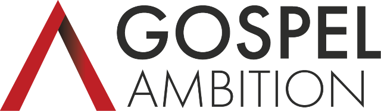

The top of every page. A red band arches across the very top (73px at the edges, 13px in the middle, at 1920px), and the white bar below it holds the logo and the menu. Links are Poppins SemiBold 18px in charcoal, uppercase, about 56px apart. The Give pill is the only red item. The bar has a faint shadow (`--shadow-nav`).

The arch is the design's own curve, drawn with an inline SVG that stretches to the page width.

Below 960px (`--threshold-l`) the links fold away behind a menu button, as on gospelambition.org: three charcoal bars, 48px square, on the right of the logo. Pressed, the bars turn into an X and the links drop below the logo as a full-width list under a thin grey rule, one per row, with the Give pill stretched across the bottom.

## Do

- Keep the menu to four or five short items. The design has About, Tools & trainings, Impact, For your ministry.
- Keep Give as the last link, as a small primary pill: `class="btn" data-variant="primary" data-size="small"`.
- Keep the button's label ("Menu") for screen readers, and point `aria-controls` at the menu's id.

- Wire up the menu button with the script below. It switches `aria-expanded` on the button; the CSS shows or hides the menu from that. Escape and choosing a link close the menu.

## Approximate

- The XD design has no mobile menu. The hamburger follows the live site, gospelambition.org.
- Hover is a proposal: links and the menu button turn red.

## Code

```html
<header class="nav-bar">
  <svg class="nav-bar__arch" viewBox="0 0 1920 73" preserveAspectRatio="none" aria-hidden="true"><path d="M1920 73.3C1920 73.3 1619.9 12.7 962.3 12.7 325.9 12.7 0 73.3 0 73.3V0h1920Z"/></svg>
  <div class="container nav-bar__inner">
    <a class="nav-bar__logo" href="/"></a>
    <button class="nav-bar__toggle" type="button" aria-expanded="false" aria-controls="nav-bar-menu">
      <span class="visually-hidden">Menu</span>
      <span class="nav-bar__bars" aria-hidden="true"><span></span><span></span><span></span></span>
    </button>
    <nav class="nav-bar__menu" id="nav-bar-menu" aria-label="Main">
      <a href="/about/">About</a>
      <a href="/tools/">Tools &amp; trainings</a>
      <a href="/impact/">Impact</a>
      <a href="/for-your-ministry/">For your ministry</a>
      <a class="btn" data-variant="primary" data-size="small" href="/give/">Give</a>
    </nav>
  </div>
</header>
```

```css
.nav-bar { position: relative; background: var(--color-white); box-shadow: var(--shadow-nav); }
.nav-bar__arch { display: block; inline-size: 100%; block-size: auto; aspect-ratio: 1920 / 73; fill: var(--color-red); }
.nav-bar__inner {
  display: flex;
  flex-wrap: wrap;
  align-items: center;
  justify-content: space-between;
  gap: var(--space-xs) var(--space-l);
  padding-block: var(--space-xxs) var(--space-s);
}
.nav-bar__logo {
  display: block;
  flex: none;
  width: clamp(140px, 15.5vw, 300px);
}
.nav-bar__logo img { display: block; inline-size: auto; }
.nav-bar__menu { display: flex; flex-wrap: wrap; align-items: center; column-gap: calc(var(--space-s) * 2); row-gap: var(--space-xs); }
.nav-bar__menu > a:not(.btn) {
  font-size: var(--size-small);
  font-weight: var(--weight-semibold);
  text-transform: uppercase;
  text-decoration: none;
  color: var(--color-text);
}
.nav-bar__menu > a:not(.btn):hover { color: var(--color-red); }
.nav-bar__toggle {
  display: none;
  align-items: center;
  justify-content: center;
  inline-size: var(--space-m);
  block-size: var(--space-m);
  padding: 0;
  color: var(--color-text);
  background: none;
  border: 0;
  cursor: pointer;
}
.nav-bar__toggle:hover { color: var(--color-red); }
.nav-bar__toggle:focus-visible { outline: 2px solid var(--color-red); outline-offset: 2px; }
.nav-bar__bars { display: flex; flex-direction: column; gap: var(--nav-bar-bar-gap, 5px); inline-size: var(--nav-bar-bar-width, 26px); }
.nav-bar__bars > span {
  display: block;
  block-size: 2px;
  background: currentColor;
  transition: transform 0.2s, opacity 0.2s;
}
.nav-bar__toggle[aria-expanded="true"] .nav-bar__bars > span:first-child { transform: translateY(var(--nav-bar-bar-shift, 7px)) rotate(45deg); }
.nav-bar__toggle[aria-expanded="true"] .nav-bar__bars > span:nth-child(2) { opacity: 0; }
.nav-bar__toggle[aria-expanded="true"] .nav-bar__bars > span:last-child { transform: translateY(calc(var(--nav-bar-bar-shift, 7px) * -1)) rotate(-45deg); }
@container (max-width: 60rem) {
  .nav-bar__toggle { display: flex; }
  .nav-bar__menu {
    flex-direction: column;
    align-items: stretch;
    inline-size: 100%;
    gap: 0;
    padding-block-start: var(--space-xxs);
    border-block-start: 1px solid var(--color-grey);
  }
  .nav-bar__menu > a:not(.btn) { padding-block: var(--space-xxs); }
  .nav-bar__menu > .btn { margin-block-start: var(--space-xxs); text-align: center; }
  .nav-bar__toggle[aria-expanded="false"] + .nav-bar__menu { display: none; }
}
@media (prefers-reduced-motion: reduce) { .nav-bar__bars > span { transition: none; } }
```

```js
// site.js: open and close the menu by switching aria-expanded on the button.
const toggle = document.querySelector(".nav-bar__toggle");
const menu = document.getElementById(toggle.getAttribute("aria-controls"));
const setOpen = (open) => toggle.setAttribute("aria-expanded", String(open));
toggle.addEventListener("click", () => setOpen(toggle.getAttribute("aria-expanded") !== "true"));
menu.querySelectorAll("a").forEach((a) => a.addEventListener("click", () => setOpen(false)));
document.addEventListener("keydown", (event) => {
  if (event.key === "Escape" && toggle.getAttribute("aria-expanded") === "true") {
    setOpen(false);
    toggle.focus();
  }
});
```
