Social proof after the tools: "Ministries around the globe use Gospel Ambition tools and trainings." On `.surface-dark`, [tabs](../../components/tabs/) switch between Ministries and Recent Activity, then a white Bold 56px heading and a full-width red panel (`.surface-red`) with 25px corners holding about 40 ministry logos in white, five columns, each at 90% opacity. The logo wall is one vector file (`assets/ministry-logos.svg`), traced from the design.

The "Recent Activity" view isn't designed.

## Do

- Show partner logos in white only, on the red panel. Ask each ministry before adding its logo.
- Follow the section with a [swoosh](../../components/swoosh/) whose `--swoosh-above` is `--color-charcoal`.

## Don't

- Don't copy the tabs onto a page unless you also build the Recent Activity panel and the script that switches them (`role="tabpanel"`, `aria-controls`). Without them, leave the tabs out.
- Don't show partner logos in their own colours here. The wall reads as one block because every logo is white.

## Code

```html
<section class="ministries surface-dark py-xl">
  <div class="container flow">
    <div class="tabs" role="tablist" aria-label="Who uses Gospel Ambition">
      <button class="tabs__tab" type="button" role="tab" aria-selected="true">Ministries</button>
      <button class="tabs__tab" type="button" role="tab" aria-selected="false">Recent Activity</button>
    </div>
    <h2 class="ministries__title">Ministries around the globe use Gospel Ambition tools and trainings.</h2>
    <div class="ministries__panel surface-red">
      
    </div>
  </div>
</section>
```

```css
.ministries .flow { --flow-space: var(--space-xs); }
.ministries__title { max-inline-size: 26em; }
.ministries__panel { --flow-space: var(--space-s); padding: var(--space-xl) var(--space-l); border-radius: var(--radius-lg); }
.ministries__panel img { display: block; inline-size: 100%; }
@container (max-width: 48rem) { .ministries__panel { padding: var(--space-s); } }
```
