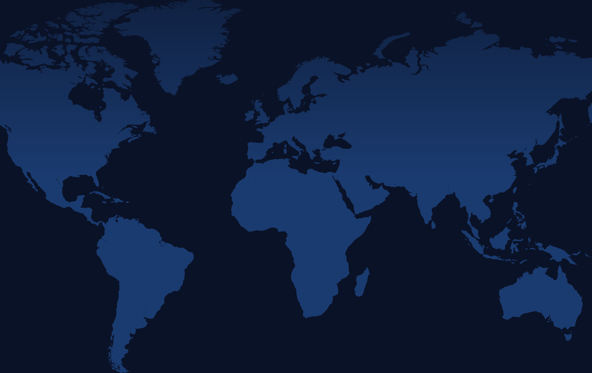
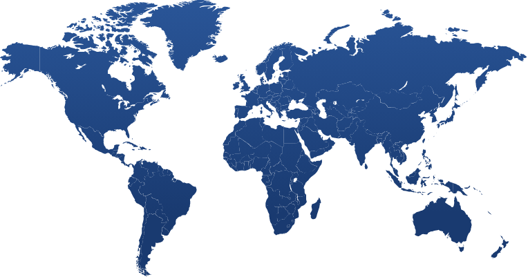
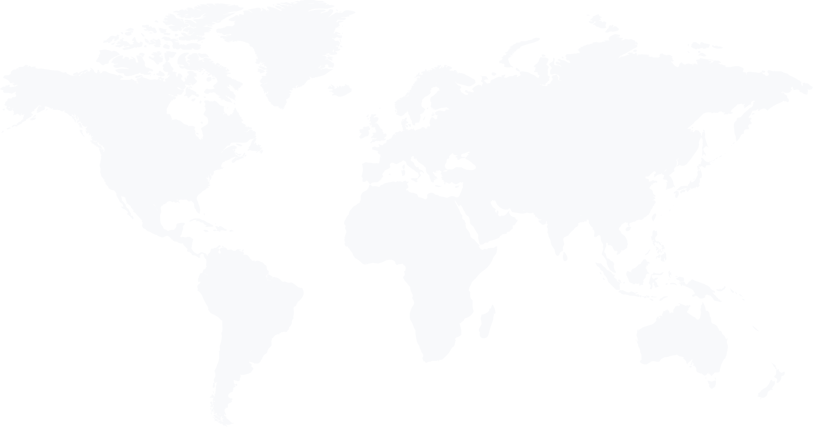
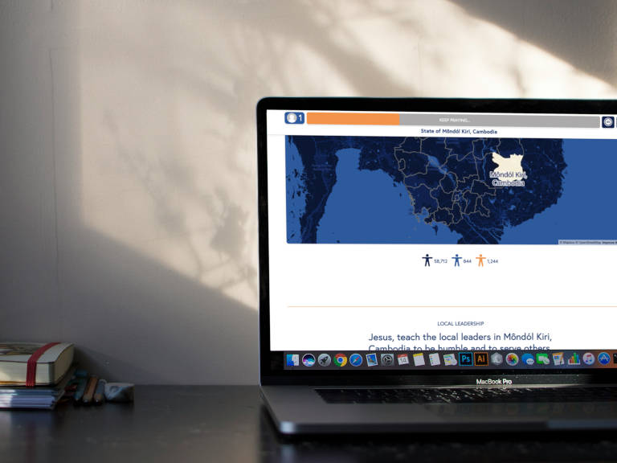
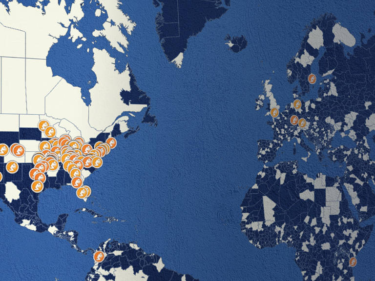

<!-- GENERATED by scripts/generate.mjs from brands/prayer-global/ and system/. Do not edit this file: edit the sources, then run `npm run generate`. -->

# Prayer.Global: resolved brand brief

Bold, hopeful and mission-driven. Navy and orange, all-caps Bebas Kai headings, for mobilising people to pray for every place on earth.

> **Building a page?** Read [`build-a-page.md`](../../build-a-page.md) first and follow its steps. This brief is the reference it points you to.

This file is the whole Prayer.Global brand in one place, with shared composition, components and patterns and Prayer.Global's overrides already merged. Use it to build or review anything for Prayer.Global. Follow it exactly.

## Setup

1. Load the fonts:
   `<link rel="stylesheet" href="assets/fonts/fonts.css">`
   `<link rel="stylesheet" href="assets/fonts/prayer-global-icons.css">`
2. Link `brands/prayer-global/brand.css`. It holds everything below as CSS, in CUBE CSS order: reset, tokens, base, composition, components, patterns, utilities and surfaces.
3. Link the page's own `site.css` after it, for anything the brand doesn't cover.
4. Copy the **HTML** of the examples below and change only the content. Their CSS is already in brand.css: components and patterns are listed here without it, and layout primitives show theirs only so you can see what each setting does. Never copy CSS into a page.

## How to style anything (CUBE CSS)

Reach for these in order, and stop at the first that works:

1. **A pattern** below, as it is.
2. **A pattern or component plus utilities, surfaces and settings**: `class="… py-xl surface-dark"`, `style="--gutter: var(--space-s)"`.
3. **Composition primitives** (flow, cluster, switcher, sidebar, grid, …) holding **components**.
4. **A new block in site.css**, built only from tokens, with a comment saying why 1–3 didn't work.

Variants are exceptions written as data attributes on the block (`class="btn" data-variant="primary"`); states use ARIA or `data-state`. Inline styles may only set a primitive's or component's settings (the custom properties in its Settings table) to tokens. No media queries: layouts respond to their container.

## Utilities

Generated from the tokens. One class, one job.

- Padding on every side.: `.p-xxxs`, `.p-xxs`, `.p-xs`, `.p-s`, `.p-m`, `.p-l`, `.p-xl`, `.p-input-y`, `.p-input-x` (e.g. `.p-xxxs` is `padding: var(--space-xxxs)`)
- Padding left and right.: `.px-xxxs`, `.px-xxs`, `.px-xs`, `.px-s`, `.px-m`, `.px-l`, `.px-xl`, `.px-input-y`, `.px-input-x` (e.g. `.px-xxxs` is `padding-inline: var(--space-xxxs)`)
- Padding top and bottom. The usual way to space a section.: `.py-xxxs`, `.py-xxs`, `.py-xs`, `.py-s`, `.py-m`, `.py-l`, `.py-xl`, `.py-input-y`, `.py-input-x` (e.g. `.py-xxxs` is `padding-block: var(--space-xxxs)`)
- Padding on top.: `.pt-xxxs`, `.pt-xxs`, `.pt-xs`, `.pt-s`, `.pt-m`, `.pt-l`, `.pt-xl`, `.pt-input-y`, `.pt-input-x` (e.g. `.pt-xxxs` is `padding-block-start: var(--space-xxxs)`)
- Padding at the bottom.: `.pb-xxxs`, `.pb-xxs`, `.pb-xs`, `.pb-s`, `.pb-m`, `.pb-l`, `.pb-xl`, `.pb-input-y`, `.pb-input-x` (e.g. `.pb-xxxs` is `padding-block-end: var(--space-xxxs)`)
- Font weight.: `.weight-regular`, `.weight-strong`, `.weight-heading` (e.g. `.weight-regular` is `font-weight: var(--weight-regular)`)
- Font family.: `.font-heading`, `.font-body`, `.font-icons` (e.g. `.font-heading` is `font-family: var(--font-heading)`)
- Line height.: `.leading-body`, `.leading-heading`, `.leading-title`, `.leading-base`, `.leading-tight` (e.g. `.leading-body` is `line-height: var(--leading-body)`)
- Rounded corners.: `.radius-sm`, `.radius-md`, `.radius-box`, `.radius-pill` (e.g. `.radius-sm` is `border-radius: var(--radius-sm)`)
- Shadow.: `.shadow-small`, `.shadow-drop` (e.g. `.shadow-small` is `box-shadow: var(--shadow-small)`)
- Text alignment.: `.text-start`, `.text-center`, `.text-end` (e.g. `.text-start` is `text-align: start`)
- Centres a block that has a width.: `.mx-auto` (`margin-inline: auto`)
- Italic text.: `.italic` (`font-style: italic`)
- Capitals.: `.uppercase` (`text-transform: uppercase`)
- Hides text on screen but keeps it for screen readers, such as a label for an icon-only link.: `.visually-hidden` (`position: absolute; inline-size: 1px; block-size: 1px; padding: 0; margin: -1px; overflow: hidden; clip: rect(0, 0, 0, 0); white-space: nowrap; border: 0`)
- Centres the items of a flex row (a switcher or cluster) vertically.: `.align-items-center` (`align-items: center`)
- How much a switcher child grows compared with its siblings, for unequal columns.: `.grow-1`, `.grow-2`, `.grow-3`, `.grow-4` (e.g. `.grow-1` is `flex-grow: 1`)
- Makes a background image cover the whole block.: `.bg-cover` (`background-size: cover; background-repeat: no-repeat`)

## Text styles

Classes from the base styles for text that isn't a plain heading or paragraph. Use them anywhere, including to give a heading the look of another level.

- `.h2`: `font-size: var(--size-h2-sm); line-height: var(--leading-title)`

## Surfaces

A surface sets a background with the text and link colours that pass contrast on it. Put sections and boxes on a surface instead of picking colours one by one.

- `.surface-default` — White page. Navy-blue text, blue links. Contrast on it: text 11.0:1, link 6.9:1.
- `.surface-brand` — Navy (the site's .brand-bg): the movement band, call-out box, footer and dark nav bar. Contrast on it: text 15.4:1, link 8.8:1.
- `.surface-dark` — Near-black navy (the site's .dark-bg) behind the hero's world map. accent is the light-blue tagline. Contrast on it: text 18.6:1, link 10.6:1, accent 10.6:1.
- `.surface-blue` — Mid blue, for the donate band. The site uses brand-lightest (#5C83C4) here, but white text on it is only 3.8:1, so the surface uses brand-lighter. Contrast on it: text 6.9:1, link 6.9:1.
- `.surface-band` — Dark blue, for feature bands. The Feature band pattern adds the navy-to-orange gradient behind the image side once the columns sit side by side; text never sits on the orange end. Contrast on it: text 13.2:1, link 7.5:1.
- `.surface-wash` — White with a faint grey wash rising from the bottom (the site's .grey-gradient), under the stats. Contrast on it: text 9.1:1, link 5.7:1.

## Icons

- **Prayer.Global icons** — The default set, for everything it covers: share, menu, prayer, relay, streak, world, chevrons, play/pause, settings, profile. Use the icon font, <i class="icon pg-relay"></i>, which takes the text colour and size (see the Icon component). Set data-size="small" (3rem) beside section titles and data-size="nav" (2rem) in the nav bar.
  Source: Custom set from prayer-global-porch (pages/assets/fonts/prayer-global). The font is assets/fonts/prayer-global-icons.css; SVG copies are in assets/icons/pg-*.svg.
  Files: `assets/icons/`
- **Ionicons** — Only for the few symbols the Prayer.Global set lacks. The site uses ion-ios-body (a person), ion-map, ion-happy, ion-sad, ion-android-warning and ion-ellipsis-horizontal; SVGs of those are in assets/icons/ion-*.svg. Size and colour them like the Prayer.Global icons, and never use both sets for the same symbol.
  Source: https://ionic.io/ionicons (the site loads v4.5.6 from cdnjs).
  Files: `assets/icons/`

## Guidelines

> Scraped from https://prayer.global in October 2026. Colours, type and spacing are the values the live site renders. Voice, principles and the do/don't lists are a **draft** inferred from the site's copy. Have the Prayer.Global team confirm them. Components and patterns use the site's own class names and CSS, translated to tokens.

### Voice (draft)

Hopeful, simple and inviting. Prayer.Global makes a huge goal ("cover the world in prayer") feel doable today.

- **Invite, then show how.** "Want to pray globally but don't know where to start? … We'll show you how."
- **Short and energetic.** Short sentences, the odd exclamation mark: "Team up in prayer!"
- **Concrete numbers.** 4,770 states, one "prayer lap", live counts of laps and intercessors. Numbers make the mission tangible.
- **Shared mission.** "You and your friends, small group or church", "every prayer moves us closer to seeing the nations reached".
- **Christian vocabulary, used plainly.** Intercessors, the nations, the lost, the Great Commission. Don't explain it away, and don't stack jargon.
- **Calls to action are verbs in caps:** START PRAYING, CREATE PRAYER RELAY, REGISTER NOW, DONATE.

### Principles (draft)

- **One big next step.** Nearly every section ends with the same orange "Start praying" button. Praying is always one click away.
- **Navy and orange, never black.** Text is navy-blue (`--color-text`), dark areas are navy (`--color-brand`), and the orange gradient is saved for the main action.
- **The world is the backdrop.** World-map imagery sits behind the hero, the intro and the stats.
- **Big, calm, centred.** Large Bebas Kai titles, centred text, a 1.8 line height and 4rem of padding between sections.

### Do

- Use the `cta` button (`class="btn" data-variant="cta"`, the orange-gradient pill) for "Start praying" and other main actions, at most one per section.
- Use Bebas Kai (`--font-heading`) for h1–h3, and Europa for everything else. Bebas Kai is caps-only, so write titles in normal case and let the font do the rest.
- Use the `primary-light` button for secondary actions in feature sections and bands, and the `white` button on navy or blue surfaces.
- Put an icon at the end of section titles: `<i class="icon pg-…" data-size="small" aria-hidden="true">`, in the title's colour.
- Alternate white feature sections with feature bands (`.feature-band.surface-band`) to pace a long page.
- Put every section on a surface: `.surface-default` (white), `.surface-brand` (navy), `.surface-dark` (hero), `.surface-blue` (donate band), `.surface-band` (feature bands) or `.surface-wash` (the grey wash under the stats). Each one sets a background with text and link colours that pass contrast.
- Build new pages from this guide's tokens, composition and components. When adding to an existing site, adapt them to that site's own classes; don't paste the guide's markup in as-is.
- Show the white logo mark only on navy (`.surface-brand`, `.surface-dark`) or on dark photos.

### Don't

- Don't use black or grey for body text. Use a surface: it gives `--color-text` on light and `--color-white` on dark.
- Don't bold Bebas Kai. It has one weight.
- Don't put orange text on white. It fails contrast. Orange is for button fills and the focus outline.
- Don't put two orange CTAs side by side.
- Don't square off buttons. Every button is a pill (`--radius-pill`).

### Known issues on the live site

These are facts from the scrape, recorded so builds don't copy them by accident:

- White text on the orange CTA gradient is 1.7:1 at the top and 3.0:1 at the bottom, and white on `--color-brand-lightest` (the `primary-light` button) is 3.8:1. Both fail WCAG AA for normal text. The site gets by with bold, uppercase, 16px+ labels. Keep labels bold and large, or raise this with the team before relying on it.
- White text on the donate band's `--color-brand-lightest` (#5C83C4) is also 3.8:1, and the band has body-size copy. `.surface-blue` uses `--color-brand-lighter` (6.9:1) instead, a shade darker than the site. To be confirmed by the team.
- The feature band's gradient ends in orange, where white text is 2.3:1. On wide screens the text stays on the navy end, but when the columns stack it runs across the orange. `.surface-band` is plain `--color-band-start`, and the Feature band only draws the gradient once the band is 48rem wide and the columns sit side by side. To be confirmed by the team.
- The site's CSS asks for weight 300 everywhere, but only Europa Regular (400) and Bold (700) exist, so 400 renders. The tokens record what renders.
- The marketing pages have no cards and no tags, so the shared Card and Tag components are excluded for this brand rather than invented.

## Tokens

### color

- `--color-background`: `#FFFFFF` — Page background.
- `--color-text`: `#1A3B70` — Body text and headings (body colour on the site). Same value as brand-light.
- `--color-brand`: `#11224E` — --pg-brand-color. Navy: .surface-brand (dark nav bar, footer, navy sections), text on the white button.
- `--color-brand-light`: `#1A3B70` — --pg-brand-color-light. Body text, outline buttons, rules.
- `--color-brand-lighter`: `#2C599D` — --pg-brand-color-lighter. Links, the primary button, hover on light-blue buttons, checkbox tick, .surface-blue.
- `--color-brand-lightest`: `#5C83C4` — --pg-brand-color-lightest. The primary-light button, link hover, the site's donate band, back-to-top button.
- `--color-brand-highlight`: `#AEC5EB` — --pg-brand-color-highlight. Hero sub-heading, links in the footer.
- `--color-brand-very-light`: `#F1F7FF` — --pg-brand-color-very-light. Pale blue tint.
- `--color-dark`: `#0A1227` — The site's .dark-bg: .surface-dark, the hero background behind the world map.
- `--color-secondary`: `#F2944A` — --pg-secondary-color. Brand orange: the secondary button, focus outline.
- `--color-secondary-lighter`: `#EDAB77` — --pg-secondary-color-lighter.
- `--color-secondary-darker`: `#D28041` — --pg-secondary-color-darker. Hover on the secondary button.
- `--color-grey`: `#ACABAB` — --pg-grey. Form field borders, disabled buttons, list dividers.
- `--color-grey-light`: `#F3F5F8` — --pg-grey-light.
- `--color-white`: `#FFFFFF` — Text on dark sections and on every filled button; outline buttons on dark.
- `--color-orange-top`: `#FFB858` — First stop of --gradient-orange (CTA buttons).
- `--color-orange-bottom`: `#EA7519` — Last stop of --gradient-orange (CTA buttons).
- `--color-blue-top`: `#5A81C0` — First stop of --gradient-blue (the cta-blue button).
- `--color-blue-bottom`: `#3F5B88` — Last stop of --gradient-blue (the cta-blue button).
- `--color-band-start`: `#1D2F57` — First stop of --gradient-blue-orange (feature bands).

### gradient

- `--gradient-orange`: `linear-gradient({color.orange-top}, {color.orange-bottom})` — --orange-gradient. Every cta button.
- `--gradient-blue`: `linear-gradient({color.blue-top}, {color.blue-bottom})` — --blue-gradient. The cta-blue button.
- `--gradient-blue-orange`: `linear-gradient(90deg, {color.band-start}, 60%, {color.secondary})` — --blue-orange-gradient. Feature bands, behind the image side (see Feature band).
- `--gradient-grey`: `linear-gradient(0deg, #0A122718, transparent)` — --grey-gradient. Faint wash rising from the bottom of the stats section.

### shadow

- `--shadow-small`: `rgba(0, 0, 0, 0.1) 0 3px 4px 1px` — --small-box-shadow. Buttons (except CTA) and form fields.
- `--shadow-drop`: `0 4px 2px #0004` — The site's .drop-shadow: filter: drop-shadow(var(--shadow-drop)) on the Image panel.

### font

- `--font-heading`: `'Bebas Kai', Arial, sans-serif` — --pg-font-family-title. h1–h3. Caps-only, one weight.
- `--font-body`: `'Europa', Arial, sans-serif` — --pg-font-family-base. Everything else, including h4, h5 and .font-body headings.
- `--font-icons`: `'PrayerGlobal'` — The icon font. Only for icon glyphs drawn with CSS content (e.g. the topic-link chevron).

### weight

- `--weight-regular`: `400` — Body and headings. The site's CSS says 300, but only Europa Regular (400) ships, so 400 is what renders.
- `--weight-strong`: `700` — Buttons, h4, h5, .weight-strong. The CTA's 600 also renders as this.
- `--weight-heading`: `400` — Bebas Kai's only weight.

### leading

- `--leading-body`: `1.8` — Body text (--bs-body-line-height).
- `--leading-heading`: `1.2` — h1, h3–h5.
- `--leading-title`: `1.1` — h2 and .h2.
- `--leading-base`: `1.5` — Buttons and stats.
- `--leading-tight`: `1` — Icons (.icon).

### size

- `--size-body`: `1.125rem` — Body text, 18px (--bs-body-font-size).
- `--size-small`: `1rem` — Buttons.
- `--size-large`: `1.25rem` — Large buttons (data-size="large"), topic links (20px).
- `--size-footer`: `1.2rem` — Footer text.
- `--size-nav-title`: `1.3rem` — The outlined Prayer.Global title in the nav bar.
- `--size-h1`: `6rem` — h1. 4rem at ≤768px (--size-h1-md), 3rem at ≤576px (--size-h1-sm).
- `--size-h1-md`: `4rem` — h1 at ≤768px.
- `--size-h1-sm`: `3rem` — h1 at ≤576px.
- `--size-h2`: `4rem` — h2 (page and section titles) at ≥768px.
- `--size-h2-sm`: `3rem` — h2 below 768px, and the .h2 class (statement headings) on desktop.
- `--size-h2-xs`: `2.5rem` — .h2 class below 768px.
- `--size-h3`: `2rem` — h3.
- `--size-h4`: `1.8rem` — h4: Europa bold uppercase.
- `--size-h5`: `1.1rem` — h5: Europa bold uppercase.
- `--size-one-em`: `1.5em` — Stat labels, the movement list. 1em at ≤48rem.
- `--size-four-em`: `4em` — Stat numbers. 3rem at ≤48rem.
- `--size-icon`: `3rem` — Icons at data-size="small": beside section titles, topic-link icons, the hero chevron.
- `--size-icon-nav`: `2rem` — Icons at data-size="nav": nav bar icon buttons.
- `--size-hero-title`: `12vh` — Hero h1. 62px below 768px.
- `--size-hero-subtitle`: `6vh` — Hero tagline. 32px below 768px.
- `--size-hero-logo`: `24vh` — Logo mark in the hero.
- `--size-hero-cta`: `3vh` — CTA button in the hero.

### radius

- `--radius-sm`: `5px` — Language switcher button.
- `--radius-md`: `10px` — Form fields, icon buttons.
- `--radius-box`: `0.375rem` — The outlined nav title.
- `--radius-pill`: `100px` — Every button.

### space

- `--space-xxxs`: `0.25rem`
- `--space-xxs`: `0.5rem` — Button padding-y, tight list gaps.
- `--space-xs`: `1rem` — Button padding-x, text-column flow, nav padding.
- `--space-s`: `1.5rem` — Container side padding (gutter 3rem).
- `--space-m`: `2rem` — Default flow, two-column switcher gap.
- `--space-l`: `3rem` — Footer and donate band padding (.py-l).
- `--space-xl`: `4rem` — Section padding (.py-xl), image overlap margin.
- `--space-input-y`: `5px` — Form field padding top and bottom.
- `--space-input-x`: `10px` — Form field padding left and right.

### threshold

- `--threshold-xs`: `27rem` — The site's default switcher threshold (.switcher).
- `--threshold-s`: `36rem` — The site's 576px breakpoint: h1 drops to 3rem, the nav title hides.
- `--threshold-m`: `40rem` — Two-column sections stack below this (the site's .switcher-md).
- `--threshold-l`: `48rem` — The site's 768px breakpoint: h1, h2, stats, icons and the hero change size.
- `--threshold-xl`: `55rem` — Wide two-column sections stack below this (the site's .switcher-lg).

### surface

- `--surface-default-background`: `{color.background}`
- `--surface-default-text`: `{color.text}`
- `--surface-default-link`: `{color.brand-lighter}`
- `--surface-brand-background`: `{color.brand}`
- `--surface-brand-text`: `{color.white}`
- `--surface-brand-link`: `{color.brand-highlight}`
- `--surface-dark-background`: `{color.dark}`
- `--surface-dark-text`: `{color.white}`
- `--surface-dark-link`: `{color.brand-highlight}`
- `--surface-dark-accent`: `{color.brand-highlight}`
- `--surface-blue-background`: `{color.brand-lighter}`
- `--surface-blue-text`: `{color.white}`
- `--surface-blue-link`: `{color.white}`
- `--surface-band-background`: `{color.band-start}`
- `--surface-band-text`: `{color.white}`
- `--surface-band-link`: `{color.brand-highlight}`
- `--surface-wash-background`: `{gradient.grey}`
- `--surface-wash-text`: `{color.text}`
- `--surface-wash-link`: `{color.brand-lighter}`


## Assets

Copied from prayer.global and its repository, [prayer-global-porch](https://github.com/PrayerTools/prayer-global-porch), in October 2026.

> **To obtain:** the master logo files. The site only serves the logo mark in white (PNG) and as an icon-font glyph. We still need the full-colour logo, the navy one-colour logo, any wordmark lockup ("PRAYER.GLOBAL" + mark) and vector (SVG/AI/EPS) masters with usage rules from the Prayer.Global team. Until then, set the wordmark as text in Bebas Kai.

### Logo mark

<div class="ds-on-dark">


</div>

- **File:** `logo-mark-white.png` — 500×500 white mark (a person kneeling in prayer in front of a globe, circled by arrows), transparent background.
- **Use on:** navy only (`--color-brand`, `--color-dark`) or dark photos. The hero shows it at 24vh.
- **Minimum size:** 48px.
- **Clear space:** at least a quarter of its width on every side.
- **Don't:** place it on white or light backgrounds, recolour it, or add effects.


- **File:** `logo-mark.svg` — the same mark as a single-colour vector (from the icon set, `pg-logo-prayer`). Inline it, or use `<i class="icon pg-logo-prayer">`, so it takes the text colour: navy on light backgrounds, white on dark.
- **Note:** this comes from the icon set, not from official logo masters. Confirm with the team before using it as the logo in print.

### Wordmark

There is no wordmark file. The site sets "PRAYER.GLOBAL" as live text in Bebas Kai (the hero `h1`), and as "Prayer.Global" in Europa inside an outlined box in the nav bar.

### Partner logo

<div class="ds-on-dark">


</div>

- **File:** `gospel-ambition-white.png` — Gospel Ambition, the organisation behind Prayer.Global. 1201×352, white.
- **Use on:** the light-blue donate band (`--color-brand-lightest`) or navy, at 135px wide.

### Fonts

- **Folder:** `fonts/` — `fonts.css` loads Europa (Regular 400, Bold 700) and Bebas Kai (one weight) from the woff2/woff files beside it. `prayer-global-icons.css` loads the PrayerGlobal icon font (`PrayerGlobal.woff`, `PrayerGlobal.ttf`) and its `.icon.pg-*` classes. Both are loaded in Setup.
- **Licence:** Europa and Bebas Kai are commercial typefaces, self-hosted on prayer.global. Check the licence covers your project before using them elsewhere.

### Icons

- **Folder:** `icons/` — SVG copies of the icon font (`pg-*.svg`) and the six Ionicons the site uses (`ion-*.svg`). They are single-colour with no fill set; inline them and set `fill: currentColor`. On web pages, prefer the icon font (see the Icon component).

### Backgrounds



- **File:** `world-map-dark.png` — 1899×1198, blue continents on `--color-dark`. The hero background (`background-size: contain`, top).



- **File:** `world-map-blue.png` — 764×401, blue continents on transparent. Beside the stats band heading.



- **File:** `world-map-light.png` — 1869×982, very faint light-blue map on transparent. Background of the intro section and other light sections.

### Photos

- **Folder:** `photos/` — the home page's feature images, for previews and reference: `panel-how-it-works.jpg`, `panel-prayer-fuel.jpg`, `panel-prayer-relays.jpg`, `panel-prayer-activity.jpg` (all about 4:3, for the Image panel), `panel-donate.jpg` (donate band) and `app-phones.png` (two-phone app mockup, resized to 900px wide).

### App store badges

- **Files:** `app-store-badge.svg`, `google-play-badge.png` — the official English badges as used on the site. Use them unchanged and at equal height.

## Composition

### Box

Padding and an optional border around content. Add a surface utility to give it a background. Shared (`system/composition/box.md`).

Every Layout's Box. It only pads and outlines: colours come from a surface (`.surface-*`), so text on it always has enough contrast.

#### Settings

| Property | Default | What it does |
| --- | --- | --- |
| `--box-padding` | `var(--space-m)` | Padding on every side. |
| `--box-border-width` | `0` | Border width. The border takes the text colour. |

#### When to use

- A callout, a panel of related links, a boxed quote. For a full card with an image and actions, use the brand's Card.

#### Code

```html
<div class="box demo-fill" style="--box-border-width: 1px">A box with a border in the text colour.</div>
```

```css
.box {
  padding: var(--box-padding, var(--space-m));
  border: var(--box-border-width, 0) solid currentColor;
  /* Keeps the box visible in Windows high contrast mode, where backgrounds are removed. */
  outline: 1px solid transparent;
  outline-offset: -1px;
}
```

### Center

Centres a block horizontally with a maximum width, such as a readable column of text. Shared (`system/composition/center.md`).

Every Layout's Center. It centres the box itself, not the text inside it.

#### Settings

| Property | Default | What it does |
| --- | --- | --- |
| `--measure` | `60ch` | Maximum width of the content. |
| `--gutter` | `0` | Minimum space on each side on narrow screens. |

Add `data-intrinsic` to also centre the children by their own width, for example a button below a paragraph. Add `data-align="start"` to keep the column at a readable width but on the left, in line with the rest of a left-aligned page.

#### When to use

- A column of article text, a form, a narrow intro inside a wide section.

#### Don't

- Don't use it as the page-width wrapper. That's Container.

#### Code

```html
<div class="center demo-box demo-fill" data-intrinsic>
  <p>A centred column, at most 60 characters wide.</p>
  <span class="demo-box">Intrinsic child</span>
</div>
```

```css
.center {
  box-sizing: content-box;
  max-inline-size: var(--measure, 60ch);
  margin-inline: auto;
  padding-inline: var(--gutter, 0);
}
.center[data-align="start"] { margin-inline: 0; }
.center[data-intrinsic] {
  display: flex;
  flex-direction: column;
  align-items: center;
}
```

### Cluster

A row of items that wraps onto new lines, with even gaps. For tags, buttons, links and icons. Shared (`system/composition/cluster.md`).

Every Layout's Cluster, as used in CUBE CSS.

#### Settings

| Property | Default | What it does |
| --- | --- | --- |
| `--gutter` | `var(--space-s)` | Gap between items, both across and down. |
| `--cluster-horizontal-alignment` | `flex-start` | `justify-content` of the row. |
| `--cluster-vertical-alignment` | `center` | `align-items` of the row. |

#### When to use

- A group of buttons, a row of social links, a list of tags.

#### Don't

- Don't use it for two things pushed to opposite ends. Use Repel.

#### Code

```html
<ul class="cluster" role="list">
  <li class="demo-box">First</li>
  <li class="demo-box">Second item</li>
  <li class="demo-box">Third</li>
  <li class="demo-box">A longer fourth item</li>
  <li class="demo-box">Fifth</li>
</ul>
```

```css
.cluster {
  display: flex;
  flex-wrap: wrap;
  gap: var(--gutter, var(--space-s));
  justify-content: var(--cluster-horizontal-alignment, flex-start);
  align-items: var(--cluster-vertical-alignment, center);
}
```

### Container

The page-width wrapper. Centres a section's content at a maximum width with side padding. Shared (`system/composition/container.md`).

CUBE CSS's wrapper, called `container` here.

#### Settings

| Property | Default | What it does |
| --- | --- | --- |
| `--container-max` | `80rem` | Maximum width of the content. |
| `--gutter` | `var(--space-m)` | Padding on each side, so content never touches the screen edge. |

#### When to use

- Inside every full-width section, so the background runs edge to edge while the content stays at a readable width.

#### Do

- Put the background on the section and the `.container` inside it.

#### Code

```html
<section class="demo-box demo-fill">
  <div class="container demo-box">Content stays within the container's maximum width.</div>
</section>
```

```css
.container {
  position: relative;
  margin-inline: auto;
  max-width: var(--container-max, 80rem);
  padding-inline: var(--gutter, var(--space-m));
}
```

### Cover

A block at least as tall as a minimum height (by default the screen), with one child centred vertically and others pinned to the top and bottom. Shared (`system/composition/cover.md`).

Every Layout's Cover. For a full-screen opening section: the main message sits in the middle, with a small header above it and a "scroll down" link or credits below.

#### Settings

| Property | Default | What it does |
| --- | --- | --- |
| `--cover-min-height` | `100vh` | The least height of the block. Set it to a size token for a shorter block. |
| `--cover-padding` | `var(--space-m)` | Padding on every side. |
| `--cover-gap` | `var(--space-s)` | Least space between the children. |

Mark the child to centre with `data-centre`. Without one, the children stack from the top.

#### When to use

- An opening section with one big message, an event page's title screen, a "coming soon" page.

#### Don't

- Don't put long content in it. If the content is taller than the screen, the block grows and the centring stops meaning anything.

#### Code

```html
<div class="cover demo-box demo-fill" style="--cover-min-height: var(--threshold-s)">
  <p>Small header</p>
  <h2 data-centre>The one centred message</h2>
  <p>Footer line</p>
</div>
```

```css
.cover {
  display: flex;
  flex-direction: column;
  min-block-size: var(--cover-min-height, 100vh);
  padding: var(--cover-padding, var(--space-m));
}
.cover > * { margin-block: var(--cover-gap, var(--space-s)); }
.cover > :first-child:not([data-centre]) { margin-block-start: 0; }
.cover > :last-child:not([data-centre]) { margin-block-end: 0; }
.cover > [data-centre] { margin-block: auto; }
```

### Flow

Even vertical space between the children of an element. Like the shared Flow, but it also clears the children's own top and bottom margins. Brand override (`brands/prayer-global/composition/flow.md`), replaces `system/composition/flow.md`.

Prayer.Global's own flow, from the Composition section of the site's `basic.css`. It replaces the shared Flow because the site's version also clears every child's own top and bottom margins, so headings and paragraphs keep exactly the gap you set.

The site has one class per size (`.flow-xsmall`, `.flow-medium`, `.flow-xmedium`, and `.flow` at 4rem). Here there is one `.flow`, and you set the size with the `--flow-space` setting, to a space token.

#### Settings

| Property | Default | What it does |
| --- | --- | --- |
| `--flow-space` | `var(--space-m)` | Space between each child. Set it on the element or on any child. |

#### When to use

- `style="--flow-space: var(--space-xs)"` (1rem): inside a text column (heading, paragraphs, button).
- No setting (2rem): between groups inside a section.
- `style="--flow-space: var(--space-xl)"` (4rem): between whole sections stacked in one wrapper.

#### Don't

- Don't add margins to the children. Flow owns that space.

#### Code

```html
<div class="flow" style="--flow-space: var(--space-xs)">
  <h3>Flow, extra small</h3>
  <p>1rem between each child.</p>
  <p>Child margins are cleared.</p>
</div>
<div class="flow">
  <h3>Flow, default</h3>
  <p>2rem between each child.</p>
</div>
```

```css
.flow > * { margin-block: 0; }
.flow > * + * { margin-block-start: var(--flow-space, var(--space-m)); }
```

### Frame

Crops an image or video to a fixed aspect ratio, such as 16:9 or square, without stretching it. Shared (`system/composition/frame.md`).

Every Layout's Frame. The frame keeps its ratio at any width and the image inside fills it, cropped rather than squashed.

#### Settings

| Property | Default | What it does |
| --- | --- | --- |
| `--frame-ratio` | `16 / 9` | Width / height. Write it unitless: `4 / 3`, `1`. |
| `--frame-position` | `50% 50%` | Which part of the image stays in view when it is cropped (`object-position`). |

#### When to use

- Photos in cards, video embeds, a row of images that must line up.

#### Do

- Give the image real `alt` text, or `alt=""` if it is decoration. The frame doesn't change what the image means.

#### Code

```html
<div class="frame demo-fill" style="--frame-ratio: 4 / 3">
  
</div>
```

```css
.frame {
  position: relative;
  aspect-ratio: var(--frame-ratio, 16 / 9);
  overflow: hidden;
  display: flex;
  justify-content: center;
  align-items: center;
}
.frame > img,
.frame > video,
.frame > iframe {
  inline-size: 100%;
  block-size: 100%;
  object-fit: cover;
  object-position: var(--frame-position, 50% 50%);
}
```

### Grid

Equal columns that fit as many items per row as there is room for, then wrap. For cards, logos and any list of like items. Shared (`system/composition/grid.md`).

Every Layout's Grid. It fits as many columns as there is room for at a minimum width and wraps the rest, so six cards become 3 + 3 on a wide screen, 2 + 2 + 2 on a tablet and one column on a phone. No media queries.

#### Settings

| Property | Default | What it does |
| --- | --- | --- |
| `--grid-min` | `20rem` | The narrowest a column may get before the grid drops a column. |
| `--gutter` | `var(--space-s)` | Gap between columns and rows. |

#### When to use

- A set of cards, a logo wall, a gallery: any number of items that should all be the same width.

#### Don't

- Don't use it for two to four items that should all stack at once. Use the Switcher.
- Don't put a grid directly in a flex row (a cluster, or a flex wrapper) without giving it a width. It has no intrinsic width, so a shrink-to-fit parent collapses it to one column. Inside a section or `.container` it fills the width by itself.

#### Code

```html
<ul class="grid demo-fill" role="list" style="--grid-min: var(--threshold-s)">
  <li class="demo-box">One</li>
  <li class="demo-box">Two</li>
  <li class="demo-box">Three</li>
  <li class="demo-box">Four</li>
  <li class="demo-box">Five</li>
  <li class="demo-box">Six</li>
</ul>
```

```css
.grid {
  display: grid;
  grid-template-columns: repeat(auto-fit, minmax(min(var(--grid-min, 20rem), 100%), 1fr));
  gap: var(--gutter, var(--space-s));
}
```

### Imposter

Centres one element over another, such as a label over an image or a dialog over the page. Shared (`system/composition/imposter.md`).

Every Layout's Imposter. It sits in the middle of the nearest positioned ancestor (`.container`, `.frame`, or anything with `position: relative`) and never grows bigger than it.

#### Settings

| Property | Default | What it does |
| --- | --- | --- |
| `--imposter-margin` | `0px` | Least space between the imposter and the edges of what it covers. |

Add `data-fixed` to centre it on the screen instead, for a dialog.

#### Do

- Put it inside a positioned parent. Without one it centres on the whole page.

#### Don't

- Don't cover text people need to read with it.

#### Code

```html
<div class="frame demo-fill" style="--frame-ratio: 3">
  
  <p class="imposter demo-box">Centred over the image</p>
</div>
```

```css
.imposter {
  position: absolute;
  inset-block-start: 50%;
  inset-inline-start: 50%;
  transform: translate(-50%, -50%);
  max-inline-size: calc(100% - var(--imposter-margin, 0px) * 2);
  max-block-size: calc(100% - var(--imposter-margin, 0px) * 2);
  overflow: auto;
}
.imposter[data-fixed] { position: fixed; }
```

### Reel

A row that scrolls sideways instead of wrapping, such as a strip of photos or cards. Shared (`system/composition/reel.md`).

Every Layout's Reel. Items stay on one line at their own width and the row scrolls horizontally. Each item snaps into place.

#### Settings

| Property | Default | What it does |
| --- | --- | --- |
| `--reel-item-width` | `auto` | Width of each item. Set it to a size token so cards line up. |
| `--gutter` | `var(--space-s)` | Gap between items. |

#### Do

- Make the reel reachable by keyboard and named for screen readers: `tabindex="0"`, `role="region"` and an `aria-label` saying what is in it.
- Leave part of the next item visible at the edge, so people can see there is more.

#### Don't

- Don't hide important content in a reel. Many people never scroll sideways. Use the Grid when everything must be seen.

#### Code

```html
<ul class="reel demo-fill" role="list" tabindex="0" aria-label="Example items" style="--reel-item-width: var(--threshold-s)">
  <li class="demo-box">One</li>
  <li class="demo-box">Two</li>
  <li class="demo-box">Three</li>
  <li class="demo-box">Four</li>
  <li class="demo-box">Five</li>
</ul>
```

```css
.reel {
  display: flex;
  gap: var(--gutter, var(--space-s));
  overflow-x: auto;
  overflow-y: hidden;
  scroll-snap-type: x mandatory;
  scrollbar-width: thin;
}
.reel > * {
  flex: 0 0 var(--reel-item-width, auto);
  scroll-snap-align: start;
}
.reel > img { block-size: 100%; flex-basis: auto; inline-size: auto; }
```

### Repel

Pushes items to opposite ends of a row, and lets them wrap when there isn't room. Shared (`system/composition/repel.md`).

CUBE CSS's repel composition.

#### Settings

| Property | Default | What it does |
| --- | --- | --- |
| `--gutter` | `var(--space-s)` | Minimum gap between the items, and between lines when they wrap. |
| `--repel-vertical-alignment` | `center` | `align-items` of the row. |

Add `data-nowrap` to keep the items on one line.

#### When to use

- A title with an action at the far end, a logo with a menu button, a button with a partner logo.

#### Code

```html
<div class="repel demo-fill">
  <strong>Left item</strong>
  <span>Right item</span>
</div>
```

```css
.repel {
  display: flex;
  flex-wrap: wrap;
  justify-content: space-between;
  align-items: var(--repel-vertical-alignment, center);
  gap: var(--gutter, var(--space-s));
}
.repel[data-nowrap] { flex-wrap: nowrap; }
```

### Sidebar

A narrow item beside a wide one, such as an image beside text. They stack when the wide one would get too narrow. No media queries. Shared (`system/composition/sidebar.md`).

Every Layout's Sidebar. The first child is the sidebar, with a preferred width. The second child takes the rest of the row, and the two stack as soon as the second would get narrower than `--sidebar-content-min` of the row.

#### Settings

| Property | Default | What it does |
| --- | --- | --- |
| `--sidebar-width` | `20rem` | Preferred width of the sidebar. When stacked it fills the row. |
| `--sidebar-content-min` | `50%` | The narrowest the main item may get before the two stack. |
| `--gutter` | `var(--space-m)` | Gap between the two, across and down. |
| `--sidebar-vertical-alignment` | `stretch` | `align-items` of the row. Use `center` to centre text beside an image. |

Add `data-side="end"` to make the **last** child the sidebar, so the narrow item sits on the right while staying second in the reading order.

#### When to use

- An image or icon beside a paragraph, a form beside its explanation, a list of filters beside results.
- Any two-column layout where the columns should not be equal. For equal columns use the Switcher.

#### Don't

- Don't give it more than two children. Wrap each side in its own element.

#### Code

```html
<div class="sidebar demo-fill" style="--sidebar-width: var(--threshold-s)">
  <div class="demo-box">Sidebar: a photo, an icon, or a short list</div>
  <div class="demo-box">The main content takes the rest of the row, and the two stack when it would get narrower than half the row.</div>
</div>
```

```html
<div class="sidebar demo-fill" data-side="end" style="--sidebar-vertical-alignment: center">
  <div class="demo-box">Main content first in the source, on the left.</div>
  <div class="demo-box">Sidebar on the right</div>
</div>
```

```css
.sidebar {
  display: flex;
  flex-wrap: wrap;
  gap: var(--gutter, var(--space-m));
  align-items: var(--sidebar-vertical-alignment, stretch);
}
/* The sidebar: the first child, or the last with data-side="end". */
.sidebar:not([data-side="end"]) > :first-child,
.sidebar[data-side="end"] > :last-child {
  flex-basis: var(--sidebar-width, 20rem);
  flex-grow: 1;
}
/* The main item takes the rest, and wraps below the sidebar when it would get too narrow. */
.sidebar:not([data-side="end"]) > :last-child,
.sidebar[data-side="end"] > :first-child {
  flex-basis: 0;
  flex-grow: 999;
  min-inline-size: var(--sidebar-content-min, 50%);
}
```

### Switcher

Items sit side by side, and all stack at once when the container gets narrower than a threshold. Stacks below 27rem by default, and can show its items in reverse. Brand override (`brands/prayer-global/composition/switcher.md`), replaces `system/composition/switcher.md`.

Every Layout's Switcher, as on prayer.global. It replaces the shared Switcher in two ways: it stacks below `--threshold-xs` (27rem) by default, as the site does, and `data-reverse` puts the last item first when side by side. It switches on the width of the container, not the viewport, so it works anywhere on the page.

The site's size classes are settings here:

- `.switcher-md` is `style="--threshold: var(--threshold-m); --gutter: var(--space-m)"` (stacks below 40rem, 2rem gap). Most two-column sections on the home page use it.
- `.switcher-lg` is `style="--threshold: var(--threshold-xl); --gutter: var(--space-l)"` (stacks below 55rem, 3rem gap).

#### Settings

| Property | Default | What it does |
| --- | --- | --- |
| `--threshold` | `var(--threshold-xs)` | Container width below which every item stacks. |
| `--gutter` | `var(--space-s)` | Gap between items. |

Add `data-reverse` to show the items in reverse order when side by side, for an image on the left with its text first in the source. Five or more children always stack. The Switcher is for two to four items.

#### When to use

- Two-column sections (text beside an image), a row of three stats, a pair of buttons.

#### Don't

- Don't use it for more than four items. Use a grid.

#### Code

```html
<div class="switcher demo-fill" data-reverse style="--threshold: var(--threshold-m); --gutter: var(--space-m)">
  <div class="demo-box">First in source, shown on the right</div>
  <div class="demo-box">Second in source, shown on the left</div>
</div>
```

```css
.switcher {
  display: flex;
  flex-wrap: wrap;
  gap: var(--gutter, var(--space-s));
}
.switcher[data-reverse] { flex-direction: row-reverse; }
.switcher > * {
  flex-grow: 1;
  flex-basis: calc((var(--threshold, var(--threshold-xs)) - 100%) * 999);
}
.switcher > :nth-last-child(n + 5),
.switcher > :nth-last-child(n + 5) ~ * {
  flex-basis: 100%;
}
```

### With icon

An icon beside a short piece of text, sized to the text's capitals and lined up with it. Shared (`system/composition/with-icon.md`).

Every Layout's Icon, named `with-icon` here because brands have their own `.icon` class for their icon fonts. The icon is as tall as the text's capital letters and sits on the same baseline, at any font size.

#### Settings

| Property | Default | What it does |
| --- | --- | --- |
| `--with-icon-gap` | `0.5em` | Space between the icon and the text. |

#### Do

- Use it for a link or label with an icon: "Download the app", a phone number, a list of features.
- Hide decorative icons from screen readers with `aria-hidden="true"`. If the icon is the only content, give the link an `aria-label` or a `.visually-hidden` label instead.

#### Code

```html
<a class="with-icon" href="/contact/"><svg viewBox="0 0 16 16" aria-hidden="true" fill="currentColor"><circle cx="8" cy="8" r="8" /></svg>Contact us</a>
```

```css
.with-icon {
  display: inline-flex;
  align-items: baseline;
  gap: var(--with-icon-gap, 0.5em);
}
.with-icon > :is(svg, img) {
  flex: none;
  block-size: 0.75em;
  block-size: 1cap;
  inline-size: auto;
}
```

## Components

### Button

Pill-shaped buttons with bold labels. The orange-gradient cta variant is the main action; blue, white, orange and outline pills are for the rest. Brand override (`brands/prayer-global/components/button.md`), replaces `system/components/button.md`. Its CSS is in brand.css (look for `/* brands/prayer-global/components/button.md */`).

The block is `.btn`, and `data-variant` picks the version (a CUBE CSS exception). Variants are named after the colour roles they use. They'll be renamed when the brand's colours get their clean-up.

#### Variants

| `data-variant` | Where the site uses it | Example |
| --- | --- | --- |
| `cta` | The main action. Orange gradient, no shadow. | Start praying |
| `cta-blue` | The main action inside a navy box. Blue gradient. | Login (Prayer Relays page) |
| `primary-light` | Secondary actions in feature sections and bands. | View prayer map, Register now |
| `primary` | Solid blue, already uppercase: dialogs and forms. | Close |
| `primary-dark` | Solid navy. | |
| `secondary` | Solid orange. | |
| `white` | On navy or blue surfaces. | Donate |
| `outline-primary` | Low-emphasis options in a row on white. | Pre-event setup (Events page) |
| `outline-light` | Outline version for navy surfaces. | Information for leaders |

Add `data-size="large"` for larger CTAs (20px labels).

Add the `.uppercase` utility to every variant except `cta`, `cta-blue` and `primary`, which uppercase themselves.

#### Do

- Write labels as short verbs: "Start praying", "Create prayer relay", "Donate".
- Use `<a>` for navigation (most CTAs open another page) and `<button>` for actions.

#### Don't

- Don't put two `cta` buttons side by side.
- Don't expect a hover change on `cta`. The site has none (marked TODO in its CSS).

#### Code

```html
<a class="btn" data-variant="cta" data-size="large" href="/newest/lap/">Start praying</a>
<a class="btn" data-variant="cta" href="/newest/lap/">Start praying</a>
<a class="btn uppercase" data-variant="primary-light" href="/map/">View prayer map</a>
<button class="btn" data-variant="primary" type="button">Close</button>
<a class="btn uppercase" data-variant="primary-dark" href="/about/">Primary dark</a>
<a class="btn uppercase" data-variant="secondary" href="/challenges/">Secondary</a>
<a class="btn py-xxxs" data-variant="outline-primary" href="/events/setup/">Pre-event setup</a>
```

```html
<div class="cluster surface-brand p-s demo-fill">
  <a class="btn" data-variant="cta-blue" data-size="large" href="/login/">Login</a>
  <a class="btn uppercase" data-variant="white" href="/donate/">Donate</a>
  <a class="btn uppercase" data-variant="outline-light" href="/leaders/">Information for leaders</a>
</div>
```

### Icon

The PrayerGlobal icon font. <i class="icon pg-…"> draws an icon in the current text colour; data-size sets the site's sizes. Prayer.Global-only (`brands/prayer-global/components/icon.md`). Its CSS is in brand.css (look for `/* brands/prayer-global/components/icon.md */`).

The live site draws its icons with the PrayerGlobal icon font (`assets/fonts/prayer-global-icons.css`, loaded in Setup). Every icon takes the colour and size of its text. The same icons are also in `assets/icons/pg-*.svg` for places a font can't go, such as image editors or emails.

Available classes: `pg-check`, `pg-chevron-down`, `pg-chevron-left`, `pg-chevron-right`, `pg-chevron-up`, `pg-close`, `pg-cluster`, `pg-community`, `pg-crown`, `pg-give`, `pg-home`, `pg-information`, `pg-logo-prayer`, `pg-menu`, `pg-pause`, `pg-prayer`, `pg-prayerfuel`, `pg-pray-hands-dark`, `pg-pray-hands-light`, `pg-profile`, `pg-question-dark`, `pg-question-light`, `pg-race`, `pg-relay`, `pg-settings`, `pg-share`, `pg-start`, `pg-status`, `pg-streak`, `pg-time`, `pg-world-arrow`, `pg-world-dark`, `pg-world-light`.

#### Sizes

Set the size with `data-size` on the icon. Without it, the icon is the size of its text.

| `data-size` | Size | Used for | Site class |
| --- | --- | --- | --- |
| `nav` | 2rem | Nav bar buttons, the call-out button's chevron | `.two-rem` |
| `small` | 3rem | Beside section titles, topic links, the hero chevron | `.icon-small` |
| `medium` | 4rem (5rem from 48rem wide) | | `.icon-medium` |
| `large` | 6rem (7rem from 48rem wide) | | `.icon-large` |

#### Do

- Put an icon at the end of section titles: `<h2>Prayer relays <i class="icon pg-relay" data-size="small" aria-hidden="true"></i></h2>`.
- Hide decorative icons from screen readers with `aria-hidden="true"`, and give icon-only buttons an `aria-label`.

#### Don't

- Don't mix in Ionicons for a symbol the PrayerGlobal set already has.

#### Code

```html
<i class="icon pg-relay" data-size="small" aria-hidden="true"></i>
<i class="icon pg-pray-hands-light" data-size="small" aria-hidden="true"></i>
<i class="icon pg-logo-prayer" data-size="small" aria-hidden="true"></i>
<i class="icon pg-streak" data-size="small" aria-hidden="true"></i>
<i class="icon pg-share" data-size="nav" aria-hidden="true"></i>
<i class="icon pg-menu" data-size="nav" aria-hidden="true"></i>
```

### Image panel

A photo or screenshot with one flat side and one half-ellipse side, with a soft drop shadow. The signature image shape of the home page. Prayer.Global-only (`brands/prayer-global/components/image-panel.md`). Its CSS is in brand.css (look for `/* brands/prayer-global/components/image-panel.md */`).

On the live site this is an SVG `clipPath` (`#clip-rounded-start` / `#clip-rounded-end`, built in `pages/home/body2.php` for 1024×753 images) on an image inside a `.drop-shadow` wrapper. Its curved side is a half-ellipse with radii of 36.77% of the width and 50% of the height. The border radii below draw exactly the same shape without needing the inline SVG. The block adds the site's drop shadow, and the image overlaps its column by 4rem towards the text, as the site's margins do.

#### Variants

| `data-curve` | Curved side | Use when | Site class |
| --- | --- | --- | --- |
| `start` | Left | The image sits to the right of the text. | `.clip-rounded-start` |
| `end` | Right | The image sits to the left of the text. | `.clip-rounded-end` |

#### When to use

- The image half of a feature section or band ("How it works", "Prayer fuel", "Prayer relays").

#### Do

- Use images at roughly 1024×753 (4:3). The curve was sized for that ratio.
- Describe the image in `alt`, or use `alt=""` if it only decorates.
- Start and end flip by themselves in right-to-left layouts.

#### Don't

- Don't curve both sides or add a border.

#### Code

```html
<div class="switcher demo-fill" style="--gutter: var(--space-xl)">
  <div class="image-panel" data-curve="end"></div>
  <div class="image-panel" data-curve="start"></div>
</div>
```

### Input

Text fields with a 2px grey border, 10px corners and a soft shadow, plus the site's custom checkbox. Brand override (`brands/prayer-global/components/input.md`), replaces `system/components/input.md`. Works with: button, center. Its CSS is in brand.css (look for `/* brands/prayer-global/components/input.md */`).

From the Contact Us form. The site styles fields by type (`input[type="text"]`, `input[type="email"]`, `textarea[type="text"]`…), so plain fields pick up the style with no class. Add `.input` to anything else, such as a `<textarea>` without `type="text"`.

#### When to use

- Short answers in `input`, longer ones in `textarea`.

#### Do

- Put the label text above the field inside the `<label>`, at body size and regular weight, as the contact form does.
- Separate fields with paragraph spacing and put the submit button below.

#### Don't

- Don't use placeholder text as the label.
- Don't go wider than the contact form (600px on the site). Put the form in a Center set to `--measure: var(--threshold-s)` (36rem).

#### Code

```html
<form class="center demo-fill" style="--measure: var(--threshold-s)" action="/contact-us/" method="post">
  <p><label class="field">Name<br /><input type="text" /></label></p>
  <p><label class="field">Email<br /><input type="email" /></label></p>
  <p><label class="field">Question or comment<br /><textarea type="text" rows="4"></textarea></label></p>
  <p><label><input type="checkbox" checked /> Sign up for Prayer.Global news and opportunities</label></p>
  <p><button class="btn uppercase" data-variant="primary-light" type="submit">Submit</button></p>
</form>
```

### Nav bar

Sticky three-column bar. Share and streak on the left, the outlined "Prayer.Global" title in the centre, login and the menu button on the right. Prayer.Global-only (`brands/prayer-global/components/nav-bar.md`). Works with: icon, cluster. Its CSS is in brand.css (look for `/* brands/prayer-global/components/nav-bar.md */`).

From `pages/assets/nav.php`. There are three versions:

- **Dark** (`.surface-brand`): navy. Used on About, Login, Register and Profile.
- **Light** (`.surface-default`): white with navy text. Every other page.
- **Home** (`data-home`, no surface): fixed and transparent with white text over the hero. Set `data-state="scrolled"` from your script once the page scrolls, and it turns navy.

| Site class | Here |
| --- | --- |
| `.navbar-dark` | `.surface-brand` |
| `.white-bg.brand` | `.surface-default` |
| `.navbar-home` | `data-home` |
| `.scrolled` | `data-state="scrolled"` |

#### Do

- Keep the title as plain text in a thin outlined box, linking to the home page. It hides itself when the page is narrower than `--threshold-s` (36rem).
- Put every other link (Map, Prayer Relays, Donate, About) in the off-canvas menu behind the menu button. Only "Login" stays in the bar.

#### Don't

- Don't put the "Start praying" button in the bar.

#### Code

```html
<nav class="pg-navbar surface-brand" aria-label="Main">
  <div class="pg-navbar__inner">
    <div class="cluster">
      <button class="icon-button" type="button" aria-label="Share"><i class="icon pg-share" data-size="nav" aria-hidden="true"></i></button>
      <a class="streak-link" href="/profile/"><i class="icon pg-streak" data-size="nav" aria-hidden="true"></i> 0<span class="visually-hidden"> day prayer streak</span></a>
    </div>
    <h5 class="navbar__title"><a class="navbar__title-link" href="/">Prayer.Global</a></h5>
    <div class="pg-navbar__end">
      <a class="pg-navbar__link" href="/login/">Login</a>
      <button class="icon-button" type="button" aria-label="Menu"><i class="icon pg-menu" data-size="nav" aria-hidden="true"></i></button>
    </div>
  </div>
</nav>
```

```html
<nav class="pg-navbar surface-default" aria-label="Main">
  <div class="pg-navbar__inner">
    <div class="cluster">
      <button class="icon-button" type="button" aria-label="Share"><i class="icon pg-share" data-size="nav" aria-hidden="true"></i></button>
      <a class="streak-link" href="/profile/"><i class="icon pg-streak" data-size="nav" aria-hidden="true"></i> 0<span class="visually-hidden"> day prayer streak</span></a>
    </div>
    <h5 class="navbar__title"><a class="navbar__title-link" href="/">Prayer.Global</a></h5>
    <div class="pg-navbar__end">
      <a class="pg-navbar__link" href="/login/">Login</a>
      <button class="icon-button" type="button" aria-label="Menu"><i class="icon pg-menu" data-size="nav" aria-hidden="true"></i></button>
    </div>
  </div>
</nav>
```

### Stat

A big Bebas Kai number over an uppercase Europa label. Three in a row for live mission figures. Prayer.Global-only (`brands/prayer-global/components/stat.md`). Works with: switcher. Its CSS is in brand.css (look for `/* brands/prayer-global/components/stat.md */`).

From the home page stats ("Current lap status", "Laps completed", "Total intercessors"). The site's markup is `<span class="four-em font-title">` over `<p class="uppercase one-em">` in a `.lh-base.text-center` column.

#### When to use

- Live, real figures that show progress on the mission. Three in a row.

#### Do

- Show real numbers with thousands separators.
- Keep labels to two or three words.

#### Don't

- Don't show unmeasured marketing claims as stats.

#### Code

```html
<div class="switcher demo-fill" style="--threshold: var(--threshold-m); --gutter: var(--space-m)">
  <div class="stat"><span class="stat__value">32%</span><p class="stat__label">Current lap status</p></div>
  <div class="stat"><span class="stat__value">63</span><p class="stat__label">Laps completed</p></div>
  <div class="stat"><span class="stat__value">33,759</span><p class="stat__label">Total intercessors</p></div>
</div>
```

### Topic links

A ruled list of in-page links. Icon on the left, centred uppercase title, chevron on the right. Each one jumps to a section further down. Prayer.Global-only (`brands/prayer-global/components/topic-links.md`). Works with: icon, center. Its CSS is in brand.css (look for `/* brands/prayer-global/components/topic-links.md */`).

From the About page ("Historic moment", "How it works", "Global race", "Moravian prayer challenge"). It looks like an accordion, but each row is a link to a section lower on the page (`.pg-accordion__toggle` in the site's CSS). The chevron comes from the icon font.

#### When to use

- Near the top of a long page made of several topic sections, as a table of contents.

#### Do

- Give every row a Prayer.Global icon that matches its topic.
- Add `data-size="small"` to a row whose title is too long to fit at 20px (16px instead).

#### Don't

- Don't use it for content that should expand in place.

#### Code

```html
<div class="topic-links center demo-fill" style="--measure: var(--threshold-m)">
  <a class="pg-accordion__toggle" href="#historic-moment"><i class="icon pg-time" data-size="small" aria-hidden="true"></i>Historic moment</a>
  <a class="pg-accordion__toggle" href="#how-it-works"><i class="icon pg-question-dark" data-size="small" aria-hidden="true"></i>How it works</a>
  <a class="pg-accordion__toggle" href="#global-race"><i class="icon pg-race" data-size="small" aria-hidden="true"></i>Global race</a>
  <a class="pg-accordion__toggle" href="#prayer-challenge" data-size="small"><i class="icon pg-prayer" data-size="small" aria-hidden="true"></i>Moravian prayer challenge</a>
</div>
```

Not available for Prayer.Global (excluded on purpose, don't build them): card, tag.

## Patterns

### Get the app

A "Get the app" title and the App Store and Google Play badges beside the two-phone mockup. Prayer.Global-only (`brands/prayer-global/patterns/app-download.md`). Works with: center, container, flow, switcher. Its CSS is in brand.css (look for `/* brands/prayer-global/patterns/app-download.md */`).

From the bottom of the home page.

#### When to use

- Near the end of the home page, or on any page about the mobile app.

#### Do

- Use the official badges unchanged (`assets/app-store-badge.svg`, `assets/google-play-badge.png`) and link them to the store listings. The store URLs in the example are placeholders: use the real listing links.

#### Don't

- Don't recolour, crop or redraw the badges. Apple and Google don't allow it.

#### Code

```html
<section class="py-xl">
  <div class="container switcher align-items-center" style="--threshold: var(--threshold-m); --gutter: var(--space-m)">
    <div class="flow">
      <h2 class="text-center">Get the app</h2>
      <div class="center app-badges" data-intrinsic>
        <a href="https://apps.apple.com/"></a>
        <a href="https://play.google.com/store/apps/"></a>
      </div>
    </div>
    <div></div>
  </div>
</section>
```

### Call-out box

A navy box inside the page column with an uppercase h4 question and one blue-gradient CTA with a chevron. Prayer.Global-only (`brands/prayer-global/patterns/callout-band.md`). Works with: button, icon. Its CSS is in brand.css (look for `/* brands/prayer-global/patterns/callout-band.md */`).

"Want to create your own Prayer Relay?" on the Prayer Relays page (`pages/challenges/active-list.php`). The Donate page's "Donate online" box uses the same navy block.

#### When to use

- Once on an inner page, to point at the next step after the intro.

#### Do

- Use the `cta-blue` button so it doesn't compete with an orange CTA on the page.
- Phrase the heading as a question.

#### Don't

- Don't make it full-bleed. It sits inside the content column.

#### Code

```html
<div class="callout-box surface-brand">
  <h4>Want to create your own Prayer Relay?</h4>
  <a class="btn px-l" data-variant="cta-blue" href="/login/">Login <i class="icon pg-chevron-right" data-size="nav" aria-hidden="true"></i></a>
</div>
```

### Donate band

Blue band. Photo on the left; statement heading, short copy, a white Donate button and the Gospel Ambition logo on the right. Prayer.Global-only (`brands/prayer-global/patterns/donate-band.md`). Works with: button, container, flow, repel, switcher. Its CSS is in brand.css (look for `/* brands/prayer-global/patterns/donate-band.md */`).

"Gospel Ambition tools and trainings are 100% free, thanks to people like you." on the home page (`section.brand-lightest-bg.white`). It sits on `.surface-blue`, which is a shade darker than the site's band so the white text passes contrast.

#### When to use

- Once, near the bottom of the home page.

#### Do

- Credit Gospel Ambition with `assets/gospel-ambition-white.png` at 135px wide.
- Use the `white` button for Donate.
- Set the photo with the `--donate-photo` setting, so the image stays content and out of the CSS.

#### Don't

- Don't use the orange CTA here. Praying stays the main action.

#### Code

```html
<section class="surface-blue">
  <div class="container" style="--gutter: 0">
    <div class="switcher" style="--gutter: var(--space-xs)">
      <div class="grow-3 donate-band__photo" style="--donate-photo: url(/brands/prayer-global/assets/photos/panel-donate.jpg)"></div>
      <div class="flow py-l px-s grow-4">
        <h2 class="font-body h2">Gospel Ambition tools and trainings are 100% free, thanks to people like you.</h2>
        <p>We love equipping the global Church with free tools to mobilize prayer and make disciples. You can help expand this mission by becoming a monthly giver or making a one-time gift.</p>
        <div class="repel" style="--gutter: var(--space-xs)">
          <a class="btn uppercase" data-variant="white" href="/donate/">Donate</a>
          <div class="donate-band__logo"></div>
        </div>
      </div>
    </div>
  </div>
</section>
```

### Feature band

Navy-to-orange gradient band. White text with a Bebas Kai title and icon on the left, a clipped image panel on the right. Prayer.Global-only (`brands/prayer-global/patterns/feature-band.md`). Works with: button, icon, image-panel, container, flow, switcher. Its CSS is in brand.css (look for `/* brands/prayer-global/patterns/feature-band.md */`).

"How it works" and "Prayer relays" on the home page (`section.brand-lightest-bg.blue-orange-gradient.py-xl`). Alternate it with the white [Feature section](../feature-section/).

#### When to use

- Every second section on a long page, to break up the white.

#### Do

- Keep the text on the left, over the navy end of the gradient.
- Use the `primary-light` button.
- Put it on `.surface-band`. The gradient only shows once the band is at least `--threshold-l` (48rem) wide, when the columns sit side by side and the text stays on the navy end. Narrower, the columns stack and the band is plain dark blue, because white text on the orange end is only 2.3:1.

#### Don't

- Don't put text over the orange end.
- Don't stack two bands back to back.

#### Code

```html
<section class="feature-band surface-band py-xl">
  <div class="container">
    <div class="switcher align-items-center" style="--threshold: var(--threshold-m); --gutter: var(--space-m)">
      <div class="flow" style="--flow-space: var(--space-xs)">
        <h2 class="text-center">How it works <i class="icon pg-logo-prayer" data-size="small" aria-hidden="true"></i></h2>
        <p>Prayer.Global has broken the world down into 4,770 states based on geographical and governmental boundaries.</p>
        <p>Pray for all 4,770…complete a "prayer lap" around the world!</p>
        <p>An interactive map tracks your prayers in real time.</p>
        <p class="text-center"><a class="btn uppercase px-s" data-variant="primary-light" href="/map/">View prayer map</a></p>
      </div>
      <div class="image-panel" data-curve="start"></div>
    </div>
  </div>
</section>
```

### Feature section

White section. Clipped image panel on the left, Bebas Kai title with icon, short copy and one button on the right. Prayer.Global-only (`brands/prayer-global/patterns/feature-section.md`). Works with: button, icon, image-panel, container, flow, switcher. Its CSS is in brand.css (look for `/* brands/prayer-global/patterns/feature-section.md */`).

"Prayer fuel" and "My prayer activity" on the home page. It's the [Feature band](../feature-band/) on white, with the columns reversed (`data-reverse` on the switcher).

#### When to use

- Introducing one feature with a picture, alternating with feature bands.

#### Do

- Use the image panel with `data-curve="end"` here: the curve faces the text.
- Keep copy to one short paragraph or a list of up to four items.

#### Don't

- Don't put more than one button in the section.

#### Code

```html
<section class="py-xl">
  <div class="container switcher align-items-center" data-reverse style="--threshold: var(--threshold-m); --gutter: var(--space-m)">
    <div class="flow" style="--flow-space: var(--space-xs)">
      <h2 class="text-center">Prayer fuel <i class="icon pg-pray-hands-light" data-size="small" aria-hidden="true"></i></h2>
      <p>We'll give you location specific prayer prompts, scripture and images to help guide your prayers for each of the 4,770 states.</p>
      <p class="text-center"><a class="btn px-s" data-variant="cta" data-size="large" href="/newest/lap/">Start praying</a></p>
    </div>
    <div class="image-panel" data-curve="end"></div>
  </div>
</section>
```

### Footer

Navy, centred. Credit lines, a single column of links, the copyright. Prayer.Global-only (`brands/prayer-global/patterns/footer.md`). Works with: container. Its CSS is in brand.css (look for `/* brands/prayer-global/patterns/footer.md */`).

From `pages/assets/working-footer.php`. The live footer also repeats the app badges between the credits and the links.

#### When to use

- At the bottom of every page.

#### Do

- Keep the three credit lines: Gospel Ambition, Disciple.Tools, Prayer.Tools.
- Make "Donate" bold (`.weight-strong`).
- Put it on `.surface-brand`. Credit links take the surface's light-blue link colour; the page links are white (`.pg-footer__link`).

#### Don't

- Don't add columns or social icons.

#### Code

```html
<footer class="pg-footer surface-brand text-center py-l">
  <div class="container">
    <p>Made with ♥ by <a href="https://gospelambition.org/">Gospel Ambition</a>.<br />Powered by <a href="https://disciple.tools/">Disciple.Tools</a>.<br />Part of the <a href="https://prayer.tools/">Prayer.Tools</a> network.</p>
    <ul role="list" data-tight>
      <li><a class="pg-footer__link" href="/contact-us/">Contact Us</a></li>
      <li><a class="pg-footer__link weight-strong" href="/donate/">Donate</a></li>
      <li><a class="pg-footer__link" href="/about/">About</a></li>
      <li><a class="pg-footer__link" href="/data-sources/">Data Sources</a></li>
      <li><a class="pg-footer__link" href="/media/">Media &amp; Promotion</a></li>
      <li><a href="/privacy/">Privacy</a></li>
    </ul>
    <p class="pt-s">Prayer Global © 2026 Gospel Ambition</p>
  </div>
</footer>
```

### Hero

Full-screen dark world map with the giant "Prayer.Global" title, the light-blue tagline, the white logo mark and one orange CTA. Prayer.Global-only (`brands/prayer-global/patterns/hero.md`). Works with: button, icon, center. Its CSS is in brand.css (look for `/* brands/prayer-global/patterns/hero.md */`).

The home page opens with this (`section.hero` in `pages/home/body2.php`). Sizes use viewport height, so the whole hero fits one screen. Below `--threshold-l` (48rem, the site's 768px) the title and tagline switch to fixed sizes.

#### When to use

- The top of the home page or a campaign landing page. One per page.

#### Do

- Keep to title, tagline, logo mark (`pg-logo-prayer` from the icon font), one `cta` button and the chevron link to the next section.
- Put it on `.surface-dark`. The tagline takes the surface's light-blue `accent`.
- Set the background with the `--hero-image` setting on the section. Copy `assets/world-map-dark.png` into your site and update the URL.
- Use the transparent home nav bar over it (see Nav bar).

#### Don't

- Don't add body copy or a second button.

#### Code

```html
<section class="hero surface-dark" style="--hero-image: url(/brands/prayer-global/assets/world-map-dark.png)">
  <div class="hero__inner">
    <div>
      <h1 class="heading">Prayer.Global</h1>
      <h2 class="sub-heading">Cover the world in prayer</h2>
      <i class="icon pg-logo-prayer heading__logo" role="img" aria-label="Prayer.Global logo"></i>
    </div>
    <div class="center" data-intrinsic>
      <a class="btn" data-variant="cta" href="/newest/lap/">Start praying</a>
      <a class="hero__next" href="#intro" aria-label="Next section"><i class="icon pg-chevron-down" data-size="small" aria-hidden="true"></i></a>
    </div>
  </div>
</section>
```

### Intro section

Centred statement heading in Europa, a few short lines, a quote, and the CTA, over a faint light-blue world map. Prayer.Global-only (`brands/prayer-global/patterns/intro-section.md`). Works with: button, center, container, flow. Its CSS is in brand.css (look for `/* brands/prayer-global/patterns/intro-section.md */`).

The first section under the hero ("Want to pray globally but don't know where to start?").

#### When to use

- Straight after the hero, to say what the site is and invite the first action.

#### Do

- Ask a question in the heading, then answer it in two or three short lines.
- Use `.h2.font-body.weight-strong` for the heading. This is the one bold Europa statement heading.
- Set the faint world map with the `--intro-image` setting.

#### Don't

- Don't write long paragraphs here.

#### Code

```html
<section class="intro-section container py-xl bg-cover" id="intro" style="--intro-image: url(/brands/prayer-global/assets/world-map-light.png)">
  <div class="flow text-center">
    <h2 class="font-body weight-strong h2">Want to pray globally but don't know where to start?</h2>
    <p>Prayer.Global makes praying for the lost simple— and life-changing.</p>
    <p class="italic center">"With this resource, you will be saying prayers you never said before, praying for people you never knew existed, and you and the world will be changed." -Northside CC Pastor</p>
    <p>We'll show you how.</p>
    <p class="weight-strong">Ready…Set…</p>
    <a class="btn" data-variant="cta" data-size="large" href="/newest/lap/">Start praying</a>
  </div>
</section>
```

### Movement band

Navy section with a Bebas Kai title and short text on the left, an uppercase list with prayer icons on the right, and two buttons underneath. Prayer.Global-only (`brands/prayer-global/patterns/movement-band.md`). Works with: button, icon, container, flow, switcher. Its CSS is in brand.css (look for `/* brands/prayer-global/patterns/movement-band.md */`).

"Mobilize a movement of prayer" on the home page (`section.brand-bg.py-xl`), on `.surface-brand`.

#### When to use

- Speaking to leaders and groups (churches, conferences, campuses) about running Prayer.Global together.

#### Do

- Pair a `primary-light` button with an `outline-light` one underneath.
- Use `ul role="list"` so the list shows icons, not bullets.

#### Don't

- Don't use the orange CTA here.

#### Code

```html
<section class="surface-brand py-xl">
  <div class="flow container">
    <div class="switcher" style="--threshold: var(--threshold-m); --gutter: var(--space-m)">
      <div class="flow grow-3">
        <h2>Mobilize a movement of prayer</h2>
        <div>Use Prayer.Global to rally your church, conference, or group around a mission to pray a full lap around the world. Every prayer moves us closer to seeing the nations reached!</div>
      </div>
      <ul role="list" class="movement-list uppercase grow-2">
        <li><i class="icon pg-prayer" aria-hidden="true"></i><span>Churches</span></li>
        <li><i class="icon pg-prayer" aria-hidden="true"></i><span>Conferences</span></li>
        <li><i class="icon pg-prayer" aria-hidden="true"></i><span>Prayer events</span></li>
        <li><i class="icon pg-prayer" aria-hidden="true"></i><span>Campus ministries</span></li>
      </ul>
    </div>
    <span class="switcher" style="--gutter: var(--space-xs)">
      <a class="btn uppercase" data-variant="primary-light" href="/challenges/create/">Create prayer relay</a>
      <a class="btn uppercase" data-variant="outline-light" href="/leaders/">Information for leaders</a>
    </span>
  </div>
</section>
```

### Stats band

The blue world map beside a Europa statement heading, then three live stats and one orange CTA on a faint grey wash. Prayer.Global-only (`brands/prayer-global/patterns/stats-band.md`). Works with: button, stat, container, flow, switcher. Its CSS is in brand.css (look for `/* brands/prayer-global/patterns/stats-band.md */`).

"Join thousands of intercessors praying daily for the nations" on the home page.

#### When to use

- Once per page, near the end, as proof of momentum before the last call to action.

#### Do

- Use real, live numbers. The site loads them from its stats API.
- Write the heading as one sentence in `.h2.font-body`, regular weight.
- Put the stats and the button on `.surface-wash`, the faint grey wash.

#### Don't

- Don't show the band without live data.

#### Code

```html
<section class="flow pt-xl">
  <div class="container switcher align-items-center" style="--threshold: var(--threshold-m); --gutter: var(--space-m)">
    <div></div>
    <h2 class="font-body h2">Join thousands of intercessors praying daily for the nations.</h2>
  </div>
  <div class="flow surface-wash pb-xl">
    <div class="container switcher" style="--threshold: var(--threshold-m); --gutter: var(--space-m)">
      <div class="stat"><span class="stat__value">32%</span><p class="stat__label">Current lap status</p></div>
      <div class="stat"><span class="stat__value">63</span><p class="stat__label">Laps completed</p></div>
      <div class="stat"><span class="stat__value">33,759</span><p class="stat__label">Total intercessors</p></div>
    </div>
    <p class="text-center"><a class="btn px-s" data-variant="cta" data-size="large" href="/newest/lap/">Start praying</a></p>
  </div>
</section>
```

## Base styles (`brands/prayer-global/base.css`)

```css
/* Prayer.Global base element styles. Replaces system/base.css for this brand.
   Load after assets/fonts/fonts.css, assets/fonts/prayer-global-icons.css and tokens.css.
   Based on the rules prayer.global renders, with values as tokens. */
body {
  /* So components can switch size with @container queries at a --threshold-* width, instead of viewport breakpoints. */
  container-type: inline-size;
  margin: 0;
  background: var(--color-background);
  color: var(--color-text);
  font-family: var(--font-body);
  font-size: var(--size-body);
  font-weight: var(--weight-regular);
  line-height: var(--leading-body);
}
h1, h2, h3, h4, h5 {
  font-weight: var(--weight-regular);
  line-height: var(--leading-heading);
  margin: 0 0 var(--space-xxs);
}
h1, h2, h3 { font-family: var(--font-heading); }
h1 { font-size: var(--size-h1); }
h2 { font-size: var(--size-h2-sm); line-height: var(--leading-title); }
h3 { font-size: var(--size-h3); }
h4, h5 { font-family: var(--font-body); font-weight: var(--weight-strong); text-transform: uppercase; }
h4 { font-size: var(--size-h4); }
h5 { font-size: var(--size-h5); margin-bottom: 0; }
/* The site's 768px and 576px breakpoints, as container queries at --threshold-l (48rem) and --threshold-s (36rem). */
@container (width >= 48rem) { h2 { font-size: var(--size-h2); } }
@container (width <= 48rem) { h1 { font-size: var(--size-h1-md); } }
@container (width <= 36rem) { h1 { font-size: var(--size-h1-sm); } }

/* .h2 + .font-body: the big sentence-case Europa heading ("Want to pray globally…"). */
.h2 { font-size: var(--size-h2-sm); line-height: var(--leading-title); }
@container (width <= 48rem) { .h2 { font-size: var(--size-h2-xs); } }

p { margin: 0 0 var(--space-xs); }
a { color: var(--color-brand-lighter); transition: 0.3s all ease; }
a:hover, a:active { color: var(--color-brand-lightest); }

/* Lists use a "●" bullet in the text colour. role="list" removes it. */
ul { list-style: none; margin: 0 0 var(--space-xs); padding: 0; line-height: var(--leading-body); }
ul li { position: relative; }
ul:not([role="list"]) li { padding-left: 1.7em; }
ul li::before { content: "●"; font-size: 1.5em; position: absolute; left: 0; top: 0.1em; line-height: 0.9; }
ul[role="list"] li::before { content: none; }
li + li { margin-top: var(--space-xs); }
[data-tight] > li + li { margin-top: var(--space-xxs); }
[dir="rtl"] ul:not([role="list"]) li { padding-left: 0; padding-right: 1.7em; }
[dir="rtl"] ul li::before { left: auto; right: 0; }

*:focus-visible { box-shadow: none; outline: 2px solid var(--color-secondary); outline-offset: 2px; }
```
