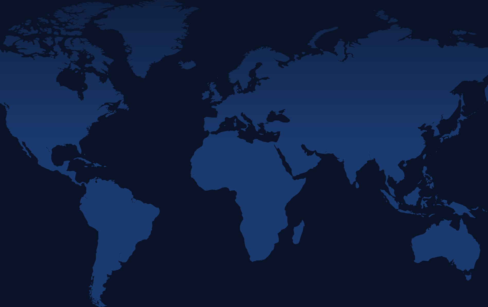
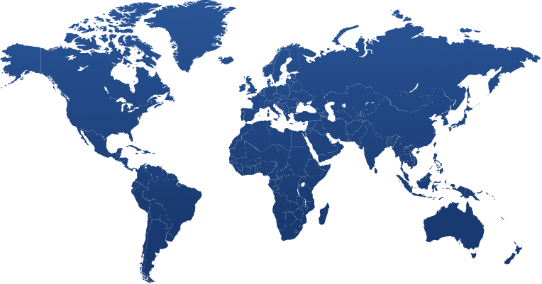
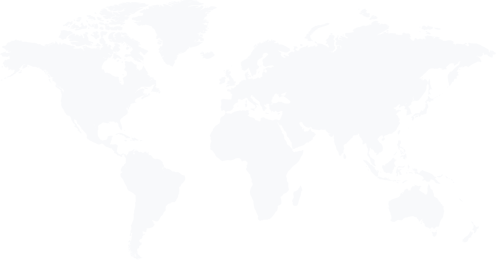

<!-- GENERATED by scripts/generate.mjs from brands/prayer-global/ and system/. Do not edit this file: edit the sources, then run `npm run generate`. -->

# Prayer.Global: resolved brand brief

Bold, hopeful and mission-driven. Navy and orange, all-caps Bebas Kai headings, for mobilising people to pray for every place on earth.

This file is the whole Prayer.Global brand in one place, with shared components and Prayer.Global's overrides already merged. Use it to build or review anything for Prayer.Global. Follow it exactly.

## Setup

1. Load the fonts:
   `<link rel="stylesheet" href="brands/prayer-global/assets/fonts/fonts.css">`
   `<link rel="stylesheet" href="brands/prayer-global/assets/fonts/prayer-global-icons.css">`
2. Load the variables: `brands/prayer-global/tokens.css` (copy also at the end of this file).
3. Load the base element styles: `brands/prayer-global/base.css`.
4. Copy the CSS of each component you use from the Components section. Use only the CSS variables, never raw colours or font names.

## Icons

- **Prayer.Global icons** — The default set, for everything it covers: share, menu, prayer, relay, streak, world, chevrons, play/pause, settings, profile. Use the icon font, <i class="icon pg-relay"></i>, which takes the text colour and size (see the Icon component). icon-small (3rem) beside section titles, two-rem (2rem) in the nav bar.
  Source: Custom set from prayer-global-porch (pages/assets/fonts/prayer-global). The font is assets/fonts/prayer-global-icons.css; SVG copies are in assets/icons/pg-*.svg.
  Files: `assets/icons/`
- **Ionicons** — Only for the few symbols the Prayer.Global set lacks. The site uses ion-ios-body (a person), ion-map, ion-happy, ion-sad, ion-android-warning and ion-ellipsis-horizontal; SVGs of those are in assets/icons/ion-*.svg. Size and colour them like the Prayer.Global icons, and never use both sets for the same symbol.
  Source: https://ionic.io/ionicons (the site loads v4.5.6 from cdnjs).
  Files: `assets/icons/`

## Guidelines

> Scraped from https://prayer.global in October 2026. Colours, type and spacing are the values the live site renders. Voice, principles and the do/don't lists are a **draft** inferred from the site's copy. Have the Prayer.Global team confirm them. Components and patterns use the site's own class names and CSS, translated to tokens.

### Voice (draft)

Hopeful, simple and inviting. Prayer.Global makes a huge goal ("cover the world in prayer") feel doable today.

- **Invite, then show how.** "Want to pray globally but don't know where to start? … We'll show you how."
- **Short and energetic.** Short sentences, the odd exclamation mark: "Team up in prayer!"
- **Concrete numbers.** 4,770 states, one "prayer lap", live counts of laps and intercessors. Numbers make the mission tangible.
- **Shared mission.** "You and your friends, small group or church", "every prayer moves us closer to seeing the nations reached".
- **Christian vocabulary, used plainly.** Intercessors, the nations, the lost, the Great Commission. Don't explain it away, and don't stack jargon.
- **Calls to action are verbs in caps:** START PRAYING, CREATE PRAYER RELAY, REGISTER NOW, DONATE.

### Principles (draft)

- **One big next step.** Nearly every section ends with the same orange "Start praying" button. Praying is always one click away.
- **Navy and orange, never black.** Text is navy-blue (`--color-text`), dark areas are navy (`--color-brand`), and the orange gradient is saved for the main action.
- **The world is the backdrop.** World-map imagery sits behind the hero, the intro and the stats.
- **Big, calm, centred.** Large Bebas Kai titles, centred text, a 1.8 line height and 4rem of padding between sections.

### Do

- Use `.btn-cta` (the orange-gradient pill) for "Start praying" and other main actions, at most one per section.
- Use Bebas Kai (`--font-heading`) for h1–h3, and Europa for everything else. Bebas Kai is caps-only, so write titles in normal case and let the font do the rest.
- Use `.btn-primary-light` for secondary actions in feature sections and bands, and `.btn-white` on navy or light-blue bands.
- Put an icon at the end of section titles: `<i class="icon icon-small pg-…">`, in the title's colour.
- Alternate white feature sections with `.blue-orange-gradient` feature bands to pace a long page.
- Use the site's class names (Layout, Button and Icon components) so markup moves between this guide and prayer.global unchanged.
- Show the white logo mark only on navy (`--color-brand`, `--color-dark`) or on dark photos.

### Don't

- Don't use black or grey for body text. Use `--color-text` on light and `--color-white` on dark.
- Don't bold Bebas Kai. It has one weight.
- Don't put orange text on white. It fails contrast. Orange is for button fills and the focus outline.
- Don't put two orange CTAs side by side.
- Don't square off buttons. Every button is a pill (`--radius-pill`).

### Known issues on the live site

These are facts from the scrape, recorded so builds don't copy them by accident:

- White text on the orange CTA gradient is 1.7:1 at the top and 3.0:1 at the bottom, and white on `--color-brand-lightest` (`.btn-primary-light`) is 3.8:1. Both fail WCAG AA for normal text. The site gets by with bold, uppercase, 16px+ labels. Keep labels bold and large, or raise this with the team before relying on it.
- The site's CSS asks for weight 300 everywhere, but only Europa Regular (400) and Bold (700) exist, so 400 renders. The tokens record what renders.
- The marketing pages have no cards and no tags, so the shared Card and Tag components are excluded for this brand rather than invented.

## Tokens

### color

- `--color-background`: `#FFFFFF` — Page background.
- `--color-text`: `#1A3B70` — Body text and headings (body colour on the site). Same value as brand-light.
- `--color-brand`: `#11224E` — --pg-brand-color. Navy: nav bar on dark pages, footer, .brand-bg sections, text on .btn-white.
- `--color-brand-light`: `#1A3B70` — --pg-brand-color-light. Body text, outline buttons, rules.
- `--color-brand-lighter`: `#2C599D` — --pg-brand-color-lighter. Links, .btn-primary, hover on light-blue buttons, checkbox tick.
- `--color-brand-lightest`: `#5C83C4` — --pg-brand-color-lightest. .btn-primary-light, link hover, donate band, back-to-top button.
- `--color-brand-highlight`: `#AEC5EB` — --pg-brand-color-highlight. Hero sub-heading, links in the footer.
- `--color-brand-very-light`: `#F1F7FF` — --pg-brand-color-very-light. Pale blue tint.
- `--color-dark`: `#0A1227` — .dark-bg. Hero background behind the world map.
- `--color-secondary`: `#F2944A` — --pg-secondary-color. Brand orange: .btn-secondary, focus outline.
- `--color-secondary-lighter`: `#EDAB77` — --pg-secondary-color-lighter.
- `--color-secondary-darker`: `#D28041` — --pg-secondary-color-darker. Hover on .btn-secondary.
- `--color-grey`: `#ACABAB` — --pg-grey. Form field borders, disabled buttons, list dividers.
- `--color-grey-light`: `#F3F5F8` — --pg-grey-light.
- `--color-input-text`: `#6C757D` — Text typed into form fields (Bootstrap gray-600).
- `--color-white`: `#FFFFFF` — Text on dark sections and on every filled button.
- `--color-light`: `#F8F9FA` — Bootstrap light. .btn-outline-light text, border and hover fill.
- `--color-black`: `#000000` — Text on .btn-outline-light when hovered. Nowhere else.
- `--color-orange-top`: `#FFB858` — First stop of --gradient-orange (CTA buttons).
- `--color-orange-bottom`: `#EA7519` — Last stop of --gradient-orange (CTA buttons).
- `--color-blue-top`: `#5A81C0` — First stop of --gradient-blue (.cta-blue).
- `--color-blue-bottom`: `#3F5B88` — Last stop of --gradient-blue (.cta-blue).
- `--color-band-start`: `#1D2F57` — First stop of --gradient-blue-orange (feature bands).

### gradient

- `--gradient-orange`: `linear-gradient({color.orange-top}, {color.orange-bottom})` — --orange-gradient. Every .btn-cta.
- `--gradient-blue`: `linear-gradient({color.blue-top}, {color.blue-bottom})` — --blue-gradient. .btn-cta.cta-blue.
- `--gradient-blue-orange`: `linear-gradient(90deg, {color.band-start}, 60%, {color.secondary})` — --blue-orange-gradient. Feature bands (.blue-orange-gradient).
- `--gradient-grey`: `linear-gradient(0deg, #0A122718, transparent)` — --grey-gradient. Faint wash rising from the bottom of the stats section.

### shadow

- `--shadow-small`: `rgba(0, 0, 0, 0.1) 0 3px 4px 1px` — --small-box-shadow. Buttons (except CTA) and form fields.
- `--shadow-drop`: `0 4px 2px #0004` — .drop-shadow, used as filter: drop-shadow(var(--shadow-drop)) around clipped images.

### font

- `--font-heading`: `'Bebas Kai', Arial, sans-serif` — --pg-font-family-title. h1–h3. Caps-only, one weight.
- `--font-body`: `'Europa', Arial, sans-serif` — --pg-font-family-base. Everything else, including h4, h5 and .font-base headings.
- `--font-icons`: `'PrayerGlobal'` — The icon font. Only for icon glyphs drawn with CSS content (e.g. the topic-link chevron).

### weight

- `--weight-regular`: `400` — Body and headings. The site's CSS says 300, but only Europa Regular (400) ships, so 400 is what renders.
- `--weight-strong`: `700` — Buttons, h4, h5, .font-weight-bold. The CTA's 600 also renders as this.
- `--weight-heading`: `400` — Bebas Kai's only weight.

### leading

- `--leading-body`: `1.8` — Body text (--bs-body-line-height).
- `--leading-heading`: `1.2` — h1, h3–h5 (Bootstrap default).
- `--leading-title`: `1.1` — h2 and .h2.
- `--leading-base`: `1.5` — Buttons and .lh-base (stats).
- `--leading-tight`: `1` — Icons (.icon).

### size

- `--size-body`: `1.125rem` — Body text, 18px (--bs-body-font-size).
- `--size-small`: `1rem` — Buttons.
- `--size-large`: `1.25rem` — .btn-lg, topic links (20px).
- `--size-footer`: `1.2rem` — .one-rem: footer text.
- `--size-nav-title`: `1.3rem` — The outlined Prayer.Global title in the nav bar.
- `--size-h1`: `6rem` — h1. 4rem at ≤768px (--size-h1-md), 3rem at ≤576px (--size-h1-sm).
- `--size-h1-md`: `4rem` — h1 at ≤768px.
- `--size-h1-sm`: `3rem` — h1 at ≤576px.
- `--size-h2`: `4rem` — h2 (page and section titles) at ≥768px.
- `--size-h2-sm`: `3rem` — h2 below 768px, and the .h2 class (statement headings) on desktop.
- `--size-h2-xs`: `2.5rem` — .h2 class below 768px.
- `--size-h3`: `2rem` — h3.
- `--size-h4`: `1.8rem` — h4: Europa bold uppercase.
- `--size-h5`: `1.1rem` — h5: Europa bold uppercase.
- `--size-one-em`: `1.5em` — .one-em: stat labels, the movement list. 1em at ≤768px.
- `--size-four-em`: `4em` — .four-em: stat numbers. 3rem at ≤768px.
- `--size-icon`: `3rem` — .icon-small: icons beside section titles, topic-link icons, the hero chevron.
- `--size-icon-nav`: `2rem` — .two-rem: nav bar icon buttons.
- `--size-hero-title`: `12vh` — Hero h1. 62px below 768px.
- `--size-hero-subtitle`: `6vh` — Hero tagline. 32px below 768px.
- `--size-hero-logo`: `24vh` — Logo mark in the hero.
- `--size-hero-cta`: `3vh` — CTA button in the hero.

### radius

- `--radius-sm`: `5px` — Language switcher button.
- `--radius-md`: `10px` — Form fields, icon buttons.
- `--radius-box`: `0.375rem` — Bootstrap .rounded: the outlined nav title.
- `--radius-pill`: `100px` — Every button.

### space

- `--space-1`: `0.25rem`
- `--space-2`: `0.5rem` — Button padding-y, tight list gaps.
- `--space-3`: `1rem` — Button padding-x, .flow-small, nav padding.
- `--space-4`: `1.5rem` — Container side padding (gutter 3rem).
- `--space-5`: `2rem` — .flow-medium, .switcher-md gap.
- `--space-6`: `3rem` — Footer padding (py-5).
- `--space-7`: `4rem` — Section padding (.py-6), image overlap margin.
- `--space-input-y`: `5px` — Form field padding top and bottom.
- `--space-input-x`: `10px` — Form field padding left and right.


## Assets

Copied from prayer.global and its repository, [prayer-global-porch](https://github.com/PrayerTools/prayer-global-porch), in October 2026.

> **To obtain:** the master logo files. The site only serves the logo mark in white (PNG) and as an icon-font glyph. We still need the full-colour logo, the navy one-colour logo, any wordmark lockup ("PRAYER.GLOBAL" + mark) and vector (SVG/AI/EPS) masters with usage rules from the Prayer.Global team. Until then, set the wordmark as text in Bebas Kai.

### Logo mark

<div class="ds-on-dark">


</div>

- **File:** `logo-mark-white.png` — 500×500 white mark (a person kneeling in prayer in front of a globe, circled by arrows), transparent background.
- **Use on:** navy only (`--color-brand`, `--color-dark`) or dark photos. The hero shows it at 24vh.
- **Minimum size:** 48px.
- **Clear space:** at least a quarter of its width on every side.
- **Don't:** place it on white or light backgrounds, recolour it, or add effects.


- **File:** `logo-mark.svg` — the same mark as a single-colour vector (from the icon set, `pg-logo-prayer`). Inline it, or use `<i class="icon pg-logo-prayer">`, so it takes the text colour: navy on light backgrounds, white on dark.
- **Note:** this comes from the icon set, not from official logo masters. Confirm with the team before using it as the logo in print.

### Wordmark

There is no wordmark file. The site sets "PRAYER.GLOBAL" as live text in Bebas Kai (the hero `h1`), and as "Prayer.Global" in Europa inside an outlined box in the nav bar.

### Partner logo

<div class="ds-on-dark">


</div>

- **File:** `gospel-ambition-white.png` — Gospel Ambition, the organisation behind Prayer.Global. 1201×352, white.
- **Use on:** the light-blue donate band (`--color-brand-lightest`) or navy, at 135px wide.

### Fonts

- **Folder:** `fonts/` — `fonts.css` loads Europa (Regular 400, Bold 700) and Bebas Kai (one weight) from the woff2/woff files beside it. `prayer-global-icons.css` loads the PrayerGlobal icon font (`PrayerGlobal.woff`, `PrayerGlobal.ttf`) and its `.icon.pg-*` classes. Both are loaded in Setup.
- **Licence:** Europa and Bebas Kai are commercial typefaces, self-hosted on prayer.global. Check the licence covers your project before using them elsewhere.

### Icons

- **Folder:** `icons/` — SVG copies of the icon font (`pg-*.svg`) and the six Ionicons the site uses (`ion-*.svg`). They are single-colour with no fill set; inline them and set `fill: currentColor`. On web pages, prefer the icon font (see the Icon component).

### Backgrounds



- **File:** `world-map-dark.png` — 1899×1198, blue continents on `--color-dark`. The hero background (`background-size: contain`, top).



- **File:** `world-map-blue.png` — 764×401, blue continents on transparent. Beside the stats band heading.



- **File:** `world-map-light.png` — 1869×982, very faint light-blue map on transparent. Background of the intro section and other light sections.

### Photos

- **Folder:** `photos/` — the home page's feature images, for previews and reference: `panel-how-it-works.jpg`, `panel-prayer-fuel.jpg`, `panel-prayer-relays.jpg`, `panel-prayer-activity.jpg` (all about 4:3, for `.clip-rounded-*`), `panel-donate.jpg` (donate band) and `app-phones.png` (two-phone app mockup, resized to 900px wide).

### App store badges

- **Files:** `app-store-badge.svg`, `google-play-badge.png` — the official English badges as used on the site. Use them unchanged and at equal height.

## Components

### Button

Bootstrap .btn restyled as a pill with bold labels. The orange-gradient .btn-cta is the main action; blue, white, orange and outline pills are for the rest. Brand override (`brands/prayer-global/components/button.md`), replaces `system/components/button.md`.

Class names are the live site's own (Bootstrap 5.2 plus prayer-global-porch overrides), so markup copied from prayer.global keeps working.

#### Variants

| Class | Where the site uses it | Example |
| --- | --- | --- |
| `.btn-cta` | The main action. Orange gradient, no shadow. | Start praying |
| `.btn-cta.cta-blue` | The main action inside a navy box. | Login (Prayer Relays page) |
| `.btn-primary-light` | Secondary actions in feature sections and bands. | View prayer map, Register now |
| `.btn-primary` | Solid blue, already uppercase: dialogs and forms. | Close |
| `.btn-primary-dark` | Solid navy. | |
| `.btn-secondary` | Solid orange. | |
| `.btn-white` | On navy or light-blue bands. | Donate |
| `.btn-outline-primary` | Low-emphasis options in a row on white. | Pre-event setup (Events page) |
| `.btn-outline-light` | Outline version for navy sections. | Information for leaders |

Add `.uppercase` to every variant except `.btn-cta` and `.btn-primary`, which uppercase themselves. Add `.btn-lg` for larger CTAs.

#### Do

- Write labels as short verbs: "Start praying", "Create prayer relay", "Donate".
- Use `<a>` for navigation (most CTAs open another page) and `<button>` for actions.

#### Don't

- Don't put two `.btn-cta` side by side.
- Don't expect a hover change on `.btn-cta`. The site has none (marked TODO in its CSS).

#### Code

```html
<a class="btn btn-cta btn-lg" href="#">Start praying</a>
<a class="btn btn-cta" href="#">Start praying</a>
<a class="btn btn-primary-light uppercase" href="#">View prayer map</a>
<button class="btn btn-primary" type="button">Close</button>
<a class="btn btn-secondary uppercase" href="#">Secondary</a>
<a class="btn btn-outline-primary py-1" href="#">Pre-event setup</a>
```

```html
<div class="brand-bg white" style="padding: 1.5rem; display: flex; gap: 1rem; flex-wrap: wrap; align-items: center">
  <a class="btn btn-cta cta-blue btn-lg" href="#">Login</a>
  <a class="btn btn-white uppercase" href="#">Donate</a>
  <a class="btn btn-outline-light uppercase" href="#">Information for leaders</a>
  <a class="btn btn-primary-dark uppercase" href="#">Primary dark</a>
</div>
```

```css
.btn {
  --btn-color: var(--color-white);
  --btn-bg: transparent;
  --btn-border: transparent;
  --btn-hover-color: var(--btn-color);
  --btn-hover-bg: var(--btn-bg);
  --btn-hover-border: var(--btn-border);
  display: inline-block;
  padding: var(--space-2) var(--space-3);
  font-family: var(--font-body);
  font-size: var(--size-small);
  font-weight: var(--weight-strong);
  line-height: var(--leading-base);
  color: var(--btn-color);
  background-color: var(--btn-bg);
  border: 1px solid var(--btn-border);
  border-radius: var(--radius-pill);
  box-shadow: var(--shadow-small);
  text-align: center;
  text-decoration: none;
  vertical-align: middle;
  cursor: pointer;
  user-select: none;
  transition: color 0.15s ease-in-out, background-color 0.15s ease-in-out, border-color 0.15s ease-in-out, box-shadow 0.15s ease-in-out;
}
.btn:hover { color: var(--btn-hover-color); background-color: var(--btn-hover-bg); border-color: var(--btn-hover-border); }
.btn:focus-visible { box-shadow: none; outline: 2px solid var(--color-secondary); outline-offset: 2px; }
.btn:disabled { --btn-bg: var(--color-grey); --btn-border: var(--color-grey); opacity: 0.65; pointer-events: none; }
.btn-lg { font-size: var(--size-large); }
.py-1 { padding-top: var(--space-1); padding-bottom: var(--space-1); }

.btn-cta {
  --btn-hover-bg: transparent;
  background-image: var(--gradient-orange);
  text-transform: uppercase;
  padding: 0.4em 1.5em;
  box-shadow: none;
  border: none;
}
.cta-blue { background-image: var(--gradient-blue); --btn-hover-color: var(--color-brand-highlight); }
.btn-primary { --btn-bg: var(--color-brand-lighter); --btn-hover-bg: var(--color-brand-light); border: none; text-transform: uppercase; }
.btn-primary-light { --btn-bg: var(--color-brand-lightest); --btn-hover-bg: var(--color-brand-lighter); border: none; }
.btn-primary-dark { --btn-bg: var(--color-brand); --btn-hover-bg: var(--color-brand-light); border: none; }
.btn-secondary { --btn-bg: var(--color-secondary); --btn-hover-bg: var(--color-secondary-darker); border: none; }
.btn-white { --btn-color: var(--color-brand); --btn-bg: var(--color-white); --btn-hover-color: var(--color-white); --btn-hover-bg: var(--color-brand-lighter); border: none; }
.btn-outline-primary { --btn-color: var(--color-brand-light); --btn-border: var(--color-brand-light); --btn-hover-color: var(--color-white); --btn-hover-bg: var(--color-brand-light); }
.btn-outline-light { --btn-color: var(--color-light); --btn-border: var(--color-light); --btn-hover-color: var(--color-black); --btn-hover-bg: var(--color-light); }
```

### Icon

The PrayerGlobal icon font. <i class="icon pg-…"> draws an icon in the current text colour; size classes match the site. Prayer.Global-only (`brands/prayer-global/components/icon.md`).

The live site draws its icons with the PrayerGlobal icon font (`assets/fonts/prayer-global-icons.css`, loaded in Setup). Every icon takes the colour and size of its text. The same icons are also in `assets/icons/pg-*.svg` for places a font can't go, such as image editors or emails.

Available classes: `pg-check`, `pg-chevron-down`, `pg-chevron-left`, `pg-chevron-right`, `pg-chevron-up`, `pg-close`, `pg-cluster`, `pg-community`, `pg-crown`, `pg-give`, `pg-home`, `pg-information`, `pg-logo-prayer`, `pg-menu`, `pg-pause`, `pg-prayer`, `pg-prayerfuel`, `pg-pray-hands-dark`, `pg-pray-hands-light`, `pg-profile`, `pg-question-dark`, `pg-question-light`, `pg-race`, `pg-relay`, `pg-settings`, `pg-share`, `pg-start`, `pg-status`, `pg-streak`, `pg-time`, `pg-world-arrow`, `pg-world-dark`, `pg-world-light`.

#### Sizes

| Class | Size | Used for |
| --- | --- | --- |
| `.two-rem` | 2rem | Nav bar buttons |
| `.icon-small` | 3rem | Beside section titles, topic links, the hero chevron |
| `.icon-medium` | 4rem (5rem from 768px) | |
| `.icon-large` | 6rem (7rem from 768px) | |

#### Do

- Put an icon at the end of section titles: `<h2>Prayer relays <i class="icon icon-small pg-relay"></i></h2>`.
- Hide decorative icons from screen readers with `aria-hidden="true"`, and give icon-only buttons an `aria-label`.

#### Don't

- Don't mix in Ionicons for a symbol the PrayerGlobal set already has.

#### Code

```html
<i class="icon icon-small pg-relay" aria-hidden="true"></i>
<i class="icon icon-small pg-pray-hands-light" aria-hidden="true"></i>
<i class="icon icon-small pg-logo-prayer" aria-hidden="true"></i>
<i class="icon icon-small pg-streak" aria-hidden="true"></i>
<i class="icon two-rem pg-share" aria-hidden="true"></i>
<i class="icon two-rem pg-menu" aria-hidden="true"></i>
```

```css
.two-rem { font-size: var(--size-icon-nav); }
.icon-small { font-size: var(--size-icon); }
.icon-medium { font-size: 4rem; }
.icon-large { font-size: 6rem; }
@media (min-width: 768px) {
  .icon-medium { font-size: 5rem; }
  .icon-large { font-size: 7rem; }
}
```

### Image panel

A photo or screenshot with one flat side and one half-ellipse side, with a soft drop shadow. The signature image shape of the home page. Prayer.Global-only (`brands/prayer-global/components/image-panel.md`).

On the live site this is an SVG `clipPath` (`#clip-rounded-start` / `#clip-rounded-end`, built in `pages/home/body2.php` for 1024×753 images). Its curved side is a half-ellipse with radii of 36.77% of the width and 50% of the height. The border radii below draw exactly the same shape without needing the inline SVG. The wrapper adds the site's `.drop-shadow`, and the image overlaps its column by 4rem towards the text, as the site's margins do.

#### When to use

- The image half of a feature section or band ("How it works", "Prayer fuel", "Prayer relays").

#### Do

- Use `.clip-rounded-start` (curve on the left) when the image sits to the right of the text, and `.clip-rounded-end` when it sits to the left.
- Use images at roughly 1024×753 (4:3). The curve was sized for that ratio.
- Flip start and end in right-to-left layouts.

#### Don't

- Don't curve both sides or add a border.

#### Code

```html
<div class="drop-shadow" style="max-width: 24rem"></div>
<div class="drop-shadow" style="max-width: 24rem"></div>
```

```css
.drop-shadow { filter: drop-shadow(var(--shadow-drop)); }
.clip-rounded-start, .clip-rounded-end { display: block; max-width: 100%; aspect-ratio: 1024 / 753; object-fit: cover; }
.clip-rounded-start { border-radius: 36.768% 0 0 36.768% / 50% 0 0 50%; margin-left: var(--space-7); }
.clip-rounded-end { border-radius: 0 36.768% 36.768% 0 / 0 50% 50% 0; margin-left: calc(-1 * var(--space-7)); }
[dir="rtl"] .clip-rounded-start { border-radius: 0 36.768% 36.768% 0 / 0 50% 50% 0; margin-left: 0; margin-right: var(--space-7); }
[dir="rtl"] .clip-rounded-end { border-radius: 36.768% 0 0 36.768% / 50% 0 0 50%; margin-left: 0; margin-right: calc(-1 * var(--space-7)); }
```

### Input

Text fields with a 2px grey border, 10px corners and a soft shadow, plus the site's custom checkbox. Brand override (`brands/prayer-global/components/input.md`), replaces `system/components/input.md`. Also needs the CSS from: button.

From the Contact Us form. The site styles fields by type (`input[type="text"]`, `input[type="email"]`, `textarea[type="text"]`…), so plain fields pick up the style with no class. Add `.input` to anything else, such as a `<textarea>` without `type="text"`.

#### When to use

- Short answers in `input`, longer ones in `textarea`.

#### Do

- Put the label text above the field inside the `<label>`, at body size and regular weight, as the contact form does.
- Separate fields with paragraph spacing and put the submit button below.

#### Don't

- Don't use placeholder text as the label.
- Don't go wider than 600px. The contact form is capped there.

#### Code

```html
<form style="max-width: 600px; width: 100%">
  <p><label class="field">Name<br /><input type="text" /></label></p>
  <p><label class="field">Email<br /><input type="email" /></label></p>
  <p><label class="field">Question or comment<br /><textarea type="text" rows="4"></textarea></label></p>
  <p><label><input type="checkbox" checked /> Sign up for Prayer.Global news and opportunities</label></p>
  <p><button class="btn btn-primary-light uppercase" type="submit">Submit</button></p>
</form>
```

```css
.field { display: block; width: 100%; }
.field input, .field textarea { width: 100%; box-sizing: border-box; }
input[type="text"], input[type="email"], input[type="password"], input[type="number"], input[type="date"], input[type="time"],
textarea[type="text"], .input {
  font: inherit;
  border: 2px solid var(--color-grey);
  border-radius: var(--radius-md);
  padding: var(--space-input-y) var(--space-input-x);
  box-shadow: var(--shadow-small);
  color: var(--color-input-text);
  background-color: var(--color-white);
}
input[type="checkbox"]:not([role="switch"]) {
  --checkbox-color: currentColor;
  --checkbox-tick: var(--color-brand-lighter);
  appearance: none;
  -webkit-appearance: none;
  background-color: var(--color-white);
  margin: 0;
  font: inherit;
  color: var(--checkbox-color);
  width: 1.15em;
  height: 1.15em;
  border: 0.15em solid var(--checkbox-color);
  border-radius: 0.25em;
  display: inline-grid;
  place-content: center;
  vertical-align: -0.15em;
}
input[type="checkbox"]:not([role="switch"])::before {
  content: "";
  width: 0.65em;
  height: 0.65em;
  transform: scale(0);
  transition: 120ms transform ease-in-out;
  box-shadow: inset 1em 1em var(--checkbox-tick);
  border-radius: 0.15em;
  transform-origin: bottom left;
  clip-path: polygon(14% 44%, 0 65%, 50% 100%, 100% 16%, 80% 0%, 43% 62%);
}
input[type="checkbox"]:not([role="switch"]):checked::before { transform: scale(1); }
input[type="checkbox"]:not([role="switch"]):disabled { --checkbox-color: var(--color-grey); --checkbox-tick: var(--color-grey); }
input[type="checkbox"]:not([role="switch"]):focus { outline: max(2px, 0.15em) solid var(--checkbox-color); outline-offset: max(2px, 0.15em); }
```

### Layout

The site's layout primitives. .container for page width, .switcher for side-by-side columns that stack on narrow screens, .flow-* for vertical rhythm, .center and .cluster. Prayer.Global-only (`brands/prayer-global/components/layout.md`).

From prayer-global-porch `basic.css` ("Composition", based on Every Layout) and Bootstrap's `.container`. Every section and pattern is built from these.

| Class | What it does |
| --- | --- |
| `.container` | Centres content at Bootstrap widths (540 / 720 / 960 / 1140 / 1320px). `data-gutter-4` gives 1.5rem side padding. |
| `.switcher` | Children sit side by side and all stack once the container is narrower than `--switcher-width` (27rem; 40rem with `.switcher-md`). `.switcher-reverse` flips the order. |
| `.flow-small` / `.flow-medium` | 1rem / 2rem between children. |
| `.center` | A centred column. |
| `.cluster` | A wrapping row with 1rem gaps. |
| `.py-6` | 4rem section padding top and bottom. |

#### Do

- Wrap section content in `.container`, and two-column content in `.switcher.switcher-md`.

#### Code

```html
<div class="container" data-gutter-4 style="outline: 1px dashed currentColor">
  <div class="switcher switcher-md">
    <div class="flow-small"><h3>Column one</h3><p>Sits beside column two on wide screens.</p></div>
    <div class="flow-small"><h3>Column two</h3><p>Stacks under column one when narrow.</p></div>
  </div>
</div>
```

```css
.container { width: 100%; padding-inline: 0.75rem; margin-inline: auto; box-sizing: border-box; }
.container[data-gutter-4] { padding-inline: var(--space-4); }
.container[data-no-gutter] { padding-inline: 0; }
@media (min-width: 576px) { .container { max-width: 540px; } }
@media (min-width: 768px) { .container { max-width: 720px; } }
@media (min-width: 992px) { .container { max-width: 960px; } }
@media (min-width: 1200px) { .container { max-width: 1140px; } }
@media (min-width: 1400px) { .container { max-width: 1320px; } }

.switcher { display: flex; flex-wrap: wrap; gap: var(--space, 1rem); }
.switcher > * { flex-grow: 1; flex-basis: calc((var(--switcher-width, 27rem) - 100%) * 999); }
.switcher > :nth-last-child(n + 5), .switcher > :nth-last-child(n + 5) ~ * { flex-basis: 100%; }
.switcher-md { --switcher-width: 40rem; --space: 2rem; }
.switcher-reverse { flex-direction: row-reverse; }

.flow-small > *, .flow-medium > * { margin-top: 0; margin-bottom: 0; }
.flow-small > * + * { margin-top: var(--space-3); }
.flow-medium > * + * { margin-top: var(--space-5); }

.center { display: flex; flex-direction: column; align-items: center; }
.cluster { display: flex; gap: var(--space-3); align-items: center; justify-content: flex-start; flex-wrap: wrap; }
.text-center { text-align: center; }
.align-items-center { align-items: center; }
.w-fit { width: fit-content; }
.mx-auto { margin-inline: auto; }
.py-6 { padding-top: var(--space-7); padding-bottom: var(--space-7); }
.pt-6 { padding-top: var(--space-7); }
.pb-6 { padding-bottom: var(--space-7); }
.grow-2 { flex-grow: 2; }
.grow-3 { flex-grow: 3; }
.grow-4 { flex-grow: 4; }
```

### Nav bar

Sticky three-column bar. Share and streak on the left, the outlined "Prayer.Global" title in the centre, login and the menu button on the right. Prayer.Global-only (`brands/prayer-global/components/nav-bar.md`). Also needs the CSS from: icon, layout.

From `pages/assets/nav.php`. There are three versions:

- **Home** (`.navbar-home.navbar-dark` + `data-home`): fixed and transparent over the hero, turning navy (`.scrolled`) once the page scrolls.
- **Dark** (`.navbar-dark`): navy. Used on About, Login, Register and Profile.
- **Light** (`.white-bg.brand`): white with navy text. Every other page.

#### Do

- Keep the title as plain text in a thin outlined box, linking to the home page. It hides itself below 576px.
- Put every other link (Map, Prayer Relays, Donate, About) in the off-canvas menu behind the menu button. Only "Login" stays in the bar.

#### Don't

- Don't put the "Start praying" button in the bar.

#### Code

```html
<nav class="pg-navbar navbar-dark" aria-label="Main">
  <div class="pg-navbar__inner">
    <div class="cluster">
      <button class="icon-button two-rem" type="button" aria-label="Share"><i class="icon pg-share"></i></button>
      <a class="streak-link" href="#"><i class="icon two-rem pg-streak" aria-hidden="true"></i> 0</a>
    </div>
    <h5 class="navbar__title"><a class="navbar__title-link" href="#">Prayer.Global</a></h5>
    <div class="pg-navbar__end">
      <a href="#">Login</a>
      <button class="icon-button two-rem" type="button" aria-label="Menu"><i class="icon pg-menu"></i></button>
    </div>
  </div>
</nav>
```

```html
<nav class="pg-navbar white-bg brand" aria-label="Main">
  <div class="pg-navbar__inner">
    <div class="cluster">
      <button class="icon-button two-rem" type="button" aria-label="Share"><i class="icon pg-share"></i></button>
      <a class="streak-link" href="#"><i class="icon two-rem pg-streak" aria-hidden="true"></i> 0</a>
    </div>
    <h5 class="navbar__title"><a class="navbar__title-link" href="#">Prayer.Global</a></h5>
    <div class="pg-navbar__end">
      <a href="#">Login</a>
      <button class="icon-button two-rem" type="button" aria-label="Menu"><i class="icon pg-menu"></i></button>
    </div>
  </div>
</nav>
```

```css
.pg-navbar { position: sticky; top: 0; z-index: 100; width: 100%; }
.pg-navbar[data-home] { position: fixed; left: 0; right: 0; padding: 1em; background: none; transition: background-color 0.3s ease-out; }
.pg-navbar[data-home].scrolled { background-color: var(--color-brand); }
.pg-navbar__inner {
  display: grid;
  grid-template-columns: 1fr auto 1fr;
  align-items: center;
  padding: var(--space-3) var(--space-4);
  max-width: 1320px;
  margin-inline: auto;
  box-sizing: border-box;
}
.pg-navbar a { text-decoration: none; color: inherit; }
.pg-navbar__end { display: flex; justify-content: flex-end; align-items: center; gap: var(--space-3); }
.white-bg { background-color: var(--color-white); }
.brand { color: var(--color-brand); }
.navbar-dark { background-color: var(--color-brand); color: var(--color-white); }
.icon-button { cursor: pointer; color: inherit; background: none; border: 0; padding: 0; border-radius: var(--radius-md); margin: 2px; display: flex; }
.streak-link { display: flex; align-items: center; gap: var(--space-1); }
.streak-link .icon { color: var(--color-secondary); }
.navbar__title {
  justify-self: center;
  margin: 0;
  padding: 0 var(--space-3);
  border: 1px solid currentColor;
  border-radius: var(--radius-box);
  font-size: var(--size-nav-title);
  font-weight: var(--weight-regular);
  text-transform: none;
}
.white-bg .navbar__title { border-color: var(--color-brand-light); }
.white-bg .navbar__title-link { color: var(--color-brand-light); }
@media (max-width: 576px) {
  .navbar__title { visibility: hidden; width: 0; height: 0; padding: 0; margin: 0; }
}
```

### Stat

A big Bebas Kai number over an uppercase Europa label. Three in a row for live mission figures. Prayer.Global-only (`brands/prayer-global/components/stat.md`). Also needs the CSS from: layout.

From the home page stats ("Current lap status", "Laps completed", "Total intercessors"). The site's markup is `<span class="four-em font-title">` over `<p class="uppercase one-em">` in a `.lh-base.text-center` column.

#### When to use

- Live, real figures that show progress on the mission. Three in a row.

#### Do

- Show real numbers with thousands separators.
- Keep labels to two or three words.

#### Don't

- Don't show unmeasured marketing claims as stats.

#### Code

```html
<div class="switcher switcher-md" style="width: 100%">
  <div class="stat"><span class="stat__value">32%</span><p class="stat__label">Current lap status</p></div>
  <div class="stat"><span class="stat__value">63</span><p class="stat__label">Laps completed</p></div>
  <div class="stat"><span class="stat__value">33,759</span><p class="stat__label">Total intercessors</p></div>
</div>
```

```css
.stat { line-height: var(--leading-base); text-align: center; }
.stat__value { font-family: var(--font-heading); font-size: var(--size-four-em); }
.stat__label { text-transform: uppercase; font-size: var(--size-one-em); margin: 0; }
@media (max-width: 768px) {
  .stat__value { font-size: var(--size-h2-sm); }
  .stat__label { font-size: 1em; }
}
```

### Topic links

A ruled list of in-page links. Icon on the left, centred uppercase title, chevron on the right. Each one jumps to a section further down. Prayer.Global-only (`brands/prayer-global/components/topic-links.md`). Also needs the CSS from: icon.

From the About page ("Historic moment", "How it works", "Global race", "Moravian prayer challenge"). It looks like an accordion, but each row is a link to a section lower on the page (`.pg-accordion__toggle` in the site's CSS). The chevron comes from the icon font.

#### When to use

- Near the top of a long page made of several topic sections, as a table of contents.

#### Do

- Give every row a Prayer.Global icon that matches its topic.
- Add `data-smaller` to a row whose title is too long to fit at 20px.

#### Don't

- Don't use it for content that should expand in place.

#### Code

```html
<div class="topic-links" style="width: 100%; max-width: 40rem">
  <a class="pg-accordion__toggle" href="#historic-moment"><i class="icon pg-time icon-small" aria-hidden="true"></i>Historic moment</a>
  <a class="pg-accordion__toggle" href="#how-it-works"><i class="icon pg-question-dark icon-small" aria-hidden="true"></i>How it works</a>
  <a class="pg-accordion__toggle" href="#global-race"><i class="icon pg-race icon-small" aria-hidden="true"></i>Global race</a>
  <a class="pg-accordion__toggle" href="#prayer-challenge" data-smaller><i class="icon pg-prayer icon-small" aria-hidden="true"></i>Moravian prayer challenge</a>
</div>
```

```css
.topic-links { border-top: 1px solid var(--color-brand-light); text-align: center; }
.pg-accordion__toggle {
  display: block;
  position: relative;
  padding: 1.8rem 0;
  border-bottom: 1px solid var(--color-brand);
  color: var(--color-brand-light);
  text-transform: uppercase;
  font-size: var(--size-large);
  text-decoration: none;
}
.pg-accordion__toggle[data-smaller] { font-size: var(--size-small); }
.pg-accordion__toggle .icon { position: absolute; left: 0; top: 0; bottom: 0; line-height: var(--leading-body); }
.pg-accordion__toggle[aria-expanded="true"] { color: var(--color-brand-lighter); border-bottom-color: transparent; }
.pg-accordion__toggle::after {
  position: absolute;
  right: 0;
  top: 50%;
  transform: translateY(-50%);
  font-family: var(--font-icons);
  font-style: normal;
  font-weight: normal;
  line-height: 1;
  font-size: var(--size-icon);
  content: "\e91b";
}
.pg-accordion__toggle[aria-expanded="true"]::after { content: "\e91e"; }
```

Not available for Prayer.Global (excluded on purpose, don't build them): card, tag.

## Patterns

### Get the app

A "Get the app" title and the App Store and Google Play badges beside the two-phone mockup. Prayer.Global-only (`brands/prayer-global/patterns/app-download.md`). Also needs the CSS from: layout.

From the bottom of the home page.

#### When to use

- Near the end of the home page, or on any page about the mobile app.

#### Do

- Use the official badges unchanged (`assets/app-store-badge.svg`, `assets/google-play-badge.png`) and link them to the store listings.

#### Don't

- Don't recolour, crop or redraw the badges. Apple and Google don't allow it.

#### Code

```html
<section class="py-6" style="width: 100%">
  <div class="switcher container switcher-md align-items-center" data-gutter-4>
    <div class="flow-medium">
      <h2 class="text-center">Get the app</h2>
      <div class="center app-badges">
        <a href="#"></a>
        <a href="#"></a>
      </div>
    </div>
    <div></div>
  </div>
</section>
```

```css
.app-badges { gap: var(--space-2); }
.app-badges img { height: 3.5rem; width: auto; display: block; }
```

### Call-out box

A navy box inside the page column with an uppercase h4 question and one blue-gradient CTA with a chevron. Prayer.Global-only (`brands/prayer-global/patterns/callout-band.md`). Also needs the CSS from: button, icon.

"Want to create your own Prayer Relay?" on the Prayer Relays page (`pages/challenges/active-list.php`). The Donate page's "Donate online" box uses the same navy block.

#### When to use

- Once on an inner page, to point at the next step after the intro.

#### Do

- Use `.btn-cta.cta-blue` so it doesn't compete with an orange CTA on the page.
- Phrase the heading as a question.

#### Don't

- Don't make it full-bleed. It sits inside the content column.

#### Code

```html
<div class="callout-box brand-bg white">
  <h4>Want to create your own Prayer Relay?</h4>
  <a class="btn btn-cta two-rem has-icon cta-blue px-5" href="#">Login <i class="icon pg-chevron-right two-rem icon-end"></i></a>
</div>
```

```css
.callout-box { width: 100%; max-width: 1140px; box-sizing: border-box; text-align: center; padding: var(--space-4) var(--space-3); }
.callout-box h4 { font-weight: var(--weight-regular); }
.callout-box .btn { margin-top: var(--space-4); }
.has-icon { position: relative; }
.icon-end { position: absolute; top: 50%; right: 0; transform: translateY(-50%); margin-right: var(--space-2); }
.px-5 { padding-left: var(--space-6); padding-right: var(--space-6); }
.callout-box .two-rem.btn { font-size: 1.4rem; }
```

### Donate band

Light-blue band. Photo on the left; statement heading, short copy, a white Donate button and the Gospel Ambition logo on the right. Prayer.Global-only (`brands/prayer-global/patterns/donate-band.md`). Also needs the CSS from: button, layout.

"Gospel Ambition tools and trainings are 100% free, thanks to people like you." on the home page (`section.brand-lightest-bg.white`).

#### When to use

- Once, near the bottom of the home page.

#### Do

- Credit Gospel Ambition with `assets/gospel-ambition-white.png` at 135px wide.
- Use `.btn-white` for Donate.

#### Don't

- Don't use the orange CTA here. Praying stays the main action.

#### Code

```html
<section class="brand-lightest-bg white" style="width: 100%">
  <div class="switcher container" data-no-gutter>
    <div class="grow-3 donate-band__photo" style="background-image: url(/brands/prayer-global/assets/photos/panel-donate.jpg)"></div>
    <div class="flow-medium py-5 px-4 grow-4">
      <h2 class="font-base h2">Gospel Ambition tools and trainings are 100% free, thanks to people like you.</h2>
      <p>We love equipping the global Church with free tools to mobilize prayer and make disciples. You can help expand this mission by becoming a monthly giver or making a one-time gift.</p>
      <div class="cluster donate-band__actions">
        <a class="btn btn-white uppercase center" href="#">Donate</a>
        <div class="donate-band__logo"></div>
      </div>
    </div>
  </div>
</section>
```

```css
.donate-band__photo { background-size: cover; background-position: center; min-height: 15rem; }
.donate-band__actions { justify-content: space-between; }
.donate-band__logo { width: 135px; }
.donate-band__logo img { width: 100%; display: block; }
.py-5 { padding-top: var(--space-6); padding-bottom: var(--space-6); }
.px-4 { padding-left: var(--space-4); padding-right: var(--space-4); }
```

### Feature band

Navy-to-orange gradient band. White text with a Bebas Kai title and icon on the left, a clipped image panel on the right. Prayer.Global-only (`brands/prayer-global/patterns/feature-band.md`). Also needs the CSS from: button, icon, image-panel, layout.

"How it works" and "Prayer relays" on the home page (`section.brand-lightest-bg.blue-orange-gradient.py-6`). Alternate it with the white [Feature section](../feature-section/).

#### When to use

- Every second section on a long page, to break up the white.

#### Do

- Keep the text on the left, over the navy end of the gradient.
- Use `.btn-primary-light` for its button.

#### Don't

- Don't put text over the orange end.
- Don't stack two bands back to back.

#### Code

```html
<section class="brand-lightest-bg blue-orange-gradient py-6" style="width: 100%">
  <div class="container" data-gutter-4>
    <div class="switcher switcher-md align-items-center">
      <div class="flow-small white">
        <h2 class="text-center">How it works <i class="icon icon-small pg-logo-prayer" aria-hidden="true"></i></h2>
        <p>Prayer.Global has broken the world down into 4,770 states based on geographical and governmental boundaries.</p>
        <p>Pray for all 4,770…complete a "prayer lap" around the world!</p>
        <p>An interactive map tracks your prayers in real time.</p>
        <a class="btn btn-primary-light uppercase center w-fit mx-auto px-4" href="#">View prayer map</a>
      </div>
      <div class="drop-shadow"></div>
    </div>
  </div>
</section>
```

```css
.blue-orange-gradient { background-image: var(--gradient-blue-orange); }
.px-4 { padding-left: var(--space-4); padding-right: var(--space-4); }
```

### Feature section

White section. Clipped image panel on the left, Bebas Kai title with icon, short copy and one button on the right. Prayer.Global-only (`brands/prayer-global/patterns/feature-section.md`). Also needs the CSS from: button, icon, image-panel, layout.

"Prayer fuel" and "My prayer activity" on the home page. It's the [Feature band](../feature-band/) on white, with the columns reversed (`.switcher-reverse`).

#### When to use

- Introducing one feature with a picture, alternating with feature bands.

#### Do

- Use `.clip-rounded-end` here: the curve faces the text.
- Keep copy to one short paragraph or a list of up to four items.

#### Don't

- Don't put more than one button in the section.

#### Code

```html
<section class="py-6" style="width: 100%">
  <div class="container switcher switcher-md switcher-reverse align-items-center" data-gutter-4>
    <div class="flow-small">
      <h2 class="text-center">Prayer fuel <i class="icon icon-small pg-pray-hands-light" aria-hidden="true"></i></h2>
      <p>We'll give you location specific prayer prompts, scripture and images to help guide your prayers for each of the 4,770 states.</p>
      <a class="btn btn-cta btn-lg center w-fit mx-auto px-4" href="#">Start praying</a>
    </div>
    <div class="drop-shadow"></div>
  </div>
</section>
```

```css
.px-4 { padding-left: var(--space-4); padding-right: var(--space-4); }
```

### Footer

Navy, centred. Credit lines, a single column of links, the copyright. Prayer.Global-only (`brands/prayer-global/patterns/footer.md`). Also needs the CSS from: layout.

From `pages/assets/working-footer.php`. The live footer also repeats the app badges between the credits and the links.

#### When to use

- At the bottom of every page.

#### Do

- Keep the three credit lines: Gospel Ambition, Disciple.Tools, Prayer.Tools.
- Make "Donate" bold.

#### Don't

- Don't add columns or social icons.

#### Code

```html
<footer class="brand-bg white text-center one-rem py-5 pg-footer" style="width: 100%">
  <div class="container">
    <p>Made with ♥ by <a href="#">Gospel Ambition</a>.<br />Powered by <a href="#">Disciple.Tools</a>.<br />Part of the <a href="#">Prayer.Tools</a> network.</p>
    <ul role="list" data-tight>
      <li><a class="white" href="#">Contact Us</a></li>
      <li><a class="white fw-bold" href="#">Donate</a></li>
      <li><a class="white" href="#">About</a></li>
      <li><a class="white" href="#">Data Sources</a></li>
      <li><a class="white" href="#">Media &amp; Promotion</a></li>
      <li><a href="#">Privacy</a></li>
    </ul>
    <p class="pt-4">Prayer Global © 2026 Gospel Ambition</p>
  </div>
</footer>
```

```css
.one-rem { font-size: var(--size-footer); }
.pg-footer a { text-decoration: none; color: var(--color-brand-highlight); }
.pg-footer a.white { color: var(--color-white); }
.fw-bold { font-weight: var(--weight-strong); }
.py-5 { padding-top: var(--space-6); padding-bottom: var(--space-6); }
.pt-4 { padding-top: var(--space-4); }
```

### Hero

Full-screen dark world map with the giant "Prayer.Global" title, the light-blue tagline, the white logo mark and one orange CTA. Prayer.Global-only (`brands/prayer-global/patterns/hero.md`). Also needs the CSS from: button, icon, layout.

The home page opens with this (`section.hero` in `pages/home/body2.php`). Sizes use viewport height, so the whole hero fits one screen. Below 768px the title and tagline switch to fixed sizes.

#### When to use

- The top of the home page or a campaign landing page. One per page.

#### Do

- Keep to title, tagline, logo mark (`pg-logo-prayer` from the icon font), one `.btn-cta` and the chevron link to the next section.
- Copy `assets/world-map-dark.png` into your site and update the URL.
- Use the transparent home nav bar over it (see Nav bar).

#### Don't

- Don't add body copy or a second button.

#### Code

```html
<section class="hero dark-bg" style="background-image: url(/brands/prayer-global/assets/world-map-dark.png)">
  <div class="hero__inner">
    <div>
      <h1 class="heading">Prayer.Global</h1>
      <h2 class="sub-heading brand-highlight">Cover the world in prayer</h2>
      <i class="icon pg-logo-prayer white heading__logo" role="img" aria-label="Prayer.Global logo"></i>
    </div>
    <div class="center">
      <a class="btn btn-cta" href="#">Start praying</a>
      <a class="hero__next" href="#" aria-label="Next section"><i class="icon icon-small pg-chevron-down white"></i></a>
    </div>
  </div>
</section>
```

```css
.hero {
  position: relative;
  width: 100%;
  box-sizing: border-box;
  min-height: 100vh;
  padding-top: 15vh;
  text-align: center;
  background-size: contain;
  background-repeat: no-repeat;
  background-position: top;
}
.hero__inner { min-height: 85vh; display: flex; flex-direction: column; justify-content: space-between; padding-inline: var(--space-3); }
.hero .heading {
  font-family: var(--font-heading);
  font-size: var(--size-hero-title);
  color: var(--color-white);
  text-transform: uppercase;
  margin: 4vh 0 0;
}
.hero .sub-heading {
  font-family: var(--font-heading);
  font-size: var(--size-hero-subtitle);
  text-transform: uppercase;
  max-width: 600px;
  margin: 0 auto 6vh;
}
.hero .heading__logo { font-size: var(--size-hero-logo); }
.hero .btn-cta { font-size: var(--size-hero-cta); }
.hero__next { margin-top: var(--space-2); text-decoration: none; }
.hero .center { margin-block: var(--space-4); }
@media (max-width: 767px) {
  .hero .heading { font-size: 62px; }
  .hero .sub-heading { font-size: 32px; }
}
```

### Intro section

Centred statement heading in Europa, a few short lines, a quote, and the CTA, over a faint light-blue world map. Prayer.Global-only (`brands/prayer-global/patterns/intro-section.md`). Also needs the CSS from: button, layout.

The first section under the hero ("Want to pray globally but don't know where to start?").

#### When to use

- Straight after the hero, to say what the site is and invite the first action.

#### Do

- Ask a question in the heading, then answer it in two or three short lines.
- Use `.h2.font-base.font-weight-bold` for the heading. This is the one bold Europa statement heading.

#### Don't

- Don't write long paragraphs here.

#### Code

```html
<section class="container py-6 cover" style="background-image: url(/brands/prayer-global/assets/world-map-light.png)">
  <div class="flow-medium center text-center">
    <h2 class="font-base font-weight-bold h2">Want to pray globally but don't know where to start?</h2>
    <p>Prayer.Global makes praying for the lost simple— and life-changing.</p>
    <p class="font-italic w-60ch">"With this resource, you will be saying prayers you never said before, praying for people you never knew existed, and you and the world will be changed." -Northside CC Pastor</p>
    <p>We'll show you how.</p>
    <p class="font-weight-bold">Ready…Set…</p>
    <a class="btn btn-cta btn-lg" href="#">Start praying</a>
  </div>
</section>
```

```css
.cover { background-size: cover; background-repeat: no-repeat; }
.font-italic { font-style: italic; }
.w-60ch { max-width: 60ch; }
```

### Movement band

Navy section with a Bebas Kai title and short text on the left, an uppercase list with prayer icons on the right, and two buttons underneath. Prayer.Global-only (`brands/prayer-global/patterns/movement-band.md`). Also needs the CSS from: button, icon, layout.

"Mobilize a movement of prayer" on the home page (`section.brand-bg.py-6`).

#### When to use

- Speaking to leaders and groups (churches, conferences, campuses) about running Prayer.Global together.

#### Do

- Pair `.btn-primary-light` with `.btn-outline-light` underneath.
- Use `ul role="list"` so the list shows icons, not bullets.

#### Don't

- Don't use the orange CTA here.

#### Code

```html
<section class="brand-bg py-6" style="width: 100%">
  <div class="flow-medium container white" data-gutter-4>
    <div class="switcher switcher-md">
      <div class="flow-medium grow-3">
        <h2>Mobilize a movement of prayer</h2>
        <div>Use Prayer.Global to rally your church, conference, or group around a mission to pray a full lap around the world. Every prayer moves us closer to seeing the nations reached!</div>
      </div>
      <ul role="list" class="movement-list uppercase grow-2">
        <li><i class="icon pg-prayer" aria-hidden="true"></i><span>Churches</span></li>
        <li><i class="icon pg-prayer" aria-hidden="true"></i><span>Conferences</span></li>
        <li><i class="icon pg-prayer" aria-hidden="true"></i><span>Prayer events</span></li>
        <li><i class="icon pg-prayer" aria-hidden="true"></i><span>Campus ministries</span></li>
      </ul>
    </div>
    <span class="switcher">
      <a class="btn btn-primary-light uppercase" href="#">Create prayer relay</a>
      <a class="btn btn-outline-light uppercase" href="#">Information for leaders</a>
    </span>
  </div>
</section>
```

```css
.movement-list { font-size: var(--size-one-em); display: flex; flex-direction: column; justify-content: space-between; margin-bottom: 0; }
.movement-list li { display: flex; align-items: center; gap: var(--space-3); }
@media (max-width: 768px) { .movement-list { font-size: 1em; } }
```

### Stats band

The blue world map beside a Europa statement heading, then three live stats and one orange CTA on a faint grey wash. Prayer.Global-only (`brands/prayer-global/patterns/stats-band.md`). Also needs the CSS from: button, stat, layout.

"Join thousands of intercessors praying daily for the nations" on the home page.

#### When to use

- Once per page, near the end, as proof of momentum before the last call to action.

#### Do

- Use real, live numbers. The site loads them from its stats API.
- Write the heading as one sentence in `.h2.font-base`, regular weight.

#### Don't

- Don't show the band without live data.

#### Code

```html
<section class="flow-medium pt-6" style="width: 100%">
  <div class="switcher container switcher-md align-items-center" data-gutter-4>
    <div></div>
    <h2 class="font-base h2">Join thousands of intercessors praying daily for the nations.</h2>
  </div>
  <div class="flow-medium grey-gradient pb-6">
    <div class="container switcher switcher-md">
      <div class="stat"><span class="stat__value">32%</span><p class="stat__label">Current lap status</p></div>
      <div class="stat"><span class="stat__value">63</span><p class="stat__label">Laps completed</p></div>
      <div class="stat"><span class="stat__value">33,759</span><p class="stat__label">Total intercessors</p></div>
    </div>
    <a class="btn btn-cta btn-lg center w-fit mx-auto px-4" href="#">Start praying</a>
  </div>
</section>
```

```css
.grey-gradient { background-image: var(--gradient-grey); }
.w-90 { width: 90%; }
.px-4 { padding-left: var(--space-4); padding-right: var(--space-4); }
```

## Base styles (`brands/prayer-global/base.css`)

```css
/* Prayer.Global base element styles. Replaces system/base.css for this brand.
   Load after assets/fonts/fonts.css, assets/fonts/prayer-global-icons.css and tokens.css.
   Translated from prayer-global-porch basic.css + Bootstrap 5.2 (the site's own rules, with values as tokens). */
body {
  margin: 0;
  background: var(--color-background);
  color: var(--color-text);
  font-family: var(--font-body);
  font-size: var(--size-body);
  font-weight: var(--weight-regular);
  line-height: var(--leading-body);
}
h1, h2, h3, h4, h5 {
  font-weight: var(--weight-regular);
  line-height: var(--leading-heading);
  margin: 0 0 var(--space-2);
}
h1, h2, h3 { font-family: var(--font-heading); }
h1 { font-size: var(--size-h1); }
h2 { font-size: var(--size-h2-sm); line-height: var(--leading-title); }
h3 { font-size: var(--size-h3); }
h4, h5 { font-family: var(--font-body); font-weight: var(--weight-strong); text-transform: uppercase; }
h4 { font-size: var(--size-h4); }
h5 { font-size: var(--size-h5); margin-bottom: 0; }
@media (min-width: 768px) { h2 { font-size: var(--size-h2); } }
@media (max-width: 768px) { h1 { font-size: var(--size-h1-md); } }
@media (max-width: 576px) { h1 { font-size: var(--size-h1-sm); } }

/* .h2 + .font-base: the big sentence-case Europa heading ("Want to pray globally…"). */
.h2 { font-size: var(--size-h2-sm); line-height: var(--leading-title); }
@media (max-width: 768px) { .h2 { font-size: var(--size-h2-xs); } }
.font-base { font-family: var(--font-body); }
.font-title { font-family: var(--font-heading); }
.font-weight-bold { font-weight: var(--weight-strong); }
.uppercase { text-transform: uppercase; }

p { margin: 0 0 var(--space-3); }
a { color: var(--color-brand-lighter); transition: 0.3s all ease; }
a:hover, a:active { color: var(--color-brand-lightest); }

/* Lists use a "●" bullet in the text colour. role="list" removes it. */
ul { list-style: none; margin: 0 0 var(--space-3); padding: 0; line-height: var(--leading-body); }
ul li { position: relative; }
ul:not([role="list"]) li { padding-left: 1.7em; }
ul li::before { content: "●"; font-size: 1.5em; position: absolute; left: 0; top: 0.1em; line-height: 0.9; }
ul[role="list"] li::before { content: none; }
li + li { margin-top: var(--space-3); }
[data-tight] > li + li { margin-top: var(--space-2); }
[dir="rtl"] ul:not([role="list"]) li { padding-left: 0; padding-right: 1.7em; }
[dir="rtl"] ul li::before { left: auto; right: 0; }

*:focus-visible { box-shadow: none; outline: 2px solid var(--color-secondary); outline-offset: 2px; }

/* Colour utilities the site uses on whole sections. */
.white { color: var(--color-white); }
.brand-bg { background-color: var(--color-brand); }
.brand-lightest-bg { background-color: var(--color-brand-lightest); }
.dark-bg { background-color: var(--color-dark); }
.brand-highlight { color: var(--color-brand-highlight); }
```

## CSS variables (`brands/prayer-global/tokens.css`)

```css
/* GENERATED by scripts/generate.mjs from brands/prayer-global/tokens*.json. Do not edit this file: edit the sources, then run `npm run generate`. */

:root, :host {
  --color-background: #ffffff; /** Page background. */
  --color-text: #1a3b70; /** Body text and headings (body colour on the site). Same value as brand-light. */
  --color-brand: #11224e; /** --pg-brand-color. Navy: nav bar on dark pages, footer, .brand-bg sections, text on .btn-white. */
  --color-brand-light: #1a3b70; /** --pg-brand-color-light. Body text, outline buttons, rules. */
  --color-brand-lighter: #2c599d; /** --pg-brand-color-lighter. Links, .btn-primary, hover on light-blue buttons, checkbox tick. */
  --color-brand-lightest: #5c83c4; /** --pg-brand-color-lightest. .btn-primary-light, link hover, donate band, back-to-top button. */
  --color-brand-highlight: #aec5eb; /** --pg-brand-color-highlight. Hero sub-heading, links in the footer. */
  --color-brand-very-light: #f1f7ff; /** --pg-brand-color-very-light. Pale blue tint. */
  --color-dark: #0a1227; /** .dark-bg. Hero background behind the world map. */
  --color-secondary: #f2944a; /** --pg-secondary-color. Brand orange: .btn-secondary, focus outline. */
  --color-secondary-lighter: #edab77; /** --pg-secondary-color-lighter. */
  --color-secondary-darker: #d28041; /** --pg-secondary-color-darker. Hover on .btn-secondary. */
  --color-grey: #acabab; /** --pg-grey. Form field borders, disabled buttons, list dividers. */
  --color-grey-light: #f3f5f8; /** --pg-grey-light. */
  --color-input-text: #6c757d; /** Text typed into form fields (Bootstrap gray-600). */
  --color-white: #ffffff; /** Text on dark sections and on every filled button. */
  --color-light: #f8f9fa; /** Bootstrap light. .btn-outline-light text, border and hover fill. */
  --color-black: #000000; /** Text on .btn-outline-light when hovered. Nowhere else. */
  --color-orange-top: #ffb858; /** First stop of --gradient-orange (CTA buttons). */
  --color-orange-bottom: #ea7519; /** Last stop of --gradient-orange (CTA buttons). */
  --color-blue-top: #5a81c0; /** First stop of --gradient-blue (.cta-blue). */
  --color-blue-bottom: #3f5b88; /** Last stop of --gradient-blue (.cta-blue). */
  --color-band-start: #1d2f57; /** First stop of --gradient-blue-orange (feature bands). */
  --gradient-orange: linear-gradient(#ffb858, #ea7519); /** --orange-gradient. Every .btn-cta. */
  --gradient-blue: linear-gradient(#5a81c0, #3f5b88); /** --blue-gradient. .btn-cta.cta-blue. */
  --gradient-blue-orange: linear-gradient(90deg, #1d2f57, 60%, #f2944a); /** --blue-orange-gradient. Feature bands (.blue-orange-gradient). */
  --gradient-grey: linear-gradient(0deg, #0A122718, transparent); /** --grey-gradient. Faint wash rising from the bottom of the stats section. */
  --shadow-small: rgba(0, 0, 0, 0.1) 0 3px 4px 1px; /** --small-box-shadow. Buttons (except CTA) and form fields. */
  --shadow-drop: 0 4px 2px #0004; /** .drop-shadow, used as filter: drop-shadow(var(--shadow-drop)) around clipped images. */
  --font-heading: 'Bebas Kai', Arial, sans-serif; /** --pg-font-family-title. h1–h3. Caps-only, one weight. */
  --font-body: 'Europa', Arial, sans-serif; /** --pg-font-family-base. Everything else, including h4, h5 and .font-base headings. */
  --font-icons: 'PrayerGlobal'; /** The icon font. Only for icon glyphs drawn with CSS content (e.g. the topic-link chevron). */
  --weight-regular: 400; /** Body and headings. The site's CSS says 300, but only Europa Regular (400) ships, so 400 is what renders. */
  --weight-strong: 700; /** Buttons, h4, h5, .font-weight-bold. The CTA's 600 also renders as this. */
  --weight-heading: 400; /** Bebas Kai's only weight. */
  --leading-body: 1.8; /** Body text (--bs-body-line-height). */
  --leading-heading: 1.2; /** h1, h3–h5 (Bootstrap default). */
  --leading-title: 1.1; /** h2 and .h2. */
  --leading-base: 1.5; /** Buttons and .lh-base (stats). */
  --leading-tight: 1; /** Icons (.icon). */
  --size-body: 1.125rem; /** Body text, 18px (--bs-body-font-size). */
  --size-small: 1rem; /** Buttons. */
  --size-large: 1.25rem; /** .btn-lg, topic links (20px). */
  --size-footer: 1.2rem; /** .one-rem: footer text. */
  --size-nav-title: 1.3rem; /** The outlined Prayer.Global title in the nav bar. */
  --size-h1: 6rem; /** h1. 4rem at ≤768px (--size-h1-md), 3rem at ≤576px (--size-h1-sm). */
  --size-h1-md: 4rem; /** h1 at ≤768px. */
  --size-h1-sm: 3rem; /** h1 at ≤576px. */
  --size-h2: 4rem; /** h2 (page and section titles) at ≥768px. */
  --size-h2-sm: 3rem; /** h2 below 768px, and the .h2 class (statement headings) on desktop. */
  --size-h2-xs: 2.5rem; /** .h2 class below 768px. */
  --size-h3: 2rem; /** h3. */
  --size-h4: 1.8rem; /** h4: Europa bold uppercase. */
  --size-h5: 1.1rem; /** h5: Europa bold uppercase. */
  --size-one-em: 1.5em; /** .one-em: stat labels, the movement list. 1em at ≤768px. */
  --size-four-em: 4em; /** .four-em: stat numbers. 3rem at ≤768px. */
  --size-icon: 3rem; /** .icon-small: icons beside section titles, topic-link icons, the hero chevron. */
  --size-icon-nav: 2rem; /** .two-rem: nav bar icon buttons. */
  --size-hero-title: 12vh; /** Hero h1. 62px below 768px. */
  --size-hero-subtitle: 6vh; /** Hero tagline. 32px below 768px. */
  --size-hero-logo: 24vh; /** Logo mark in the hero. */
  --size-hero-cta: 3vh; /** CTA button in the hero. */
  --radius-sm: 5px; /** Language switcher button. */
  --radius-md: 10px; /** Form fields, icon buttons. */
  --radius-box: 0.375rem; /** Bootstrap .rounded: the outlined nav title. */
  --radius-pill: 100px; /** Every button. */
  --space-1: 0.25rem;
  --space-2: 0.5rem; /** Button padding-y, tight list gaps. */
  --space-3: 1rem; /** Button padding-x, .flow-small, nav padding. */
  --space-4: 1.5rem; /** Container side padding (gutter 3rem). */
  --space-5: 2rem; /** .flow-medium, .switcher-md gap. */
  --space-6: 3rem; /** Footer padding (py-5). */
  --space-7: 4rem; /** Section padding (.py-6), image overlap margin. */
  --space-input-y: 5px; /** Form field padding top and bottom. */
  --space-input-x: 10px; /** Form field padding left and right. */
}
```
