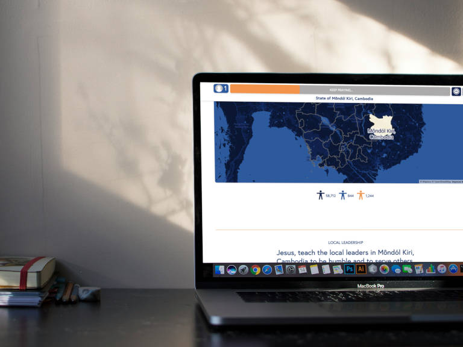
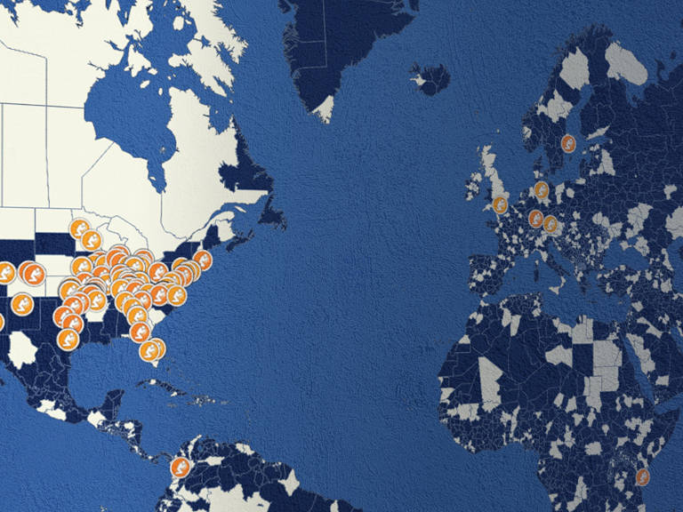

On the live site this is an SVG `clipPath` (`#clip-rounded-start` / `#clip-rounded-end`, built in `pages/home/body2.php` for 1024×753 images) on an image inside a `.drop-shadow` wrapper. Its curved side is a half-ellipse with radii of 36.77% of the width and 50% of the height. The border radii below draw exactly the same shape without needing the inline SVG. The block adds the site's drop shadow, and the image overlaps its column by 4rem towards the text, as the site's margins do.

## Variants

| `data-curve` | Curved side | Use when | Site class |
| --- | --- | --- | --- |
| `start` | Left | The image sits to the right of the text. | `.clip-rounded-start` |
| `end` | Right | The image sits to the left of the text. | `.clip-rounded-end` |

## When to use

- The image half of a feature section or band ("How it works", "Prayer fuel", "Prayer relays").

## Do

- Use images at roughly 1024×753 (4:3). The curve was sized for that ratio.
- Describe the image in `alt`, or use `alt=""` if it only decorates.
- Start and end flip by themselves in right-to-left layouts.

## Don't

- Don't curve both sides or add a border.

## Code

```html
<div class="switcher demo-fill" style="--gutter: var(--space-xl)">
  <div class="image-panel" data-curve="end"></div>
  <div class="image-panel" data-curve="start"></div>
</div>
```

```css
.image-panel { filter: drop-shadow(var(--shadow-drop)); }
.image-panel > img { display: block; max-width: 100%; aspect-ratio: 1024 / 753; object-fit: cover; }
.image-panel[data-curve="start"] > img { border-radius: 36.768% 0 0 36.768% / 50% 0 0 50%; margin-left: var(--space-xl); }
.image-panel[data-curve="end"] > img { border-radius: 0 36.768% 36.768% 0 / 0 50% 50% 0; margin-left: calc(-1 * var(--space-xl)); }
[dir="rtl"] .image-panel[data-curve="start"] > img { border-radius: 0 36.768% 36.768% 0 / 0 50% 50% 0; margin-left: 0; margin-right: var(--space-xl); }
[dir="rtl"] .image-panel[data-curve="end"] > img { border-radius: 36.768% 0 0 36.768% / 50% 0 0 50%; margin-left: 0; margin-right: calc(-1 * var(--space-xl)); }
```
