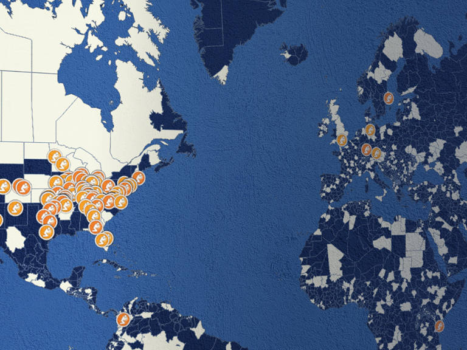

"How it works" and "Prayer relays" on the home page (`section.brand-lightest-bg.blue-orange-gradient.py-xl`). Alternate it with the white [Feature section](../feature-section/).

## When to use

- Every second section on a long page, to break up the white.

## Do

- Keep the text on the left, over the navy end of the gradient.
- Use the `primary-light` button.
- Put it on `.surface-band`. The gradient only shows once the band is at least `--threshold-l` (48rem) wide, when the columns sit side by side and the text stays on the navy end. Narrower, the columns stack and the band is plain dark blue, because white text on the orange end is only 2.3:1.

## Don't

- Don't put text over the orange end.
- Don't stack two bands back to back.

## Code

```html
<section class="feature-band surface-band py-xl">
  <div class="container">
    <div class="switcher align-items-center" style="--threshold: var(--threshold-m); --gutter: var(--space-m)">
      <div class="flow" style="--flow-space: var(--space-xs)">
        <h2 class="text-center">How it works <i class="icon pg-logo-prayer" data-size="small" aria-hidden="true"></i></h2>
        <p>Prayer.Global has broken the world down into 4,770 states based on geographical and governmental boundaries.</p>
        <p>Pray for all 4,770…complete a "prayer lap" around the world!</p>
        <p>An interactive map tracks your prayers in real time.</p>
        <p class="text-center"><a class="btn uppercase px-s" data-variant="primary-light" href="/map/">View prayer map</a></p>
      </div>
      <div class="image-panel" data-curve="start"></div>
    </div>
  </div>
</section>
```

```css
.feature-band { position: relative; isolation: isolate; }
/* The navy-to-orange gradient, only once the columns sit side by side (--threshold-l), so text never sits on the orange end. */
@container (width >= 48rem) {
  .feature-band::before {
    content: "";
    position: absolute;
    inset: 0;
    z-index: -1;
    background-image: var(--gradient-blue-orange);
  }
}
```
