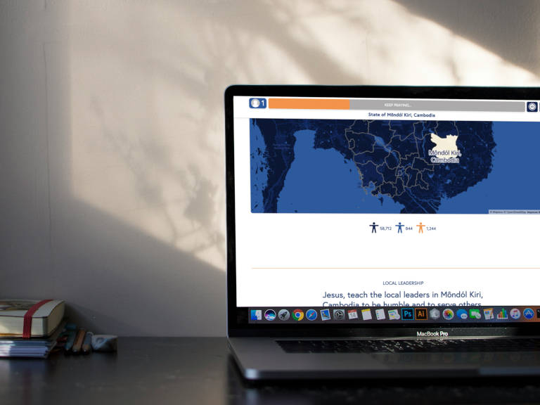

"Prayer fuel" and "My prayer activity" on the home page. It's the [Feature band](../feature-band/) on white, with the columns reversed (`data-reverse` on the switcher).

## When to use

- Introducing one feature with a picture, alternating with feature bands.

## Do

- Use the image panel with `data-curve="end"` here: the curve faces the text.
- Keep copy to one short paragraph or a list of up to four items.

## Don't

- Don't put more than one button in the section.

## Code

```html
<section class="py-xl">
  <div class="container switcher align-items-center" data-reverse style="--threshold: var(--threshold-m); --gutter: var(--space-m)">
    <div class="flow" style="--flow-space: var(--space-xs)">
      <h2 class="text-center">Prayer fuel <i class="icon pg-pray-hands-light" data-size="small" aria-hidden="true"></i></h2>
      <p>We'll give you location specific prayer prompts, scripture and images to help guide your prayers for each of the 4,770 states.</p>
      <p class="text-center"><a class="btn px-s" data-variant="cta" data-size="large" href="/newest/lap/">Start praying</a></p>
    </div>
    <div class="image-panel" data-curve="end"></div>
  </div>
</section>
```

