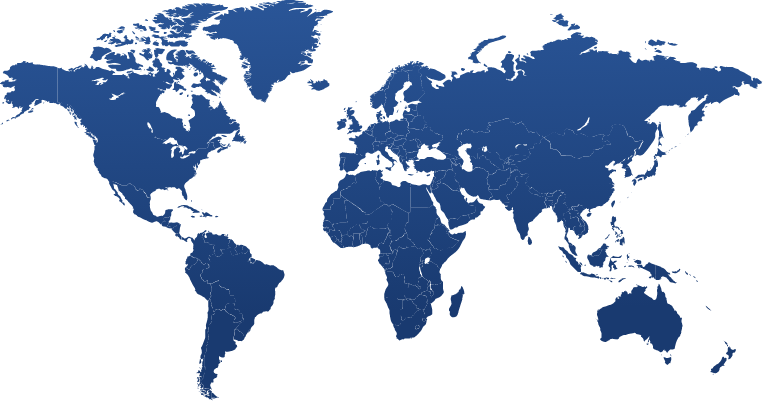

"Join thousands of intercessors praying daily for the nations" on the home page.

## When to use

- Once per page, near the end, as proof of momentum before the last call to action.

## Do

- Use real, live numbers. The site loads them from its stats API.
- Write the heading as one sentence in `.h2.font-body`, regular weight.
- Put the stats and the button on `.surface-wash`, the faint grey wash.

## Don't

- Don't show the band without live data.

## Code

```html
<section class="flow pt-xl">
  <div class="container switcher align-items-center" style="--threshold: var(--threshold-m); --gutter: var(--space-m)">
    <div></div>
    <h2 class="font-body h2">Join thousands of intercessors praying daily for the nations.</h2>
  </div>
  <div class="flow surface-wash pb-xl">
    <div class="container switcher" style="--threshold: var(--threshold-m); --gutter: var(--space-m)">
      <div class="stat"><span class="stat__value">32%</span><p class="stat__label">Current lap status</p></div>
      <div class="stat"><span class="stat__value">63</span><p class="stat__label">Laps completed</p></div>
      <div class="stat"><span class="stat__value">33,759</span><p class="stat__label">Total intercessors</p></div>
    </div>
    <p class="text-center"><a class="btn px-s" data-variant="cta" data-size="large" href="/newest/lap/">Start praying</a></p>
  </div>
</section>
```

```css
.stats-band__map { width: 90%; }
```
